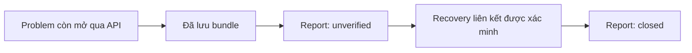

> Bản dùng để chuyển chat/tài khoản. Nguồn: `docs/DIAGNOSIS_ENGINE_LOGIC_VA_PHAT_TRIEN.md` tại `34bf592cf83e0fa39d36a1fecf8a836d3dc25eab`.
> Nội dung lấy từ tài liệu nguồn; các liên kết được đổi để dùng ngoài project. Đọc file 01 về trạng thái cuối phiên trước khi tiếp tục.

# Diagnosis engine: logic vận hành và bàn giao phát triển

Đối tượng đọc: AI hoặc lập trình viên tiếp nhận đồ án. Tài liệu đủ để hiểu kiến trúc, lần theo một ca xử lý và chọn đúng phần source cần sửa, thay vì đọc toàn bộ repository. Khi thực sự thay đổi tính năng, vẫn phải đọc và kiểm tra những hàm bị tác động; đây không phải cam kết mọi thay đổi đều an toàn chỉ bằng tài liệu.

**Phiên bản tài liệu: bản tối ưu đọc Zabbix ngày 17/10/2026, sau cleanup `7d32be7`; mốc kỹ thuật tuần 5 vẫn là `26b581e` / tag `week5-technical-20261017`.** Tài liệu mô tả source mới trong cùng commit với nó. Tag tuần 5 và evidence gốc vẫn là mốc lịch sử; không lấy hash source cũ để khẳng định code mới chưa thay đổi. Những mục “hướng phát triển” vẫn là đề xuất, chưa phải chức năng đã có.

## 1. Hiểu hệ thống trong hai phút

1. Zabbix phát hiện **triệu chứng** bằng item/trigger và sinh problem event.
2. Người vận hành chọn một problem còn mở. Python CLI không tự theo dõi tất cả event.
3. Engine xác minh event, thu bằng chứng hiện tại, đánh giá tất cả sáu luật roadmap rồi kiểm tra lại event.
4. Mỗi luật trả `matched`, `not_matched` hoặc `insufficient_evidence`, kèm giải thích và thông tin còn thiếu.
5. Có `--save` mới lưu bundle vào SQLite; không có thì chỉ preview. Zabbix dùng MySQL riêng.
6. Sau khắc phục, `recovery.py` xác minh cặp event trước khi ghi recovery; không sửa bằng chứng cũ.
7. `report.py` đọc SQLite để xuất JSON/Markdown/CSV; không chẩn đoán lại khi mở report.
8. Engine không dùng AI/ML/LLM, không tự SSH, không tự sửa dịch vụ. AI đang đọc tài liệu là công cụ hỗ trợ phát triển, không phải thành phần suy luận của sản phẩm.

Đừng suy từ tên event ra nguyên nhân: trong lab, R1/R2/R5 đều có thể bắt đầu từ cùng trigger “HTTP check failed”. Chính evidence bổ sung giúp phân biệt các giả thuyết.

## 2. Bối cảnh triển khai và ranh giới trách nhiệm

| Thành phần | Địa chỉ / vị trí | Trách nhiệm |
|---|---|---|
| MON01 | 192.168.56.10; host ID 10084, tên kỹ thuật `Zabbix server` | Zabbix, frontend 8080, MySQL, Agent2, Python CLI, SQLite |
| SRV01 | 192.168.56.20; host ID 10683 | Nginx 80, Agent2, host đích; chạy local HTTP probe |
| CLI01 | 192.168.56.30; host ID 10684 | Agent2, observer DNS và host đối chứng |
| Project Windows | `C:\Users\Darrys\do-an` | Repository chính và tài liệu |
| Engine trên MON01 | `/home/phat/do-an/diagnosis-engine` | `.venv`, source và DB runtime |
| Nhật ký D: | `D:\Study\network-monitoring-project\docs\bangiao` | Bản lưu tài liệu; không phải root project đang chạy |

Ba VM có NAT và Host-only `192.168.56.0/24`. Các IP lab trao đổi trực tiếp cùng subnet; không có gateway trung gian chung. R5 hiện dùng fault firewall TCP 80, không phải gateway failure. MON01 đọc Agent passive trên TCP 10050; Agent MON01 được Zabbix truy cập qua127.0.0.1.

Zabbix 7.0 LTS, API quan sát7.0.30; Python engine quan sát3.14.4 trên Ubuntu. Thu ICMP/DNS/HTTP probe hiện phụ thuộc công cụ Linux như `ping`, `dig`, `ip`. Test chạy được trên Windows không đồng nghĩa live collector đã được thiết kế chạy native Windows.

## 3. Đầu vào CLI và luồng thực thi chính xác

### 3.1. Ý nghĩa tham số

| Tham số | Mặc định | Ý nghĩa |
|---|---|---|
| `--event-id` | Không có | Không truyền: liệt kê problem host; có truyền: thực hiện diagnosis |
| `--save` | False | Bật lưu bundle; bắt buộc có event-id |
| `--db` | `diagnosis.db` cạnh repository.py | SQLite đích cho app/recovery/report |
| `--host-id` | `10683` | Danh tính host trong API; không đồng nhất IP |
| `--target-ip` | `192.168.56.20` | IP probe trực tiếp |
| `--ruleset` | `roadmap` | `roadmap` hoặc `legacy` |
| `--control-ip` | Không có | Host đối chứng cho R1; người vận hành phải chọn đúng subnet |
| `--http-service` | `unknown` | `expected`, `absent`, `unknown`; ảnh hưởng R2/R5 |
| `--http-observer` / `--http-evidence` | `srv01` / không có | Danh tính observer và file HTTP ngoài |
| `--dns-name` | Không có | Tên cần chẩn đoán DNS; thiếu thì R4 thiếu dữ liệu |
| `--dns-observer` / `--dns-evidence` | `cli01` / không có | Observer và file DNS ngoài |
| `--dns-control-ip` | Không có | IP đối chứng cho DNS; dispatcher dùng target nếu tham số này không được truyền |

**CLI và `diagnose_roadmap()` cùng mặc định `http_service="unknown"`**, lấy từ `policy.DEFAULT_HTTP_SERVICE`. Chưa khai báo thì R2/R5 đều insufficient; web server phải truyền `expected`, host không có HTTP truyền `absent`. Caller Python cũ từng bỏ qua tham số này cần bổ sung `http_service="expected"` nếu muốn giữ cách đánh giá HTTP trước cleanup.

Khi dùng `--dns-evidence`, CLI bắt buộc có cả `--dns-name` và `--dns-control-ip`; không suy ra mục tiêu kiểm tra từ nội dung file. Thiếu tham số thì dừng trước API/probe. Hàm dispatcher vẫn giữ fallback `control_ip or target` để tương thích caller Python, nhưng importer mới yêu cầu mục tiêu DNS rõ ràng.

### 3.2. Một lần chạy có event

```text
build_parser → parse args → validate_args
  → require_open_event(event_id, host_id)
  → ghi collection_started = Unix seconds
  → collect_evidence: ping target + TCP80
  → nếu legacy: bốn metric ngữ cảnh, kết thúc collection
  → nếu roadmap: TCP10050 → collect_roadmap_metrics(host_id)
      → một item.get lấy sáu key, ghi thời điểm nhận phản hồi
      → bốn metric ngữ cảnh + agent_metric
      → history.get CPU nếu item CPU dùng được → cpu_history
  → ping control nếu có và khác target
  → nạp external HTTP/DNS nếu được cung cấp
  → evaluate_evidence → diagnose_roadmap(...) → sáu DiagnosisRecord
  → require_open_event(...) lần hai
  → print_assessment: in kết quả
  → nếu --save: init_db → save_incident_bundle → incident_id
```

Collection diễn ra tuần tự, không phải snapshot nguyên tử của cả lab. Trong roadmap, bốn metric, agent_metric và cpu_history dùng cùng mốc thời gian nhận một phản hồi item.get; sample_clock vẫn là thời điểm mẫu do Zabbix trả về. History là lời gọi riêng, kết thúc cửa sổ tại mốc nhận item.get. Xem mục 17 về giới hạn đồng thời và số request. `now` đánh giá luật được lấy sau khi thu. Evidence phản ánh lúc thu, **không tự tái dựng trạng thái tại event.clock**. Engine có thể được gọi muộn sau event; cần phân biệt event time, collection time và sample time của metric.

`require_open_event` làm hai lời gọi: problem.get để bảo đảm event còn trong tập problem có quyền đọc trên host; event.get để kiểm tra ID, value1, r_eventid0 và host membership. Parser chuẩn hóa ID thành chuỗi số, clock/severity/value thành số nguyên, không chấp nhận bool thay số nguyên.

Event đã recovered trước lần kiểm tra cuối thì dừng trước bước lưu. Tuy vậy vẫn còn khoảng đua giữa kiểm tra cuối và commit SQLite; không có khóa hoặc transaction phân tán với Zabbix.

## 4. Ba hợp đồng dữ liệu phải giữ ổn định

### 4.1. EventRecord và danh tính

```text
HostRecord(host_id: str, host: str, name: str)
EventRecord(event_id: str, clock: int, name: str,
            severity: int, value: int, hosts: tuple[HostRecord, ...])
```

`event_id` thuộc Zabbix; `incident_id` là PK nội bộ SQLite; `Run ID` là mã lượt thử của công cụ thực nghiệm. Không thay thế ba loại ID cho nhau. `EventRecord` không giữ trigger ID/r_eventid; khi xác minh recovery, chương trình đọc lại raw event từ API để kiểm tra các trường đó.

### 4.2. EvidenceRecord

```python
EvidenceRecord(
    check_type="tcp",
    target="192.168.56.20",
    collected_at=1700000600,
    result={"port": 80, "status": "refused"},
)
```

Đây là ví dụ dữ liệu tổng hợp, không phải một phép đo live. Trường `result` thực tế có thể giữ timeout, errno, stdout/stderr hoặc dữ liệu API. `target` có thể là IP, tên DNS hoặc **host ID**, tùy check_type:

| check_type | target | Phần result quan trọng |
|---|---|---|
| `ping` | IP | status, returncode, thời lượng và output |
| `tcp` | IP | port, status, errno, timeout |
| `metric` | Host ID | key, units, status, value, sample_clock, age |
| `agent_metric` | Host ID | key=`agent.ping`, status, sample_clock, raw item |
| `cpu_history` | Host ID | key=`system.cpu.util`, units%, samples, support_items |
| `local_http` | IP dịch vụ | observer, port 80, path/, local_address_verified, status, http_status |
| `dns` | Tên chuẩn hóa | observer, record_type=A, status, dns_status, addresses |
| `dns_control_ping` | IP đối chứng DNS | observer và kết quả ping từ chính observer đó |

Metric có `collected_at` mới vẫn có thể chứa **sample_clock cũ**. `agent_metric` ghi “vừa kiểm tra API, thấy agent.ping đã cũ”; điều đó không biến mẫu agent cũ thành mới.

### 4.3. DiagnosisRecord

```text
DiagnosisRecord(rule_id, status, probable_cause, reasoning,
                missing_info: tuple[str,...], next_actions: tuple[str,...])
```

`result()` trong roadmap_rules gán probable_cause bằng reason khi matched, còn trạng thái khác thì None. Đây là chuỗi giải thích, không phải mã nguyên nhân chuẩn hóa hoặc xác suất. Không có confidence score. Các luật đánh giá độc lập, không chọn một “winner” và không loại trừ nhau bằng một bộ xếp hạng chung.

## 5. Thu thập và chọn evidence

### 5.1. Thu trực tiếp và từ Zabbix

- Ping: một gói, timeout 2s, giới hạn tiến trình3s. Returncode0 → success;1 → no_reply; lỗi khác → error; tiến trình quá hạn → timeout. Helper luật chỉ chấp nhận success/no_reply, nên **ping timeout của tiến trình không tự trở thành no_reply**.
- TCP: timeout 2s; tách success/refused/timeout/error. Errno113 hoặc lỗi hệ điều hành khác không tự được chuyển thành timeout.
- Bốn metric ngữ cảnh: CPU utilization, memory utilization, load1m, dung lượng phân vùng `/`. Có thu RAM/disk không có nghĩa roadmap đang có luật RAM/disk.
- Agent: item agent.ping phải tồn tại duy nhất, enabled, có clock hợp lệ. Clock0 → missing; mẫu quá180s → no_data; mẫu mới nhưng unsupported → unsupported; giá trị mới bằng1 → success. Nhánh stale/no_data được xét trước state unsupported trong collector này.
- CPU: lấy300s numeric history theo value_type0/3; kiểm tra đơn vị%, trạng thái item, giá trị hữu hạn, không trùng clock, rồi giữ CPU count/load làm support items.

### 5.2. Quy tắc `latest()`

Lọc theo check_type, target và các filter như port/observer/key; chọn record có collected_at lớn nhất, sau đó yêu cầu tuổi trong0–180s. Không tự lùi về record cũ tốt hơn khi record mới nhất lỗi hoặc hết hạn. Record tương lai bị coi không dùng được.

Đầu vào từ collector/model đang được tin cậy ở một số bước. `latest()` chọn max trước kiểm tra kiểu của timestamp đã chọn; record giả mạo hoặc trộn kiểu không được bảo đảm luôn biến thành insufficient một cách êm. Nếu mở API nhận JSON tùy ý, cần validation tại ranh giới nhập thay vì giả định toàn bộ rule layer đã chống mọi input xấu.

### 5.3. External probe

HTTP probe chạy **trên SRV01**, xác minh hostname và IP đích được gán trên máy; gửi HEAD tới IP dịch vụ, port 80, path/, timeout 3s, không proxy/redirect. HTTP 200 → success; non200, refused hoặc timeout → failed; lỗi collector khác → error.

Importer HTTP yêu cầu schema_version1, đúng observer, một record, đúng trường/target, ≤64KiB, tuổi0–180s, local_address_verified và cặp status/code hợp lệ. Envelope sai thì app dừng; record hợp lệ nhưng status error có thể không dùng được cho luật. Một JSON có status success nhưng HTTP 500 bị từ chối, không được “sửa hộ”.

DNS probe chạy **trên CLI01**, ghi hostname làm observer, truy vấn A bằng dig và ping IP control cùng máy. Bản probe mới xuất `schema_version: 1`. `dns_evidence.load_dns_evidence()` nhận đúng hai record: một `dns` và một `dns_control_ping`; kiểm tra đúng tên đã chuẩn hóa, đúng IP control, observer, tuổi 0–180 giây và ý nghĩa status/rcode/addresses. Địa chỉ trả về phải là danh sách IPv4; success cần NOERROR và có địa chỉ; no_answer/NXDOMAIN cần cặp mã tương ứng và không có địa chỉ. Timeout/error hợp lệ vẫn được giữ để rule đánh giá; không tự đổi lỗi lệnh thành lỗi resolver.

Hai importer cùng dùng `probe_evidence.load_probe_rows()`: đọc tối đa 64KiB + 1 byte để phát hiện vượt giới hạn, giải mã UTF-8, kiểm tra envelope là object, evidence là list không rỗng, đúng bốn trường mỗi record, result là object, timestamp là int thật và observer nhất quán. JSON như `[]`, `result: null`, timestamp bool, file quá lớn hoặc không phải UTF-8 đều thành ValueError rõ ràng trước khi lưu DB.

**Tương thích DNS cũ:** envelope thiếu schema_version vẫn được chấp nhận nếu toàn bộ nội dung hợp lệ. Có version nhưng khác số nguyên 1 thì bị từ chối. HTTP vẫn bắt buộc version 1. File cũ đã hết hạn không dùng cho một lần chẩn đoán live mới; replay chỉ dùng thời gian lịch sử được chỉ định rõ.

Engine chỉ đọc file đã chuyển về MON01. File JSON chưa có chữ ký: observer là trường được kiểm tra, không phải bằng chứng mật mã rằng file chưa bị người vận hành sửa.

## 6. Bảng quyết định đầy đủ của R1–R6

Áp dụng freshness và kiểu kết quả hợp lệ trước khi diễn giải. Nhánh trả kết quả sớm có thể không cần mọi evidence khác có mặt. Tên chính thức trong DB lần lượt là R1_HOST_OR_LOCAL_CONNECTIVITY, R2_HTTP_SERVICE_SUSPECTED, R3_AGENT_UNAVAILABLE, R4_DNS_RESOLVER_SUSPECTED, R5_HTTP_ACCESS_FILTER_SUSPECTED, R6_SUSTAINED_CPU_HIGH.

### R1 — host hoặc kết nối cục bộ

1. Ping target success **hoặc** TCP 80 success/refused → not_matched: đã có phản hồi từ đích.
2. Nếu chưa bác bỏ được nhưng thiếu ping/TCP/đối chứng khác target → insufficient.
3. Target no_reply + TCP 80 timeout + control ping success → matched.
4. Các tổ hợp còn lại có đủ dữ liệu → not_matched.

Control cùng subnet là điều kiện người vận hành phải bảo đảm; code chỉ kiểm tra control có và khác target, không xác minh subnet/topology. Matched chưa chứng minh mất nguồn VM.

### R2 — service/listener HTTP nghi gặp lỗi

1. Ping hoặc TCP 80 không diễn giải được → insufficient.
2. Ping không success hoặc TCP 80 success → not_matched.
3. Local HTTP 200 hợp lệ → not_matched; hướng service-down đơn giản bị phản bác.
4. TCP timeout và thiếu local HTTP dùng được → insufficient.
5. Các trường hợp còn lại, với ping success → matched.

Hệ quả dễ bỏ sót: **TCP refused có thể làm R2 matched dù local HTTP thiếu hoặc error**. Không mô tả mọi nhánh R2 đều bắt buộc local probe thất bại. Trong quy trình thử R2/R5, vẫn thu local probe mới để có bằng chứng đối chiếu. Refused chưa chứng minh Nginx dừng: firewall reject cũng có thể tạo triệu chứng này.

### R3 — Agent không khả dụng

1. agent_metric mới có status success → not_matched, ngay cả khi bằng chứng khác thiếu.
2. Nếu thiếu ping/TCP 10050/agent record, hoặc agent status không phải no_data → insufficient.
3. Ping success + agent no_data + TCP 10050 refused/timeout → matched.
4. Tổ hợp đủ dữ liệu còn lại → not_matched.

Agent chưa từng có mẫu, item disabled hoặc record lỗi không tự là “agent đã dừng”. Rule chưa phân biệt service dừng, allow-list và firewall.

### R4 — DNS hoặc đường truy cập DNS

1. Không cấu hình tên → insufficient.
2. Thiếu DNS/control đúng observer, sai freshness hoặc control status ngoài success/no_reply → insufficient.
3. DNS chỉ diễn giải được nếu: success+NOERROR+có địa chỉ; no_answer+NOERROR; nxdomain+NXDOMAIN; dns_error+SERVFAIL/REFUSED; hoặc timeout. Trạng thái khác → insufficient.
4. DNS success → not_matched; chưa so A answer với IP kỳ vọng. Tới đây control record phải tồn tại và hợp lệ, nhưng không bắt buộc control success.
5. DNS lỗi và IP control không success → insufficient: chưa cô lập được lỗi DNS.
6. DNS lỗi có thể diễn giải + control success → matched.

NXDOMAIN có thể do tên sai. DNS thành công trên MON01 không thay bằng chứng CLI01; ping IP control tốt không chứng minh mọi kết nối Internet tốt.

### R5 — filtering hoặc đường truy cập HTTP

1. TCP 80 success **hoặc** target ping no_reply → not_matched sớm.
2. Nếu không có đủ ping/TCP/local HTTP dùng được → insufficient.
3. Ping success + remote TCP refused/timeout + local HTTP 200 → matched.
4. Tổ hợp đủ dữ liệu còn lại → not_matched.

Local HTTP 200 không đi qua cùng ingress path với MON01. Kết luận chỉ nghi filtering/access path; muốn quy nguyên nhân firewall cần đọc rule/counter và đối chiếu observer khác.

### R6 — CPU cao kéo dài

1. cpu_history phải mới, status success, units%.
2. Ít nhất3 mẫu; giá trị hữu hạn trong[0,100]; clock integer, tăng và không trùng; kiểm tra clock trong now−480..now ở rule. Collector hiện lấy cửa sổ300s nên vận hành thực tế hẹp hơn biên kiểm tra của rule.
3. Span≥240s, maxgap≤120s, mẫu cuối≤180s. Không đạt → insufficient.
4. Mean số học <90 → not_matched ngay, chưa cần đủ support items.
5. Mean≥90: CPU count/load phải enabled, supported, có tuổi không âm; CPU count≤86580s, load≤180s. Count là số nguyên≥1, load hữu hạn≥0. Thiếu/sai → insufficient.
6. Load≥count → matched; nếu không → not_matched.

CPU count được cho tuổi lớn vì heartbeat1d; áp180s cho mọi support item sẽ phá quy tắc hiện hành. Mean chưa có trọng số thời gian. CPU/load cao chưa chứng minh ứng dụng chậm.

### HTTP scope trước khi gọi R2/R5

| http_service | R2/R5 |
|---|---|
| expected | Chạy điều kiện thực tế của hai luật |
| absent | Trả not_matched với lý do not applicable; không phải true negative |
| unknown | Trả insufficient_evidence cho hai luật |

Dispatcher luôn trả danh sách R1,R2,R3,R4,R5,R6 theo thứ tự này, kể cả event có tên CPU hay DNS. Không có nhánh “event HTTP thì chỉ chạy R2”.

## 7. Zabbix trigger khác luật Python ở đâu?

| Nhóm thử | Trigger dùng ở lab | Điều kiện chính |
|---|---|---|
| R1/R2/R5 |25334, HTTP check failed|last(web.test.fail)>0; scenario30s, timeout 5s, yêu cầu200|
| R3 |25260, Agent không khả dụng|max(availability,3m)=0|
| R4 |25335, DNS thất bại|max của3 mẫu DNS gần nhất =0; item30s|
| R6 |25250, CPU cao|min(CPU,5m)>90; phụ thuộc load-high25249|

Trigger CPU dùng min>90 trong5m; R6 dùng mean≥90 cùng load/coverage. Macro trigger không tự cập nhật ngưỡng hard-code trong Python. Nếu chỉnh threshold, cần sửa/kiểm chứng cả hai lớp theo mục tiêu mới, không âm thầm giả định đồng bộ.

## 8. SQLite và vòng đời hồ sơ



Sơ đồ nói về khả năng xác minh của hồ sơ, không phải cột status được cập nhật liên tục. Chưa lưu recovery không chứng minh event còn mở; đã closed không chứng minh host hiện tại khỏe.

| Bảng | Vai trò / ràng buộc |
|---|---|
| incidents | id INTEGER PK; event_id TEXT UNIQUE; clock≥0, severity0..5, value0/1, name, hosts_json, created_at |
| evidence | FK incident_id; check_type, target, collected_at, result_json |
| diagnoses | FK incident_id; rule_id, CHECK ba status, probable_cause, reasoning, missing_info_json, next_actions_json, created_at |
| recoveries | incident_id PK/FK, recovery_event_id, recovery_clock, verified_at, problem_json, recovery_json |

`init_db` tạo ba bảng đầu. recoveries được tạo bổ sung trong lần lưu recovery đầu tiên.

`save_incident_bundle`: chuyển evidence/diagnoses thành list, từ chối list rỗng → bật foreign_keys → BEGIN IMMEDIATE → chèn/lấy incident theo event_id → nếu đã có evidence **hoặc** diagnoses thì từ chối append → chèn toàn bundle → commit; có lỗi thì rollback.

“Chống trùng” hiện là **từ chối trộn lần thu mới vào hồ sơ cũ**, không phải trả lại một assessment mới tự động. Các helper save_event/save_evidence/save_diagnosis riêng lẻ vẫn tồn tại phục vụ luồng cũ; chúng không cung cấp đầy đủ bảo vệ bundle. Không dùng chúng để tạo luồng mới rồi cho rằng vẫn có cùng tính nguyên tử.

`recovery.py` cần incident đã lưu. Nếu problem.r_eventid=0, không thay DB. Nếu có recovery, kiểm tra ID liên kết khác problem, source/object là trigger event, cùng trigger, tập host khớp bản lưu, value1→0, problem clock trùng và problem≤recovery≤now. Lưu trùng cùng ID/clock là idempotent; xung đột bị từ chối. Không đổi incidents.value ban đầu hoặc ghi đè evidence.

`report.py` mở DB mode=ro, đọc snapshot trong transaction. JSON schema_version2 chứa assessment_basis, recovery_status, lifecycle_status, incident, evidence, diagnoses và recovery. lifecycle là closed nếu có recovery lưu, còn lại unverified. CSV có một dòng mỗi diagnosis và lặp evidence JSON; không phải CSV một dòng mỗi trial. Chuỗi có prefix công thức spreadsheet được neutralize; xuất tệp dùng exclusive create, không ghi đè report cũ.

## 9. Hai ví dụ để kiểm tra hiểu đúng

### 9.1. Cùng cảnh báo HTTP, hai giả thuyết

| Bằng chứng | Nginx dừng | Chặn remote TCP 80 |
|---|---|---|
| Ping MON01→SRV01 |success|success|
| Remote TCP 80 |refused|timeout hoặc refused|
| HTTP HEAD trên IP dịch vụ từ SRV01 |failed|success/200|
| R2 / R5 |matched / not_matched|not_matched / matched|

Đây là ví dụ tổ hợp, không phải mọi firewall đều timeout hoặc mọi service lỗi đều refused. Các luật vẫn phải giữ thông tin cần kiểm tra thêm.

Hồ sơ thực nghiệm để đọc nhanh: [R2-01](https://github.com/Darrys37/smb-network-monitoring/blob/34bf592cf83e0fa39d36a1fecf8a836d3dc25eab/evidence/week4/official-runs/R2-01/incident.json) và [R5-01](https://github.com/Darrys37/smb-network-monitoring/blob/34bf592cf83e0fa39d36a1fecf8a836d3dc25eab/evidence/week4/official-runs/R5-01/incident.json). Report là bằng chứng đã lưu, không dùng event lịch sử đã closed để ép chạy app mới.

### 9.2. Ví dụ thuần dữ liệu, không cần VM/API

Chạy trong thư mục diagnosis-engine; timestamp cố định chỉ dùng cho ví dụ này:

```python
from models import EvidenceRecord
from roadmap_rules import diagnose_roadmap

now = 1700000600
target = "192.168.56.20"
records = [
    EvidenceRecord("ping", target, now, {"status": "success"}),
    EvidenceRecord("tcp", target, now, {"port": 80, "status": "refused"}),
    EvidenceRecord("local_http", target, now, {
        "observer": "srv01", "port": 80, "path": "/",
        "local_address_verified": True,
        "status": "failed", "http_status": None,
    }),
]
results = diagnose_roadmap("10683", target, records,
                          http_service="expected", now=now)
print([(d.rule_id, d.status) for d in results])
```

Kỳ vọng theo thứ tự: R1 not_matched, R2 matched, R3 insufficient, R4 insufficient, R5 not_matched, R6 insufficient. Thiếu evidence cho luật khác được giữ nguyên; không phải lỗi khiến toàn bộ lần đánh giá phải “đúng/sai” một nhãn duy nhất.

## 10. Gọi luồng live đúng cách

Không lưu token/mật khẩu trong tài liệu hoặc tham số. `.env` trên MON01 dùng `ZABBIX_URL` và `ZABBIX_API_TOKEN`; khóa mẫu đã sửa từ lỗi cũ ZABBIX_URLL. Client dùng Bearer, timeout 5s, kiểm tra HTTP/JSON-RPC/id/error/result; không in nội dung lỗi tùy ý có thể chứa secret. CPU history đạt10000 hàng bị coi có nguy cơ cắt, không tiếp tục tính như đã đủ dữ liệu.

```bash
# MON01: xem problem, không lưu gì
cd ~/do-an/diagnosis-engine
.venv/bin/python app.py --host-id 10683
```

Đối với R2/R5, khi problem còn mở: tạo HTTP JSON mới trên SRV01 bằng `http_probe.py`, chuyển về MON01, rồi:

```bash
read -r -p 'Problem event ID mới: ' EVENT_ID
read -r -p 'Đường dẫn HTTP JSON mới trên MON01: ' HTTP_FILE
.venv/bin/python app.py --event-id "$EVENT_ID" --host-id 10683 \
  --target-ip 192.168.56.20 --ruleset roadmap \
  --control-ip 192.168.56.30 --http-service expected \
  --http-observer srv01 --http-evidence "$HTTP_FILE" --save
```

Sau rollback và recovery thật:

```bash
.venv/bin/python recovery.py --event-id "$EVENT_ID"
read -r -p 'Incident ID vừa lưu: ' INCIDENT_ID
.venv/bin/python report.py --incident-id "$INCIDENT_ID" --format json
```

Nếu chọn --db riêng, dùng cùng đường dẫn ở app/recovery/report. R4 dùng host10684/target.30, control R1.20, HTTP absent; thêm dns-name example.com, dns-observer cli01, dns-control-ip1.1.1.1 và file DNS mới. Engine không tự chuyển file qua SSH.

## 11. Muốn sửa gì thì đọc/sửa đúng chỗ nào?

| Việc mới | Các điểm cần đọc đầu tiên | Điều dễ làm hỏng |
|---|---|---|
| Thêm loại evidence | models.py, collector, app.collect_evidence, probe_evidence.py và importer riêng | Sai target/units/observer, biến error thành fault |
| Thêm luật R7 | roadmap_rules.py, dispatcher, collector/app, test_roadmap_rules.py | Test đang giả định6 luật/thứ tự; thiếu trạng thái insufficient |
| Thay ngưỡng CPU/freshness | policy.py, roadmap_rules.py, roadmap_evidence.py, trigger/macro và tests | Đổi một lớp nhưng báo cáo vẫn mô tả lớp kia |
| Thêm tham số cấu hình | app.build_parser/validate_args, policy.py, dispatcher và tests | Mặc định hàm và CLI không đồng nhất, hard-code vẫn còn |
| Thêm dashboard/Web API | service orchestration mới, app.py, repository/report | Gọi CLI bằng shell ghép chuỗi; gộp job ghi nhiều lần; đánh đồng closed với healthy |
| Chạy tự động theo event | worker mới dùng luồng validation/collection/bundle | Retry toàn bộ app với --save gây duplicate; collector chạy sai observer |
| Chẩn đoán lại cùng event | Thiết kế assessment/versioning, repository/report, migration | UNIQUE(event_id) hiện không cho nhiều assessment; không xóa evidence cũ để lách |
| Theo dõi nhiều Zabbix server | client config + danh tính/schema | event_id/host_id chỉ duy nhất trong từng server; hiện chưa có server_instance_id |
| Thêm notification | Adapter riêng sau commit thành công, audit/dedup | Gửi nhiều lần do retry hoặc rò token/evidence nhạy cảm |
| Tự khắc phục | Tầng action riêng có quyền/approval/audit/rollback | Cho rule đánh giá đồng thời sửa target, làm mất evidence lỗi |

Không cần đọc file đuôi gạch nối `zabbix-client.py` để tìm client chuẩn: **client app đang import là `zabbix_client.py`**. Các script check_*/save_events và rules.py là đường hỗ trợ/legacy; dispatcher roadmap là nguồn chính của sáu luật hiện hành.

## 12. Quy trình thêm tính năng có thể kiểm chứng

1. Nêu rõ đầu vào, observer, chỉ số/đơn vị, điều kiện matched/not_matched/insufficient và điều gì chưa thể kết luận.
2. Chọn nguồn bằng chứng thật. Nếu là metric, khai báo item và tuổi mẫu; nếu cần observer khác, tạo probe/import contract thay vì giả dữ liệu trên MON01.
3. Ưu tiên collector chỉ thu dữ liệu và rule chỉ diễn giải dữ liệu, có tham số now để test không phụ thuộc thời gian thật.
4. Tích hợp tham số và orchestration, giữ kiểm tra event trước/sau và transaction bundle. Chưa cần sửa DB chỉ vì thêm rule_id hoặc check_type mới: hai trường này hiện là TEXT tổng quát.
5. Viết test nhắm đúng rủi ro: điều kiện khớp/không khớp/thiếu; biên threshold; clock tương lai/cũ; error/unsupported; sai observer/scope; event recovery trong collection; duplicate/rollback. Không chỉ test lại cùng một biểu thức theo cách khác.
6. Nếu thay schema, migration cộng thêm và report tương thích DB cũ; kiểm tra DB/report mẫu, không xóa DB runtime để “test pass”. Version schema và phiên bản assessment/rule cần có thiết kế rõ.
7. Chạy các test bị ảnh hưởng rồi bộ test hiện có. Lệnh từ đúng thư mục engine: `.venv/bin/python -m pytest -q`.
8. Thử lab với Run ID mới và rollback, giữ cả lượt lỗi/abstention. Tách khỏi evidence đóng băng tuần 4; cập nhật tài liệu và đo theo chỉ số đã định nghĩa trước.

Ví dụ phát triển cụ thể: luật disk trong roadmap. Trước khi viết mới, đọc `diagnose_disk` ở rules.py (legacy) và metric `vfs.fs.dependent.size[/,pused]` đã có collector. Quyết định tái dùng điều kiện nào, đặt rule ID mới, đưa vào dispatcher và cập nhật test đang yêu cầu6 kết quả. Kiểm tra item có tồn tại/units%/tuổi mẫu, giữ nguyên các ca cũ. Việc này **chưa được triển khai trong tài liệu này**.

Cleanup đã thống nhất validation chung DNS/HTTP và gom policy roadmap. Các mở rộng còn lại nên ưu tiên mapping host→IP, profile cấu hình theo host và version assessment/rule; sau đó mới cân nhắc worker hoặc giao diện. Chưa có đánh giá nào chứng minh cần thay luật bằng AI hoặc confidence score. Muốn thêm điểm tin cậy phải định nghĩa cách hiệu chỉnh, không biến 18/18 thành xác suất cho mọi ca mới.

## 13. Những giới hạn hiện hữu để AI tiếp nhận không hiểu quá mức

- Host ID và target IP được truyền riêng; kiểm tra event đúng host không đồng thời chứng minh IP probe đúng interface của host đó.
- Một bộ luật có thể nhiều matched hoặc nhiều insufficient; không có root-cause correlation/ranking đa event.
- HTTP/DNS đã dùng chung validation envelope, nhưng schema riêng theo protocol. Các hàm rule nhận EvidenceRecord nội bộ; chưa phải API công khai nhận mọi JSON tùy ý.
- Chưa có hàng đợi, retry/backoff chung, lịch chạy liên tục, profile endpoint tùy ý hoặc đa tenant.
- JSON probe chưa ký; API lab hiện dùng HTTP. Thiết kế môi trường triển khai rộng hơn cần xét trust boundary riêng.
- DB chưa có rule_version/assessment_version/server_instance_id. Chẩn đoán lặp hoặc nhiều server đòi thay mô hình danh tính.
- Preview là không ghi bundle, nhưng vẫn thực hiện probe/API; không phải chế độ offline thuần dữ liệu.
- Bắt được lỗi API không đồng nghĩa có thể cho engine tiếp tục với số0. Giữ lỗi vận hành và thiếu dữ liệu phân biệt.
- `init_db` chạy trước save bundle; bundle lỗi có thể để lại schema đã khởi tạo, nhưng không được để lại bundle ghi dở. Không mô tả mọi lỗi luôn giữ DB byte-identical.
- Các câu chữ/test/log có thể được công cụ thử dựa vào, như `Saved incident ID:`. Nếu refactor output, cần cập nhật caller hoặc cung cấp output JSON ổn định.

## 14. Bằng chứng hiện có và các số không được diễn giải sai

Mốc tuần 5: 280 tests đạt trên MON01 và 280 trên Windows; đây là kết quả lịch sử của mốc kỹ thuật, không phải một lần test mới do mở tài liệu. 18 fault hợp lệ thuộc 6 nhóm, mỗi nhóm 3, mục tiêu khớp18/18. Một attempt R5-03 hủy trước fault được giữ riêng; retry có ID riêng. Baseline 30 phút 06 giây theo lựa chọn phiên ngắn, không phải 4 giờ.

Không có tập âm độc lập nên không tính accuracy tổng quát/specificity/FPR. 108 đầu ra luật gồm18 matched,66 not_matched,24 insufficient; các luật ngoài mục tiêu/HTTP absent không tự là TN. Ba demo tuần 5 là bộ diễn tập riêng, không nâng cỡ mẫu18. CLI elapsed gồm API/collection/rules/SQLite; event interval không phải downtime thật.

Các đường dẫn chỉ cần mở khi cần kiểm chứng:

- [Audit kỹ thuật cuối](https://github.com/Darrys37/smb-network-monitoring/blob/34bf592cf83e0fa39d36a1fecf8a836d3dc25eab/evidence/week5/final-20261017/final-audit.json).
- [CSV18 run sạch](https://github.com/Darrys37/smb-network-monitoring/blob/34bf592cf83e0fa39d36a1fecf8a836d3dc25eab/evidence/week5/day29-20261017/clean-runs.csv), [định nghĩa chỉ số](https://github.com/Darrys37/smb-network-monitoring/blob/34bf592cf83e0fa39d36a1fecf8a836d3dc25eab/evidence/week5/day29-20261017/audit.json).
- [Ví dụ R5-02 có CPU span239s](https://github.com/Darrys37/smb-network-monitoring/blob/34bf592cf83e0fa39d36a1fecf8a836d3dc25eab/evidence/week4/official-runs/R5-02/incident.json): đừng hạ ngưỡng240s chỉ để loại abstention.
- [Chương 2](https://github.com/Darrys37/smb-network-monitoring/blob/34bf592cf83e0fa39d36a1fecf8a836d3dc25eab/docs/CHUONG_2_KIEN_TRUC_VA_TRIEN_KHAI.md), [hướng dẫn cài/chạy](https://github.com/Darrys37/smb-network-monitoring/blob/34bf592cf83e0fa39d36a1fecf8a836d3dc25eab/docs/HUONG_DAN_CAI_DAT_VA_KHOI_PHUC.md), [giới thiệu đồ án](02_GIOI_THIEU_DO_AN.md).

## 15. Cách bắt đầu một phiên phát triển mới

Đọc tài liệu này để xác định feature thuộc lớp nào; kiểm tra commit hiện tại so với mốc đầu tài liệu. Đọc đúng những module trong bảng mục11 và test tương ứng. Tóm tắt điều kiện hiện hành, phần cần thay và tiêu chí nghiệm thu trước khi sửa. Nếu thay semantics, giữ report/evidence cũ đọc được và công bố phiên bản mới; không ghi đè dữ liệu tuần 4/5 để chúng “khớp” feature mới.

Roadmap môn học đã đóng phần kỹ thuật, từ ngày31 không thêm feature trừ lỗi chặn demo trong nhánh nghiệm thu đó. Phát triển tiếp nên dùng nhánh/phiên bản mới theo phạm vi người dùng giao, giữ tag nghiệm thu làm mốc so sánh. Tài liệu bàn giao không tự cấp quyền triển khai production, gửi thông báo hay tạo hành động tự khắc phục.

## 16. Cấu trúc sau cleanup: đọc và giải thích khi bảo vệ

### 16.1. Đọc source theo một đường chính

| Bước | Điểm đọc | Câu trả lời cần nắm |
|---|---|---|
| 1 | `models.py` | Event là sự kiện; evidence là quan sát có thời gian; diagnosis là kết quả một luật |
| 2 | `app.main()` | Chỉ điều phối các bước; không chứa điều kiện chi tiết R1–R6 |
| 3 | `build_parser()` / `validate_args()` | Người vận hành khai báo host/event/scope/observer và file probe |
| 4 | `require_open_event()` | Xác minh problem còn mở, đúng host trước và sau collection |
| 5 | `collect_evidence()` | Probe target trước; roadmap gộp item.get; importer chỉ đọc file ngoài |
| 6 | `evaluate_evidence()` / `diagnose_roadmap()` | Chọn bộ luật, áp dụng scope và trả sáu kết quả độc lập |
| 7 | `r1()` … `r6()` | Mỗi hàm đọc bằng chứng, xét điều kiện, trả lý do và dữ liệu thiếu |
| 8 | `print_assessment()` / `save_incident_bundle()` | Trình bày và ghi transaction; rule không trực tiếp ghi DB |
| 9 | `sync_recovery()` / `load_report()` | Bổ sung recovery xác minh, rồi đọc hồ sơ cũ để báo cáo |

Tên `r1`–`r6`, rule_id, schema SQLite, thứ tự kết luận R1–R6 và dòng `Saved incident ID:` được giữ để tương thích. Biến ngắn như p/t/a trong luật đã đổi thành `target_ping`, `target_tcp`, `agent`; mỗi hàm có mô tả trách nhiệm. R6 tách `_validated_cpu_samples()` và `_validated_cpu_support()` để phần kết luận chỉ còn bốn ý: history dùng được → đủ độ phủ → CPU cao → có load/count hỗ trợ.

### 16.2. Policy dùng chung

`policy.py` là nơi khai báo scope HTTP và các ngưỡng của bộ roadmap:

| Hằng | Giá trị / ý nghĩa |
|---|---|
| `DEFAULT_HTTP_SERVICE` | unknown; CLI và Python giống nhau |
| `EVIDENCE_MAX_AGE_SECONDS` | 180 giây cho evidence / load / import probe |
| `PROBE_MAX_BYTES` / `PROBE_SCHEMA_VERSION` | 65536 byte / version 1 |
| `CPU_HISTORY_WINDOW_SECONDS` | Collector yêu cầu 300 giây history |
| `CPU_SAMPLE_MAX_AGE_SECONDS` | 480 giây, gồm cửa sổ 300 + tuổi evidence 180 |
| `CPU_MIN_SAMPLES` / `CPU_MIN_COVERAGE_SECONDS` | Ít nhất 3 mẫu, phủ ít nhất 240 giây |
| `CPU_MAX_GAP_SECONDS` / `CPU_HIGH_PERCENT` | Khoảng mẫu tối đa 120 giây, trung bình CPU ≥90% |
| `CPU_COUNT_MAX_AGE_SECONDS` | 86580 giây do CPU count có heartbeat một ngày |

Đây là policy của Python, không tự cập nhật trigger/macro Zabbix. `rules.py` vẫn là bộ legacy riêng để tái lập; không gộp nó vào roadmap vì điều kiện lịch sử khác nhau. Collector cơ bản vẫn nhận timeout/max_age riêng khi có nhu cầu. Không diễn giải “gom policy” thành mọi tham số của toàn lab đều cấu hình ở một file.

### 16.3. Kiểm chứng bản cleanup

- 355 tests đạt trên Windows và trên MON01; kiểm tra lint và format bằng Ruff đạt.
- Replay 18 hồ sơ tuần 4: cả 108 DiagnosisRecord giữ nguyên status, probable_cause, reasoning, missing_info và next_actions khi dùng cùng scope và thời điểm lịch sử.
- Đối chiếu thêm 576 tổ hợp ping/TCP/local HTTP/scope/tuổi evidence với source mốc tuần 5: cùng đầu vào tường minh cho cùng đầu ra.
- 3 DNS probe cũ không có version và 6 HTTP probe cũ được importer mới chấp nhận ở thời gian lịch sử.
- Test bổ sung kiểm tra mặc định CLI/Python giống nhau, lỗi envelope/UTF-8/size/timestamp/observer, ý định DNS còn thiếu và không ghi DB khi import lỗi. Test import helper bảo đảm không gọi API ngoài ý muốn.

Các test cũ về HTTP khai báo rõ `expected` vì fixture mô tả web server; không hạ yêu cầu kết quả để “cho pass”. Đây là kiểm thử hồi quy phần mềm và replay, **không phải 18 lượt fault live mới**. Không thay báo cáo, dữ liệu hay tag nghiệm thu cũ để khớp source mới.

Lệnh kiểm tra dành cho developer, từ thư mục engine:

```bash
python -m pip install -r requirements-dev.txt
python -m ruff check .
python -m ruff format --check .
python -m pytest -q
```

### 16.4. Cách trình bày trong khoảng hai phút

“Zabbix phát hiện triệu chứng và tạo event. Module của em kiểm tra event còn mở, thu bằng chứng từ đúng góc nhìn, rồi chạy sáu luật độc lập. Mỗi luật giải thích điều kiện khớp hoặc dữ liệu còn thiếu; không suy nguyên nhân chỉ từ tên cảnh báo. Ví dụ HTTP từ xa thất bại nhưng HTTP trên IP dịch vụ vẫn trả 200 thì nghi đường truy cập, chưa kết luận do firewall. Em kiểm tra lại event trước khi lưu và ghi cả hồ sơ trong một transaction. Khi phục hồi, em bổ sung recovery đã xác minh để giữ nguyên bằng chứng ban đầu.”

Nếu bị hỏi “clean code có đổi kết luận cũ không?”: trả lời rằng đã đối chiếu 108 kết quả lưu và 576 tổ hợp tổng hợp. Hai thay đổi có chủ ý là mặc định HTTP thống nhất unknown và từ chối external JSON không hợp lệ rõ ràng hơn. Không tuyên bố kiểm thử đã chứng minh hệ thống không thể có lỗi.

### 16.5. Bản chạy trên ba VM sau cleanup

Đã đồng bộ source và kiểm tra trên môi trường lab ngày 17/10/2026:

| Máy | Source/probe hiện hành | Xác minh |
|---|---|---|
| MON01 | `/home/phat/do-an/diagnosis-engine` | 355 tests sau đồng bộ; API đọc problem thành công; SQLite integrity=ok, không lỗi foreign key |
| SRV01 | `/home/phat/http_probe.py` | Probe mới trả HTTP 200 và được importer MON01 chấp nhận |
| CLI01 | `/home/phat/week4-dns-probe/` | DNS probe version 1 và ping đối chứng thành công; importer MON01 chấp nhận |

SQLite trước/sau đồng bộ giữ 39 incidents, 301 evidence, 172 diagnoses và 29 recoveries; hash DB và `.env` không thay đổi. Những con số này là tổng runtime DB, không phải số lượt thực nghiệm hợp lệ.

Source MON01 trước cập nhật được giữ tại `/home/phat/diagnosis-before-cleanup-20261017T100804Z`. Bản probe cũ SRV01 ở `/home/phat/probes-before-cleanup-20261017T100902Z`; bản probe cũ CLI01 ở `/home/phat/probes-before-cleanup-20261017T101001Z`. Đây là backup source tại VM; không thay thế backup SQLite nhất quán hoặc bản ngoài thiết bị.

Trong phiên làm việc, MON01 từng mất phản hồi; người thực hiện đã reset VM. Sau reset đã kiểm tra lại SSH, dịch vụ, tính toàn vẹn DB rồi mới đồng bộ source. Chưa xác định nguyên nhân gián đoạn VM, nên kết quả kiểm thử code không được diễn giải thành đã loại trừ mọi lỗi vận hành VirtualBox. Không có fault mới được chủ động tạo trong cleanup này.


## 17. Tối ưu đọc Zabbix sau cleanup

### 17.1. Vấn đề và cách xử lý

Trước tối ưu, một lượt roadmap đọc item ba lần: bốn metric ngữ cảnh; agent.ping; CPU util/count/load. CPU util và load bị lấy lặp. `collect_roadmap_metrics(host_id)` hiện lấy hợp của sáu key bằng một `item.get`, sau đó dùng chính dữ liệu đó để xây dựng sáu EvidenceRecord. History CPU vẫn dùng `history.get` riêng khi item CPU tồn tại, enabled, supported và có đơn vị `%`.

| Phần đọc API trong một lượt roadmap thành công, có history CPU | Trước (`7d32be7`) | Sau |
|---|---:|---:|
| item.get | 3 | 1 |
| history.get | 1 | 1 |
| problem.get + event.get trước/sau collection | 4 | 4 |
| Tổng | 8 | 6 |

Số request giảm 25% cho đường chạy trên, không có nghĩa thời gian chạy giảm 25%. Nếu CPU item thiếu hoặc không dùng được thì không gọi history; nếu xảy ra lỗi thì luồng có thể dừng sớm. Không bỏ lần xác minh event cuối để tiết kiệm request.

### 17.2. Cách đọc source mới

- `evidence.METRIC_UNITS`: bốn metric ngữ cảnh và đơn vị mong đợi.
- `evidence.metric_records_from_items(...)`: chuẩn hóa dữ liệu đã có, không gọi mạng; `collect_metrics(...)` vẫn là collector độc lập cho legacy/caller cũ.
- `roadmap_evidence.collect_roadmap_metrics(...)`: lấy sáu key một lần, ghi `now` sau khi nhận phản hồi, tạo bốn metric, agent_metric và cpu_history.
- `_agent_metric_from_items(...)`: diễn giải item agent đã nhận; giữ quy tắc stale trước unsupported.
- `_cpu_history_from_items(...)`: dùng item CPU/support đã nhận để yêu cầu và kiểm tra history; hàm này vẫn có I/O, không phải hàm thuần.
- `collect_agent_metric(...)` và `collect_cpu_history(...)` còn dùng được độc lập; CLI roadmap dùng hàm gộp, không gọi thêm hai hàm này.

Không có cache toàn cục hay tái sử dụng dữ liệu từ lượt trước/host khác. Mẫu cũ vẫn bị đánh giá theo `lastclock`; lấy cùng phản hồi không biến sáu item thành mẫu được Zabbix đo cùng lúc. `now` đánh giá luật vẫn lấy sau toàn bộ collection, nên thời gian chờ history/probe tiếp theo vẫn làm evidence già đi bình thường.

Thứ tự evidence mới là ping target → TCP80 → TCP10050 → bốn metric → agent_metric → cpu_history → control/probe ngoài. Rule chọn theo loại/target/port và timestamp, không dựa vào chỉ số vị trí trong list. Caller mới cũng phải dùng các thuộc tính này. Legacy giữ luồng ping → TCP80 → bốn metric. Không đổi schema SQLite, schema report/probe, default HTTP scope hay điều kiện R1–R6.

### 17.3. Kiểm chứng và giới hạn

- 369 tests đạt trên Windows và bản thử riêng trên MON01; Ruff lint/format đạt. 14 test mới tập trung vào số request, thời điểm nhận dữ liệu, không giữ cache, nhánh legacy và không ghi DB khi item/history API lỗi.
- 15 tình huống collector được đối chiếu với source chưa sửa ở `7d32be7`, cùng dữ liệu và thời gian cho cùng EvidenceRecord. Đây là so sánh dữ liệu cố định, không cam kết hai lần đo live khác nhau phải giống nhau.
- Đánh giá lại 18 hồ sơ tuần 4: đủ 108 kết luận giữ nguyên mọi trường. Hồ sơ cũ và tag nghiệm thu không bị sửa.
- Thu thử thật trên MON01 với SRV01 bình thường: 10 evidence, đúng một item.get và một history.get. Không có DNS probe nên R4 trả insufficient_evidence; năm luật còn lại not_matched. Lần thu này không tạo incident, không tiêm fault.
- Mốc thời gian chung được lấy khi nhận item.get, thay cho các mốc riêng trước đây. Gần ranh giới freshness hoặc khi hệ thống đang chuyển trạng thái, dữ liệu live có thể khác; đây không phải thay ngưỡng luật. Chưa có benchmark trước/sau đủ để công bố tỷ lệ tăng tốc.

Khi thêm metric mới vào roadmap, ưu tiên thêm key vào lần đọc chung rồi chuẩn hóa thành evidence; không đặt API call trong rule. Nếu phát triển cache dài hạn hoặc chạy song song, cần thiết kế riêng freshness, thời điểm quan sát, lỗi từng nguồn và quyền ghi hồ sơ.


Bản tối ưu đã triển khai trên MON01 và đạt lại 369 tests sau triển khai; DB runtime và `.env` không đổi. Source trước tối ưu được lưu tại `/home/phat/diagnosis-before-optimization-20261017T124751Z`. Probe HTTP/DNS không đổi giao thức hoặc cách gọi; đợt này không tạo fault mới.
