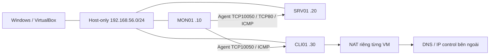
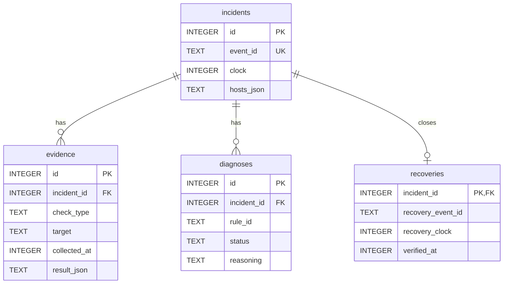
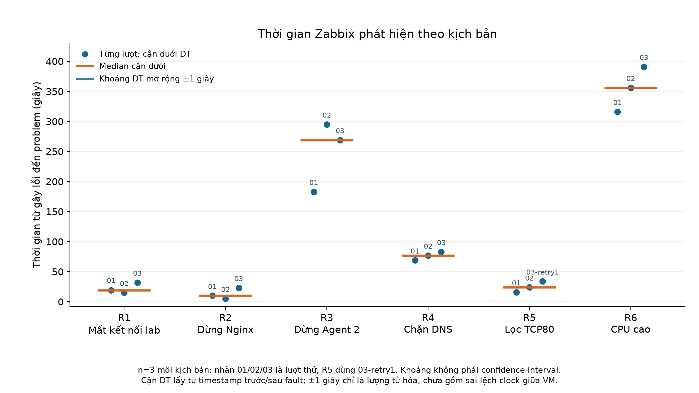
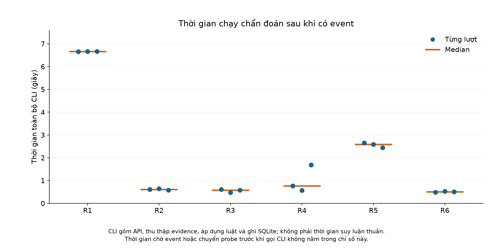
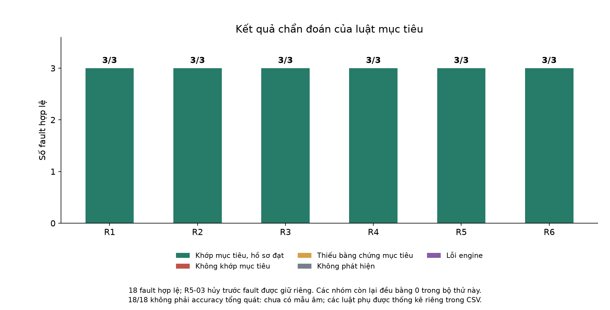

**BỘ NÔNG NGHIỆP VÀ MÔI TRƯỜNG**

**PHÂN HIỆU TRƯỜNG ĐẠI HỌC THỦY LỢI**

**BỘ MÔN CÔNG NGHỆ THÔNG TIN**


**ĐỒ ÁN CHUYÊN ĐỀ CÔNG NGHỆ THÔNG TIN:**

**XÂY DỰNG HỆ THỐNG GIÁM SÁT TẬP TRUNG, CẢNH BÁO VÀ HỖ TRỢ CHẨN ĐOÁN SỰ CỐ CHO HẠ TẦNG MẠNG DOANH NGHIỆP NHỎ**

**Lớp: S26-65CNTT**

| **Giảng viên hướng dẫn** | TS Hoàng Văn Quý           |
| ------------------------ | -------------------------- |
| **Sinh viên thực hiện**  | Trần Tất Phát - 2351067106 |

**TP.Hồ Chí Minh 2026**

# Phạm vi bản báo cáo

Bản kỹ thuật tổng hợp từ Chương1 đã có và Chương2/3 nghiệm thu tuần5. Các lời dự kiến trong cơ sở lý thuyết không thay cho kết quả thực nghiệm. Thông tin bìa kế thừa tài liệu người thực hiện cung cấp; kiểm tra định dạng mẫu trường trước nộp.

# Chương1. Cơ sở lý thuyết và nghiên cứu liên quan

CƠ SỞ LÝ THUYẾT & NGHIÊN CỨU LIÊN QUAN

## 1.1 Tổng quan bài toán và định hướng đề tài

Trong một mạng máy tính phục vụ học tập hoặc hoạt động của một đơn vị nhỏ, việc không truy cập được một dịch vụ có thể xuất phát từ nhiều nguyên nhân: máy chủ mất kết nối, dịch vụ ngừng hoạt động, cấu hình phân giải tên miền sai hoặc tài nguyên xử lý bị sử dụng ở mức cao. Các biểu hiện này dễ bị nhầm lẫn nếu chỉ quan sát một phép kiểm tra riêng lẻ. Vì vậy, bên cạnh phát hiện bất thường, người quản trị cần có dữ liệu hỗ trợ khoanh vùng nguyên nhân và lựa chọn bước kiểm tra tiếp theo.

Đề tài hướng đến xây dựng một mô hình giám sát kết hợp hỗ trợ chẩn đoán sự cố trong phòng thực hành mạng. Zabbix được sử dụng làm nền tảng thu thập số liệu và phát sinh cảnh báo. Trên cơ sở đó, một mô đun do sinh viên xây dựng sẽ tổng hợp sự kiện, đối chiếu bằng chứng với tập luật và trình bày nhận định sơ bộ có giải thích. Kết quả hướng tới là hỗ trợ người vận hành hiểu vì sao xuất hiện cảnh báo và cần kiểm tra thành phần nào.

Ở mức độ đồ án môn học, đối tượng nghiên cứu được giới hạn ở mạng ảo nhỏ gồm máy giám sát, máy chủ dịch vụ web và máy khách. Đề tài tập trung vào các lỗi kết nối, dịch vụ, phân giải tên miền và tài nguyên máy chủ có thể chủ động tái hiện. Nội dung chương này trình bày cơ sở lý thuyết, các công nghệ liên quan và lý do lựa chọn hướng tiếp cận; thiết kế chi tiết và kết quả triển khai thuộc các chương tiếp theo.

## 1.2 Cơ sở lý thuyết về giám sát và chẩn đoán sự cố

### 1.2.1 Địa chỉ mạng và kiểm tra khả năng kết nối

Địa chỉ IP xác định giao diện mạng trong quá trình trao đổi dữ liệu; mặt nạ mạng xác định phạm vi mạng con; gateway là điểm chuyển tiếp khi thiết bị cần gửi dữ liệu đến mạng khác. Một dịch vụ có thể không truy cập được do sai địa chỉ, sai tuyến hoặc do chính ứng dụng. Việc tách các lớp kiểm tra giúp giảm nguy cơ quy kết nhầm nguyên nhân.

ICMP cung cấp các thông điệp điều khiển và báo lỗi cho IP. Lệnh ping thường sử dụng Echo Request và Echo Reply để kiểm tra khả năng phản hồi của đích \[1\]. Kết quả ping thành công là bằng chứng về khả năng liên lạc tại thời điểm kiểm tra, không chứng minh ứng dụng web hoạt động. Ngược lại, ping thất bại có thể do lọc ICMP hoặc mất gói, nên không đủ để khẳng định máy chủ đã tắt.

### 1.2.2 Kiểm tra dịch vụ và phân giải tên miền

Kiểm tra kết nối TCP tới cổng dịch vụ cho biết khả năng thiết lập kết nối đến cổng đó. Với dịch vụ web, cần kiểm tra thêm phản hồi HTTP và nội dung mong đợi. Cổng TCP mở nhưng HTTP trả lỗi vẫn có thể thể hiện sự cố ở tầng ứng dụng. Khi cổng không phản hồi, nguyên nhân có thể là dịch vụ dừng, firewall chặn hoặc đường truyền không thông.

DNS là hệ thống phân giải tên miền, tổ chức dữ liệu theo cấu trúc phân cấp \[2\]. Trong đồ án, việc so sánh truy cập bằng địa chỉ IP với truy vấn DNS từ cùng máy khách giúp nhận biết nhóm lỗi liên quan đến phân giải tên. Kết quả cần được ghi kèm máy thực hiện phép đo và DNS server được sử dụng, vì hai máy có thể sử dụng các cấu hình phân giải khác nhau.

### 1.2.3 Dữ liệu giám sát và vòng đời sự cố

Dữ liệu giám sát gồm giá trị đo, thời điểm đo và đối tượng được đo. Cảnh báo được tạo khi một điều kiện bất thường thỏa mãn; chẩn đoán là bước diễn giải các bằng chứng để khoanh vùng nguyên nhân. Sự cố được theo dõi từ khi phát hiện đến khi ghi nhận phục hồi. Chu kỳ lấy mẫu và thời gian duy trì ngưỡng ảnh hưởng đến độ trễ phát hiện cũng như số cảnh báo phát sinh.

### 1.2.4 Phương pháp chẩn đoán dựa trên luật

Trong phương pháp dựa trên luật, mỗi luật gồm điều kiện và kết luận. Ví dụ, nếu máy chủ vẫn phản hồi ping nhưng kiểm tra HTTP thất bại, hệ thống có thể nhận định rằng cần kiểm tra dịch vụ web hoặc chính sách truy cập. Chỉ khi có thêm bằng chứng về trạng thái tiến trình, hệ thống mới có cơ sở thu hẹp nhận định về dịch vụ. Đây là nguyên tắc suy luận được đề tài lựa chọn, chưa phải kết quả thực nghiệm.

Ưu điểm của tập luật là dễ đọc, dễ kiểm tra và có thể giải thích kết luận bằng các điều kiện cụ thể. Hạn chế là chỉ xử lý tốt các trường hợp đã được mô tả; các lỗi đồng thời hoặc dữ liệu không đầy đủ có thể làm nhiều luật cùng khớp. Khi bằng chứng thiếu hoặc mâu thuẫn, đầu ra cần thể hiện trạng thái chưa đủ cơ sở kết luận thay vì gán một nguyên nhân chắc chắn.

Đề tài dự kiến lưu mã sự kiện nguồn để việc đọc lại cùng sự kiện không tạo thêm bản ghi trùng. Cơ chế này khác với việc gom nhiều cảnh báo có chung nguyên nhân: một sự cố vật lý vẫn có thể phát sinh nhiều sự kiện khác nhau. Phạm vi môn học ưu tiên chống trùng theo mã sự kiện, còn tương quan nhiều sự kiện chỉ được xem xét khi có đủ quan hệ phụ thuộc và dữ liệu kiểm chứng.

## 1.3 Tài liệu và nền tảng công nghệ liên quan

### 1.3.1 Các nguồn tài liệu sử dụng

Cơ sở giao thức được tham khảo từ RFC 792 về ICMP \[1\] và RFC 1034 về DNS \[2\]. Đây là các tài liệu đặc tả dùng để giải thích ý nghĩa của phép đo mạng. Tài liệu chính thức của Zabbix được sử dụng để tìm hiểu khả năng giám sát, API, phụ thuộc trigger và tương quan sự kiện \[3\]–\[6\]. Tài liệu LibreNMS và Prometheus phục vụ khảo sát các hướng tiếp cận tương đồng \[7\], \[8\].

Các nguồn trên chủ yếu là đặc tả kỹ thuật và tài liệu phần mềm. Phần khảo sát không xem tài liệu hướng dẫn sản phẩm là bằng chứng thực nghiệm về hiệu quả của mô đun đề xuất. Những nhận định về mức phù hợp với đồ án được phân tích theo phạm vi chức năng; hiệu quả thực tế cần được đánh giá sau khi triển khai.

### 1.3.2 Zabbix và vai trò trong đề tài

Zabbix hỗ trợ thu thập chỉ số, thiết lập điều kiện cảnh báo và hiển thị dữ liệu giám sát \[3\]. Trong đề tài, host đại diện đối tượng theo dõi; item là đại lượng thu thập; trigger là điều kiện đánh giá bất thường. Agent cung cấp số liệu từ máy được giám sát, còn dashboard tập hợp trạng thái và diễn biến của các chỉ số để người vận hành theo dõi.

Zabbix API là giao diện để chương trình bên ngoài trao đổi dữ liệu với hệ thống bằng JSON-RPC \[4\]. Mô đun dự kiến sử dụng API để lấy thông tin sự kiện và chỉ số cần thiết. Dữ liệu phải giữ được thời điểm phát sinh, đối tượng liên quan và trạng thái phục hồi, nhằm tránh diễn giải một phép đo cũ như trạng thái hiện tại.

Zabbix đã có cơ chế phụ thuộc trigger nhằm hạn chế cảnh báo dây chuyền và có chức năng tương quan sự kiện \[5\], \[6\]. Vì vậy, phần mở rộng của đồ án cần được xác định là cách tổ chức kiểm tra và giải thích cho các tình huống cụ thể, không coi việc phân tích quan hệ giữa cảnh báo là khả năng hoàn toàn mới của hệ thống.

### 1.3.3 Công cụ hỗ trợ

Python được lựa chọn cho mô đun xử lý sự kiện và đối chiếu luật. SQLite được dùng để lưu hồ sơ sự cố ở quy mô nhỏ; thư viện sqlite3 cung cấp giao diện truy cập cơ sở dữ liệu này trong Python \[9\]. Cơ sở dữ liệu của mô đun độc lập với cơ sở dữ liệu phục vụ Zabbix, giúp giới hạn trách nhiệm lưu trữ và thuận tiện xuất dữ liệu đánh giá.

Nginx được lựa chọn làm dịch vụ web thử nghiệm; tài liệu chính thức hướng dẫn cấu hình phục vụ nội dung và điều khiển tiến trình \[10\]. Linux là môi trường dự kiến để vận hành các thành phần và kiểm tra trạng thái dịch vụ. Các công cụ ping, curl và dig được dùng để thu thập bằng chứng kết nối, HTTP và DNS. Môi trường ảo hóa giúp tái hiện lỗi trong phạm vi phòng thực hành.

## 1.4 Khảo sát và so sánh các giải pháp tương đồng

Ba hệ thống được khảo sát gồm Zabbix, LibreNMS và Prometheus. Chúng đại diện cho các cách tổ chức giám sát có thể tham khảo khi xây dựng đồ án. Việc so sánh dưới đây dựa trên tài liệu chính thức và nhu cầu của đề tài; không phải kết quả đo hiệu năng giữa các sản phẩm.

### 1.4.1 Đặc điểm của các hệ thống liên quan

LibreNMS hỗ trợ phát hiện thiết bị tự động, giám sát mạng, cảnh báo và API \[7\]. Điểm phù hợp là quản lý tập thiết bị mạng và số liệu theo dõi. Với mục tiêu giải thích lỗi dịch vụ và DNS từ phía máy khách, đề tài vẫn cần xác định thêm các phép kiểm tra và quy tắc diễn giải cho từng tình huống.

Prometheus lưu số liệu theo chuỗi thời gian gắn nhãn, hỗ trợ truy vấn PromQL và thu thập theo mô hình kéo dữ liệu. Alertmanager đảm nhiệm xử lý cảnh báo \[8\]. Cách tiếp cận này thuận tiện cho phân tích chỉ số; tuy nhiên, khi dùng cho đề tài, việc tổ chức bộ thu thập, cảnh báo và hồ sơ chẩn đoán sẽ cần thêm cấu hình tích hợp.

_Bảng 1.1 So sánh các giải pháp trong phạm vi đề tài_

| **Giải pháp**      | **Điểm mạnh**                                                                 | **Hạn chế khi áp dụng cho đồ án**                                              |
| ------------------ | ----------------------------------------------------------------------------- | ------------------------------------------------------------------------------ |
| Zabbix \[3\]–\[6\] | Tích hợp thu thập, dashboard, cảnh báo, API và quan hệ phụ thuộc.             | Cần cấu hình rõ phép đo và quy trình giải thích cho từng nhóm lỗi.             |
| LibreNMS \[7\]     | Khám phá thiết bị và giám sát hạ tầng mạng; có cảnh báo và API.               | Cần bổ sung quy trình kiểm tra dịch vụ và DNS theo góc nhìn máy khách.         |
| Prometheus \[8\]   | Chuỗi thời gian gắn nhãn, truy vấn linh hoạt, tích hợp hệ sinh thái giám sát. | Cần phối hợp nhiều thành phần để có quy trình cảnh báo và hồ sơ sự cố phù hợp. |

### 1.4.2 Cơ sở lựa chọn hướng tiếp cận

Đồ án lựa chọn Zabbix vì nền tảng này cung cấp sẵn các thành phần thu thập, lưu lịch sử, hiển thị và cảnh báo cần thiết cho mô hình. Nhờ đó, phần xây dựng của sinh viên tập trung vào xử lý dữ liệu và giải thích sự cố. LibreNMS và Prometheus là các hướng tham khảo để nhận diện ưu điểm của việc khám phá thiết bị, tổ chức số liệu và phân tách chức năng giám sát.

Điểm cần bổ sung trong phạm vi bài toán là một quy trình nhất quán: tiếp nhận sự kiện, thu thập bằng chứng liên quan, áp dụng luật, ghi nhận nhận định và lưu căn cứ. Không thể từ bảng khảo sát suy ra rằng các công cụ hiện có không hỗ trợ mở rộng tương tự. Giá trị của đồ án nằm ở việc hiện thực hóa quy trình này và đánh giá được trên mô hình cụ thể.

## 1.5 Hướng tiếp cận và đóng góp dự kiến của đề tài

### 1.5.1 Mục tiêu và phạm vi chức năng

Mục tiêu của đề tài là xây dựng hệ thống giám sát và hỗ trợ khoanh vùng nguyên nhân sơ bộ của các sự cố thường gặp trong mạng thực hành. Các nhóm tình huống dự kiến gồm mất khả năng liên lạc với máy chủ, dịch vụ HTTP không hoạt động, mất dữ liệu từ agent, lỗi phân giải DNS, lỗi đường truy cập HTTP và dấu hiệu sử dụng CPU cao kéo dài.

Triển khai hiện tại dùng fault firewall TCP80 cho R5 vì ba host cùng subnet, không có gateway trung gian; không tuyên bố đã kiểm chứng lỗi đường kết nối dùng chung. CPU cao được xem là biểu hiện cần kiểm tra, không tự động được kết luận là nguyên nhân khiến dịch vụ chậm. Phạm vi tập trung vào các tình huống có thể quan sát và tái hiện; không đặt mục tiêu xác định mọi nguyên nhân trong mạng thực tế.

Hệ thống dự kiến đưa ra nhận định và gợi ý bước kiểm tra; thao tác khắc phục do người thực hiện quyết định. Phương pháp sử dụng tập luật xác định trước, không sử dụng mô hình học máy hoặc mô hình ngôn ngữ lớn. Lựa chọn này phù hợp với yêu cầu giải thích được từng kết luận và kiểm tra độc lập bằng dữ liệu đo.

### 1.5.2 Dữ liệu đầu vào và kết quả đầu ra

Đầu vào gồm thông tin sự kiện từ Zabbix, các chỉ số giám sát và kết quả kiểm tra bổ sung. Mỗi bằng chứng cần gắn với đối tượng, thời điểm và vị trí đo. Với lỗi DNS trên máy khách, phép kiểm tra phải được thực hiện từ chính máy khách hoặc sử dụng dữ liệu thu từ máy đó; một truy vấn thành công trên máy giám sát không phủ nhận lỗi cấu hình tại máy khách.

Đầu ra dự kiến là hồ sơ sự cố chứa mã sự kiện, đối tượng ảnh hưởng, trạng thái, nhận định sơ bộ, luật được áp dụng và bằng chứng. Khi không đủ dữ liệu, hồ sơ ghi rõ điều kiện còn thiếu. Dashboard của Zabbix phục vụ theo dõi trạng thái; bảng kết quả do mô đun xuất ra phục vụ xem xét lịch sử và đánh giá chức năng.

### 1.5.3 Phần kế thừa và phần sinh viên xây dựng

_Bảng 1.2 Phân định các thành phần của đồ án_

| **Nhóm**                | **Nội dung**                                                                                                        |
| ----------------------- | ------------------------------------------------------------------------------------------------------------------- |
| Kế thừa                 | Chức năng thu thập, dashboard, lịch sử số liệu, trigger và API của Zabbix; công cụ kiểm tra mạng và dịch vụ Nginx.  |
| Tự xây dựng             | Mô đun đọc sự kiện, chuẩn hóa dữ liệu, thu bằng chứng, đối chiếu tập luật, lưu hồ sơ và xuất kết quả có giải thích. |
| Tự cấu hình và đánh giá | Mô hình mạng thực hành, điều kiện cảnh báo, tình huống kiểm tra và dữ liệu đối chiếu giữa nhận định với lỗi đã tạo. |

Cải thiện dự kiến so với việc chỉ theo dõi cảnh báo là giảm thao tác thu thập bằng chứng lặp lại và làm rõ căn cứ của mỗi nhận định. Chống trùng khi đọc lại cùng sự kiện là yêu cầu đúng đắn của mô đun, không phải tuyên bố Zabbix tạo sự kiện trùng. Các lợi ích về thời gian hoặc độ chính xác chỉ được kết luận sau khi có số liệu thử nghiệm.

## 1.6 Kết luận chương

Chương 1 đã trình bày cơ sở kiểm tra kết nối, dịch vụ, DNS và phương pháp chẩn đoán dựa trên luật; đồng thời khảo sát các nền tảng giám sát liên quan. Từ đó, đề tài xác định hướng sử dụng Zabbix kết hợp mô đun xử lý do sinh viên xây dựng, với đầu ra là nhận định sơ bộ có bằng chứng. Đây là cơ sở cho việc phân tích, thiết kế và đánh giá hệ thống trong các chương tiếp theo.

# Chương 2. Kiến trúc và triển khai hệ thống

Nội dung kỹ thuật được đối chiếu trực tiếp trên MON01, SRV01, CLI01 ngày 17/10/2026 (UTC+7), mã nguồn hiện tại và cấu hình đóng băng của thực nghiệm tuần 4. [Biên bản ngày 31](NGAY_31_TUAN_5.markdown) ghi phạm vi, thời điểm và kết quả kiểm tra. Chương này mô tả kiến trúc đã triển khai; hình thức trình bày và đánh số hình cần ghép theo mẫu của trường khi đóng gói báo cáo.

## 2.1. Mục tiêu, phạm vi và thành phần

Hệ thống dùng Zabbix để thu dữ liệu, lưu lịch sử, đánh giá trigger và phát sinh problem/recovery. Module Python nhận một problem được người vận hành chọn, thu bằng chứng hiện tại, đánh giá sáu luật và xuất hồ sơ có giải thích. Khi có `--save`, module lưu incident, evidence và diagnosis vào SQLite. Người vận hành quyết định bước kiểm tra và khắc phục tiếp theo.

| Thành phần | Trách nhiệm đã triển khai | Dữ liệu lưu |
|---|---|---|
| Zabbix server, Agent 2, frontend | Thu dữ liệu, đánh giá trigger, hiển thị problem/history | MySQL của Zabbix |
| Module Python CLI trên MON01 | Kiểm tra event, thu evidence, áp dụng luật, lưu/xuất hồ sơ | SQLite `diagnosis.db` |
| HTTP probe tại SRV01 | Kiểm tra HTTP trên chính IP dịch vụ được xác minh là địa chỉ cục bộ | JSON do người vận hành chuyển về MON01 |
| DNS probe tại CLI01 | Đo DNS và ping IP đối chứng cùng observer | JSON do người vận hành chuyển về MON01 |
| Công cụ thực nghiệm | Gây fault, rollback, poll event và gọi CLI | Log, Run ID, timestamp, report trong evidence |

CLI không phải daemon theo dõi mọi event; sản phẩm chưa có webhook/action tự gọi module, học máy hay tự khắc phục. Watcher và timer rollback thuộc công cụ thực nghiệm, không phải khả năng tự động của sản phẩm. API Zabbix và SQLite là hai nguồn dữ liệu tách biệt, không có transaction chung.

## 2.2. Topology và triển khai máy ảo

Ba VM chạy Ubuntu Server trên VirtualBox, cùng laptop Windows. Mỗi VM có NAT trên `enp0s3` và Host-only trên `enp0s8`. Mạng giám sát là `192.168.56.0/24`; lưu lượng giữa ba IP lab đi trực tiếp trong subnet, không qua gateway chung.

| Máy | IP Host-only | Host ID / tên kỹ thuật trong Zabbix | vCPU / RAM | Vai trò |
|---|---|---|---|---|
| MON01 | 192.168.56.10 | 10084 / `Zabbix server` | 2 / 4096 MB | Zabbix, MySQL, frontend Nginx:8080, Agent 2, Python và SQLite |
| SRV01 | 192.168.56.20 | 10683 / `SRV01` | 1 / 3048 MB | Nginx:80, Agent 2, đích HTTP/Agent/CPU |
| CLI01 | 192.168.56.30 | 10684 / `CLI01` | 1 / 2048 MB | Agent 2, observer DNS và host đối chứng |

Processing Cap hiện tại là 100% trên cả ba VM. Ubuntu quan sát là 26.04.1, kernel `7.0.0-34-generic`; MON01 dùng Python 3.14.4 và API Zabbix 7.0.30 thuộc nhánh 7.0 LTS. Đây là cấu hình lab đã đo, không phải yêu cầu phần cứng tối thiểu chung. [Thông số VirtualBox](../evidence/week5/day31-20261017/virtualbox-runtime.json) và [snapshot ba VM](../evidence/week5/day31-20261017/architecture-audit.json) là nguồn đối chiếu.



Gateway NAT `10.0.2.2` là đầu ra riêng của từng VM. Adapter Windows `.1` không được triển khai thành router trung gian giữa các máy lab. CLI01 dùng DNS stub `127.0.0.53`; đường DNS thực tế xem [resolver và route CLI01](../evidence/week5/day31-20261017/cli01-live.json). R5 dùng firewall HTTP thay phương án lỗi gateway, theo phạm vi đã chốt trước thực nghiệm.

| Luồng | Cổng / giao thức | Ghi chú triển khai |
|---|---|---|
| Windows → frontend MON01 | TCP8080 / HTTP | Dashboard và JSON-RPC `/api_jsonrpc.php` |
| Engine → API trên MON01 | HTTP POST / JSON-RPC 2.0 | URL từ `.env`; token Bearer, timeout 5 giây |
| Zabbix → Agent SRV01/CLI01 | TCP10050 / passive Agent | Template passive; MON01 Agent được truy cập qua 127.0.0.1 |
| MON01 → SRV01 | TCP80 / HTTP và TCP probe | Web scenario và bằng chứng kết nối là hai phép đo khác nhau |
| MON01 → đích/đối chứng | ICMP echo | Probe của CLI; không gọi đây là trigger ICMP đã triển khai |
| CLI01 → resolver | DNS qua cấu hình hệ điều hành | Probe truy vấn A; fault R4 chặn UDP/TCP đích 53 |
| Người vận hành → VM | TCP22 / SSH | Quản trị và chuyển probe, không phải tác vụ remote tự động của engine |

`ServerActive` có trong cấu hình Agent, nhưng bằng chứng về template/item hiện hành là passive; sự tồn tại tùy chọn này không chứng minh đang thu dữ liệu bằng active checks. MySQL dùng cho Zabbix, còn engine chỉ đọc API và ghi SQLite; engine không cần tài khoản MySQL.

## 2.3. Dữ liệu giám sát, item và trigger

### 2.3.1. Các item liên quan trực tiếp

Snapshot kiểm tra gồm 28 item trong phạm vi giám sát thực nghiệm trên ba host. Đây không phải tổng số item được cài trong toàn bộ Zabbix. [Bảng item đối chiếu](../evidence/week5/day31-20261017/item-inventory.csv) ghi ID, key, loại, chu kỳ, master và preprocessing; [snapshot MON01](../evidence/week5/day31-20261017/mon01-live.json) giữ cấu hình và trạng thái lúc kiểm tra.

| Item | Host / ID tiêu biểu | Thu thập / chu kỳ | Ý nghĩa và lưu ý |
|---|---|---|---|
| `agent.ping` | SRV01 / 50782 | Agent passive / 1m | Tuổi mẫu dùng cho bằng chứng Agent; không đồng nhất với availability |
| `zabbix[host,agent,available]` | SRV01 / 50821 | Internal / 1m | Trigger Agent đánh giá availability |
| `system.cpu.util[,idle]` | SRV01 / 50797 | Agent passive / 1m | Master của CPU utilization |
| `system.cpu.util` | SRV01 / 50822 | Dependent / theo master | Preprocessing `100 - value`; delay 0 không có nghĩa không cập nhật |
| `system.cpu.load[all,avg1]` | SRV01 / 50791 | Agent passive / 1m | Load một phút, dùng cùng CPU count |
| `system.cpu.num` | SRV01 / 50793 | Agent passive / 1m | Discard unchanged, heartbeat 1d; không đòi history mới mỗi phút |
| `system.uptime` | SRV01 / 50814 | Agent passive / 30s | Kiểm tra reboot và tính liên tục |
| `vm.memory.util` | SRV01 / 50823 | Dependent / master 50819 | Có thu làm ngữ cảnh; không có luật R7 về RAM |
| `web.test.fail[SRV01 HTTP]` | SRV01 / 51006 | Web scenario / 30s | Mã bước lỗi; 0 nghĩa scenario thành công |
| `web.test.rspcode[SRV01 HTTP,Homepage]` | SRV01 / 51008 | Web scenario / 30s | Mã HTTP của bước kiểm tra |
| `web.test.time[SRV01 HTTP,Homepage,resp]` | SRV01 / 51009 | Web scenario / 30s | Thời gian đáp ứng bước; không phải CLI elapsed |
| `net.dns[,example.com,A,2,1,udp]` | CLI01 / 51011 | Agent passive / 30s | Phép đo DNS từ CLI01 |

Web scenario `SRV01 HTTP` chạy tại Zabbix server, có bước `Homepage` tới `http://192.168.56.20/`, yêu cầu HTTP200, timeout 5s, một lần thử. Việc host của scenario là SRV01 không có nghĩa HTTP request được phát từ SRV01. Probe HTTP nội bộ của Python là phép đo độc lập chạy trên máy dịch vụ.

### 2.3.2. Trigger và quan hệ với sáu luật

| Kịch bản | Trigger dùng trong các lượt chính thức | Điều kiện theo cấu hình hiệu lực |
|---|---|---|
| R1, R2, R5 | 25334 — `SRV01: HTTP check failed` | `last(web.test.fail[SRV01 HTTP]) > 0` |
| R3 | 25260 — Agent không khả dụng | `max(availability, {$AGENT.TIMEOUT}) = 0`; macro = 3m |
| R4 | 25335 — DNS example.com thất bại | `max(DNS item, #3) = 0`: ba giá trị gần nhất đều 0 |
| R6 | 25250 — CPU cao | `min(CPU utilization, 5m) > {$CPU.UTIL.CRIT}`; macro = 90 |

R1 dùng problem HTTP làm đầu vào rồi kết hợp ping/TCP/đối chứng để nghi ngờ mất kết nối; không có trigger ICMP riêng được dùng trong ba lượt R1. Như vậy không tồn tại quan hệ một-một giữa sáu luật và sáu trigger. Bảng [trigger–kịch bản](../evidence/week5/day31-20261017/trigger-scenario-map.csv) lấy event thực tế làm bằng chứng.

Trigger CPU 25250 phụ thuộc trigger load-high 25249. Macro `{$LOAD_AVG_PER_CPU.MAX.WARN}` hiệu lực là 1,5. Tên hàm `last`, `max`, `min`, macro kế thừa và liên kết template được kiểm tra thêm bằng SELECT chỉ đọc vì token API không trả đủ phần này. [Kết quả đối chiếu SQL](../evidence/week5/day31-20261017/critical-sql-reviewed.json) xác nhận ngưỡng và template; không xuất thông tin đăng nhập.

Trigger Zabbix và luật Python có điều kiện khác nhau: trigger CPU dùng min >90 trong 5 phút; R6 dùng mean ≥90 cùng kiểm tra độ phủ và load ≥ số CPU. Không mô tả hai lớp này như cùng một thuật toán hoặc suy ra mọi fault CPU đều tạo event giống nhau.

## 2.4. Luồng xử lý và API Zabbix

```mermaid
sequenceDiagram
    participant O as Người vận hành
    participant P as Python CLI trên MON01
    participant Z as Zabbix API
    participant E as Probe / bằng chứng
    participant Q as SQLite
    O->>P: event-id, host-id, target, scope
    P->>Z: problem.get + event.get
    Z-->>P: Problem còn mở, đúng host
    P->>E: Ping, TCP80/10050; đọc probe JSON
    P->>Z: item.get + history.get
    P->>P: Đánh giá sáu luật
    P->>Z: Kiểm tra lại problem còn mở
    alt Có --save
        P->>Q: BEGIN IMMEDIATE / bundle / COMMIT
    else Preview
        P-->>O: Kết quả, không lưu DB
    end
    O->>P: recovery.py sau phục hồi
    P->>Z: Đọc problem và event recovery liên kết
    P->>Q: Bổ sung recovery đã xác minh
    O->>P: report.py theo incident-id
    P->>Q: Đọc snapshot nhất quán
    P-->>O: JSON / Markdown / CSV
```

Không truyền `--event-id` thì `app.py` chỉ liệt kê problem đang mở trên host được chọn. `--save` bắt buộc có event ID. Khi chẩn đoán, `require_open_event` xác nhận event nằm trong danh sách problem có quyền đọc, ID trả về đúng, `value=1`, `r_eventid=0` và thuộc đúng host. Kiểm tra được lặp sau collection và đánh giá luật; nếu thất bại, không gọi bước lưu bundle. Hai lần kiểm tra không khóa event ở Zabbix trong lúc ghi SQLite: vẫn có khoảng đua giữa kiểm tra cuối và commit.

| API sản phẩm dùng | Công dụng |
|---|---|
| `apiinfo.version` | Kiểm tra phiên bản, không dùng token cho lời gọi này |
| `problem.get` | Problem hiện đang mở trong phạm vi host và quyền truy cập |
| `event.get` | Đọc problem/recovery theo ID và host liên quan |
| `item.get` | Metric cuối, trạng thái item, tuổi mẫu và ID/value_type để lấy history |
| `history.get` | CPU history 300 giây, numeric value_type 0 hoặc 3 |

Các lời gọi API là HTTP POST nhưng chỉ thực hiện phương thức đọc. `zabbix_client.py` nạp URL/token từ `.env`, đặt timeout 5s, kiểm tra HTTP, JSON-RPC envelope, response ID và error/result. Lỗi được chuyển thành thông báo gọn, không in token hoặc nội dung trả về tùy ý. History đạt giới hạn 10.000 dòng bị từ chối như dữ liệu có thể bị cắt; không tính tiếp như đã thu đủ.

`trigger.get`, `httptest.get`, macro/template và SELECT MySQL trong hồ sơ nghiệm thu thuộc công cụ kiểm chứng cấu hình, không phải engine tự quản trị Zabbix. HTTP lab dùng mạng riêng; chưa triển khai TLS cho frontend/API trong cấu hình hiện tại. JSON probe xác minh observer/địa chỉ/thời gian ở mức ứng dụng, chưa có chữ ký bảo đảm người vận hành không sửa file.

## 2.5. Thu thập bằng chứng và tổ chức mã nguồn

| Tệp / module | Vai trò |
|---|---|
| [app.py](../diagnosis-engine/app.py) | CLI, kiểm tra event trước/sau, phối hợp thu và đánh giá, tùy chọn lưu |
| [zabbix_client.py](../diagnosis-engine/zabbix_client.py), [event_parser.py](../diagnosis-engine/event_parser.py) | JSON-RPC và chuẩn hóa event/host |
| [models.py](../diagnosis-engine/models.py) | Dataclass HostRecord, EventRecord, EvidenceRecord, DiagnosisRecord |
| [evidence.py](../diagnosis-engine/evidence.py) | Ping, TCP, DNS collector và metric ngữ cảnh |
| [roadmap_evidence.py](../diagnosis-engine/roadmap_evidence.py) | Agent heartbeat và CPU history/support items |
| [http_probe.py](../diagnosis-engine/http_probe.py), [http_evidence.py](../diagnosis-engine/http_evidence.py) | Tạo/kiểm tra local HTTP JSON |
| [dns_probe.py](../diagnosis-engine/dns_probe.py) | DNS và IP control trên CLI01, gắn observer theo hostname |
| [roadmap_rules.py](../diagnosis-engine/roadmap_rules.py) | Sáu luật roadmap và ba trạng thái |
| [repository.py](../diagnosis-engine/repository.py) | SQLite, transaction bundle, kiểm tra và lưu recovery |
| [recovery.py](../diagnosis-engine/recovery.py), [report.py](../diagnosis-engine/report.py) | Đồng bộ recovery và xuất hồ sơ đã lưu |

`rules.py` và `--ruleset legacy` được giữ để tương thích; đợt thực nghiệm dùng `--ruleset roadmap` (cũng là mặc định hiện tại). Source không tự SSH vào các host khác để thu external probe. HTTP/DNS JSON phải được tạo trên đúng observer rồi chuyển về MON01 trước khi gọi CLI.

Mỗi EvidenceRecord gồm `check_type`, `target`, `collected_at` (Unix UTC), `result`. Ping phát một gói, timeout 2s và timeout tiến trình 3s; TCP80/10050 có timeout 2s. TCP phân biệt `success`, `refused`, `timeout`, `error`; lỗi hệ điều hành như errno113 không tự được đổi thành timeout. Các luật chỉ dùng trạng thái được diễn giải hợp lệ và còn mới.

HTTP JSON giới hạn 64 KiB, đúng một record, schema_version=1, đúng observer, target, port80, path `/`, địa chỉ cục bộ đã xác minh; tuổi từ 0 đến 180s. DNS JSON phải đúng observer và chỉ gồm `dns`/`dns_control_ping`, timestamp integer; luật đối chiếu tên, control IP, record A và freshness. Sự kiểm tra hai định dạng không hoàn toàn giống nhau; không khẳng định DNS có cùng giới hạn 64 KiB của HTTP.

`collect_agent_metric` phân biệt enabled/disabled, missing, no_data, unsupported và success. Với mẫu cũ hơn 180s, collector gắn no_data trước bước đánh giá state; R3 không phải lệnh kiểm tra systemctl. `collect_cpu_history` yêu cầu numeric history hợp lệ, không trùng clock, sắp xếp theo thời gian; CPU count/load được giữ làm dữ liệu hỗ trợ.

## 2.6. Sáu luật và ý nghĩa đầu ra

Mỗi luật tạo `rule_id`, `status`, `probable_cause`, `reasoning`, `missing_info`, `next_actions`. Ba trạng thái là `matched`, `not_matched`, `insufficient_evidence`. `matched` xác nhận tổ hợp điều kiện, không chứng minh duy nhất một nguyên nhân gốc. `not_matched` chỉ bác bỏ điều kiện của luật đó; `insufficient_evidence` không phải host khỏe hoặc lỗi chẩn đoán đã xác định.

| Luật | Điều kiện khớp chính | Điểm cần phân biệt |
|---|---|---|
| R1 — host/kết nối cục bộ | Ping đích no_reply, TCP80 timeout, ping host đối chứng thành công | Đối chứng phải khác đích; người vận hành chọn host cùng subnet. Mã không tự kiểm tra subnet hoặc chứng minh mất nguồn |
| R2 — service/listener HTTP | Ping thành công, TCP80 thất bại; local HTTP không phản bác giả thuyết | TCP refused có thể khớp dù thiếu local HTTP. TCP timeout thiếu local HTTP thì insufficient; local HTTP200 thì not_matched |
| R3 — Agent không khả dụng | Ping thành công, agent.ping no_data, TCP10050 refused/timeout | Một mẫu agent.ping mới trả 1 làm luật not_matched; chưa phân biệt Agent dừng và firewall/allow-list |
| R4 — DNS/resolver/đường DNS | DNS lỗi/timeout/no-answer có thể diễn giải, IP đối chứng cùng observer còn phản hồi | NXDOMAIN có thể do tên sai; A answer không kiểm tra IP có đúng IP kỳ vọng hay không |
| R5 — filtering/đường HTTP | Ping thành công, TCP80 refused/timeout, local HTTP200 | Không tự đọc firewall/packet counter; local HTTP không đi cùng ingress path với MON01 |
| R6 — CPU cao kéo dài | Mean CPU ≥90%, history đủ độ phủ, load ≥ CPU count | Chưa có đối chứng đủ để kết luận ứng dụng chậm do CPU |

R6 cần ít nhất 3 mẫu, clock không trùng/tăng đúng, span ≥240s, max gap ≤120s, mẫu cuối ≤180s; collector thực tế lấy 300s history gần nhất. Giá trị CPU hữu hạn trong [0,100]. Mean là trung bình số học, không dùng trọng số thời gian. CPU count phải là số nguyên ≥1, tuổi ≤86.580s (heartbeat 1 ngày cộng 180s); load hữu hạn không âm, tuổi ≤180s. Nếu mean <90%, luật có thể trả not_matched mà không cần đủ corroboration load/count; nếu mean cao nhưng corroboration thiếu thì insufficient.

Hầu hết evidence dùng tuổi 0–180s. Sai observer, dữ liệu tương lai/cũ, thiếu probe hoặc lỗi lệnh không được dùng như bằng chứng xác nhận fault. Tuy nhiên luật có nhánh trả not_matched sớm khi đã có bằng chứng bác bỏ, nên không nhất thiết mọi đầu vào đều có mặt ở mọi kết quả.

HTTP scope `expected`, `absent`, `unknown` phải khai báo theo vai trò host. `expected` đánh giá R2/R5; `absent` trả not_matched với lý do not applicable; `unknown` trả insufficient cho hai luật. Các trường hợp absent không phải true negative. CLI01 dùng absent trong R4; SRV01 dùng expected trong các lượt dịch vụ.

## 2.7. SQLite và vòng đời incident

SQLite mặc định nằm cạnh `repository.py`, có thể đổi bằng `--db`. Các trường JSON giữ cấu trúc dữ liệu đầy đủ; ID event của Zabbix dùng TEXT, khác incident ID nội bộ INTEGER.



| Bảng | Ràng buộc / nội dung còn lại |
|---|---|
| `incidents` | event_id UNIQUE; clock ≥0; severity 0–5; value 0/1; name, created_at |
| `evidence` | FK incident_id; result_json và timestamp của từng phép thu |
| `diagnoses` | FK incident_id; CHECK ba status; probable_cause, missing_info_json, next_actions_json, created_at |
| `recoveries` | Một hàng mỗi incident; problem_json và recovery_json cùng thông tin xác minh |

`init_db` tạo ba bảng đầu; `recoveries` được tạo bổ sung khi lưu recovery đầu tiên. `save_incident_bundle` bật foreign_keys, mở `BEGIN IMMEDIATE`, chèn/lấy incident theo event_id duy nhất, từ chối nếu đã có evidence hoặc diagnoses rồi mới lưu toàn bộ bundle. Có lỗi thì rollback. Ràng buộc này nằm ở luồng bundle; các hàm lưu từng phần phục vụ tương thích vẫn tồn tại, nên không mô tả SQLite tự cấm mọi kiểu append từ công cụ khác.

| Trạng thái quan sát | Ý nghĩa đúng |
|---|---|
| Event còn mở qua API | Điều kiện đầu vào để chạy app; không phải trạng thái đồng bộ liên tục vào DB |
| Đã lưu bundle, chưa có recovery | `report.py` trả `lifecycle_status=unverified`, `recovery_status=not_recorded`; chưa đủ biết event hiện còn mở hay đã phục hồi |
| Có recovery đã xác minh | `lifecycle_status=closed`, `recovery_status=verified`; giữ nguyên evidence/diagnosis ban đầu |

`recovery.py` đọc problem đã lưu, lấy `r_eventid` rồi đọc recovery. `save_recovery` kiểm tra liên kết event, cùng trigger, source/object trigger events, value problem=1/recovery=0, tập host khớp, clock problem trùng bản lưu và problem ≤ recovery ≤ thời điểm xác minh. Recovery trùng ID/clock là idempotent; recovery xung đột bị từ chối ghi đè. Không sửa `incidents.value` ban đầu thành 0 để giả lập hiện trạng.

`report.py` mở SQLite mode=ro, đọc trong một transaction, xuất JSON schema_version=2, Markdown hoặc CSV. CSV incident có một dòng mỗi diagnosis; CSV thực nghiệm có một dòng mỗi Run ID. Báo cáo công bố cơ sở là evidence đã lưu tại lúc chẩn đoán, không mặc định tái dựng chính xác thời điểm event hoặc sức khỏe hiện tại. Tệp output dùng chế độ không ghi đè.

Schema thật và số hàng lúc ngày 31 được lưu trong [MON01 live snapshot](../evidence/week5/day31-20261017/mon01-live.json): 36 incidents, 268 evidence, 154 diagnoses, 26 recoveries. Các tổng này gồm cả lịch sử trước 18 lượt chính thức; không dùng tổng DB làm mẫu số thực nghiệm.

## 2.8. Cấu hình và vận hành đã triển khai

Source trên MON01 ở `/home/phat/do-an/diagnosis-engine`; bản Windows ở `C:\Users\Darrys\do-an\diagnosis-engine`. Môi trường Python dùng `requests`, `python-dotenv`; `pytest` phục vụ kiểm tra. `.env` cục bộ chứa URL/token và bị loại khỏi Git. Trên SRV01/CLI01, probe dùng Python tiêu chuẩn và các lệnh hệ điều hành (ping, dig cho DNS), không cần token API.

```bash
cd ~/do-an/diagnosis-engine
source .venv/bin/activate
python app.py --host-id 10683
```

Lệnh trên chỉ liệt kê problem. Với fault hiện đang tồn tại trên SRV01, người vận hành chọn event mới rồi chạy cấu hình tương ứng; HTTP probe phải bổ sung cho các lượt R2/R5 theo quy trình thực nghiệm.

```bash
read -r -p 'Problem event ID mới: ' EVENT_ID
python app.py --event-id "$EVENT_ID" --host-id 10683 \
  --target-ip 192.168.56.20 --ruleset roadmap \
  --control-ip 192.168.56.30 --http-service expected --save
```

Các lệnh R2/R5 thêm `--http-observer srv01 --http-evidence <JSON-mới>`. R4 chọn host10684, target `.30`, control R1 `.20`, HTTP absent, `--dns-name example.com --dns-observer cli01 --dns-control-ip 1.1.1.1 --dns-evidence <JSON-mới>`. Không tái sử dụng event tuần 4 đã closed cho một lần chạy app mới.

```bash
python recovery.py --event-id "$EVENT_ID"
read -r -p 'Incident ID đã lưu: ' INCIDENT_ID
python report.py --incident-id "$INCIDENT_ID" --format json
```

Lệnh đầy đủ, cách thu/chuyển probe và rollback xem [README](../README.md), [README module](../diagnosis-engine/README.md), [kịch bản demo](KICH_BAN_DEMO_10_PHUT.md). Ngày 31 chỉ kiểm tra đọc; không tạo fault để minh họa lệnh và không thêm chức năng.

## 2.9. Kiểm chứng, giới hạn và nguồn truy vết

Ngày 31 kiểm tra SSH cả ba VM; Agent và các dịch vụ chính active, HTTP trả 200, ba interface Agent available=1, không có problem mở lúc snapshot. NTP báo synchronized, nhưng không đo được chính xác sai lệch clock giữa VM. Cấu hình trong phạm vi baseline và 40 tệp source/test/requirements/pytest.ini trên MON01 và Windows khớp bản đóng băng. Kết quả thời điểm kiểm tra không thay thế baseline dài hạn hoặc diễn tập ba lần sau reboot.

| Nội dung kiến trúc | Nguồn kiểm chứng |
|---|---|
| IP, route, DNS, service và cấu hình Agent chọn lọc | [MON01](../evidence/week5/day31-20261017/mon01-live.json), [SRV01](../evidence/week5/day31-20261017/srv01-live.json), [CLI01](../evidence/week5/day31-20261017/cli01-live.json) |
| Item, trigger, web scenario và trạng thái host | [Inventory](../evidence/week5/day31-20261017/item-inventory.csv), [trigger map](../evidence/week5/day31-20261017/trigger-scenario-map.csv), snapshot MON01 |
| Hàm trigger, ngưỡng và template kế thừa | [SQL đã đối chiếu](../evidence/week5/day31-20261017/critical-sql-reviewed.json) |
| Schema, foreign key và integrity DB runtime | Snapshot MON01; SQLite mở chỉ đọc |
| Khớp source/config và giới hạn kiểm tra | [Architecture audit](../evidence/week5/day31-20261017/architecture-audit.json) |
| Ví dụ lưu incident/recovery thật | [R2-01, incident22](../evidence/week4/official-runs/R2-01/incident.json), [R6-01, incident34](../evidence/week4/official-runs/R6-01/incident.json) |

SQLite được sao lưu bằng backup API để tạo bản nhất quán. Export YAML host/template không thay backup MySQL, cấu hình daemon hoặc secret. Bản Windows và VM cùng phụ thuộc laptop, chưa phải dự phòng độc lập trước mất/hỏng thiết bị. Baseline chính thức dài 1.806 giây theo lựa chọn phiên ngắn, không gọi là baseline bốn giờ.

R1 ngắt Host-only thay vì tắt nguồn; R4 chặn DNS thay vì chứng minh resolver upstream hỏng; R5 chặn TCP80 thay lỗi gateway. Không suy rộng lab một topology và ba lượt mỗi fault thành chất lượng vận hành doanh nghiệp. Phân tích định lượng thuộc [Chương 3](CHUONG_3_THUC_NGHIEM_VA_DANH_GIA.md); hoàn thiện báo cáo thực nghiệm, diễn tập và release là các đầu việc tiếp theo của tuần 5.


# Chương 3. Thực nghiệm và đánh giá

Bản kỹ thuật hoàn thiện tuần 5 từ bộ dữ liệu chính thức ngày 16–17/10/2026. Các số được tạo từ `all-trials.csv` và `experiment-summary.json`, không lấy từ dry run hoặc số unit test. Cần ghép vào mẫu báo cáo của trường trước khi nộp.

## 3.1. Mục tiêu và môi trường

Thực nghiệm đánh giá khả năng Zabbix phát hiện sáu điều kiện lỗi trong lab, khả năng luật mục tiêu của module Python khớp evidence khi fault còn tồn tại, và khả năng lưu recovery đúng liên kết event. Lab gồm MON01, SRV01 và CLI01 trên cùng laptop VirtualBox như Chương 2. Không có tập host độc lập hoặc đánh giá vận hành doanh nghiệp.

Source tham chiếu `ca04071`, export cấu hình `978b4f9`, phiếu thử `4cabeb0`. Trước đợt đo đã lưu snapshot hiệu lực, macro/template bổ sung, thông số runtime và hash source/tests. Trước mỗi trial, bộ ghi đối chiếu hash engine. Engine, trigger và sampling không được sửa giữa các lượt để khớp kết quả.

Mốc kiểm tra trước baseline có 280 tests passed. Đây là kiểm tra module, tách biệt khỏi kết quả 18 lượt fault thật. Các công cụ điều khiển fault/ghi thử không phải chức năng tự khắc phục của engine.

## 3.2. Baseline và điều kiện trước thử

Baseline mới bắt đầu 16/10/2026 16:26:08 UTC, kết thúc 16:56:14 UTC, tương ứng 23:26:08–23:56:14 UTC+7: tổng cộng 1.806 giây (30 phút 06 giây). Theo lựa chọn phiên ngắn, không gọi đây là baseline bốn giờ. Có 31 poll, 963 history rows của 28 item; đã đối chiếu lịch sử event, khoảng lấy mẫu, item errors và uptime. Không thấy problem mới trong cửa sổ quan sát đã kiểm tra.

Tần suất problem mới quan sát trong baseline là 0 / (1806/3600) = 0 sự kiện/giờ trong đúng cửa sổ ngắn này. Không có event để phân loại false alert; số 0 không ước lượng chắc chắn rủi ro dài hạn. Engine là CLI, không chạy liên tục trên tập âm nên baseline Zabbix không cung cấp tỷ lệ chẩn đoán sai của engine.

Trước mỗi fault, kiểm tra host reachable, HTTP 200, service đang chạy và không có problem nền trên host mục tiêu. Các VM báo NTP synchronized; chưa đo chính xác sai số clock giữa các VM. Trước lượt CPU tiếp theo, chờ history năm phút không còn mẫu CPU cao và không còn problem; lưu riêng bằng chứng precondition.

## 3.3. Sáu kịch bản và quy trình

| Kịch bản | Fault thực thi | Observer/đích và đối chứng | Rollback |
|---|---|---|---|
| R1 | Ngắt enp0s8 của SRV01 | MON01 → SRV01; CLI01 đối chứng cùng subnet | Timer bật lại card, có failsafe riêng |
| R2 | Dừng Nginx SRV01 | MON01 đo ping/TCP; SRV01 đo local HTTP | Start Nginx |
| R3 | Dừng Agent 2 SRV01 | MON01 đo ping, TCP10050 và agent history | Start Agent 2; chờ telemetry mới và recovery |
| R4 | Chặn UDP/TCP đích 53 tại output CLI01 | CLI01 đo example.com và ping 1.1.1.1; HTTP scope absent | Xóa đúng bảng nft riêng |
| R5 | Chặn TCP80 từ MON01 tại input SRV01 | MON01 đo remote; SRV01 đo HTTP trên IP dịch vụ | Xóa đúng bảng nft riêng |
| R6 | stress-ng, một worker CPU 100%, timeout 12 phút | History CPU/load của SRV01, một vCPU | Dừng đúng PID, xác nhận không còn worker |

R1 không mô phỏng đầy đủ mất nguồn VM; R4 không chứng minh resolver upstream hỏng; R5 dùng phương án firewall thay gateway theo phạm vi đã chốt. Vì vậy kết quả chỉ kiểm chứng những fault đã thực thi.

Mỗi lượt ghi timestamp trước/sau gây lỗi trên VM độc lập với MON01. Bộ ghi poll API khoảng năm giây, nhận đúng trigger đã chọn, chạy engine một lần, chờ recovery, đồng bộ SQLite và xuất report. Với R2/R5, HTTP JSON được thu tại SRV01 sau event; với R4, DNS và IP control được thu cùng observer CLI01 sau event. Các file phải còn fresh khi collection bắt đầu.

Có một lần R5-03 được tạo watcher nhưng lệnh gây fault bị chặn trước thực thi vì giới hạn sử dụng ở bước duyệt tự động. Hồ sơ timeout giữ nguyên, kèm adjudication `aborted_before_fault`; R5-03-retry1 là fault trial mới có mã riêng. Không tính lần bị hủy vào mẫu số detection. R2-03 có probe trước event được giữ riêng, còn diagnosis dùng probe mới sau event; engine không được chạy lại để chọn kết quả đẹp.

## 3.4. Chỉ số và cách chấm

- Detection rate = số fault hợp lệ có đúng problem / tổng fault hợp lệ.
- Target diagnosis success end-to-end = số fault hợp lệ có luật mục tiêu matched bằng evidence và hồ sơ qua kiểm tra / tổng fault hợp lệ. No detection, engine error và insufficient_evidence không bị loại khỏi mẫu số.
- Detection time nằm giữa `problem_clock − fault_after` và `problem_clock − fault_before`. Các timestamp có độ phân giải một giây; CSV bổ sung biên ±1 giây cho lượng tử hóa, chưa gồm sai số NTP chưa đo.
- CLI elapsed đo bằng monotonic clock từ khi gọi app tới khi kết thúc, gồm API, collection, luật và SQLite; không phải thời gian suy luận thuần túy.
- Recovery recognition nằm giữa `recovery_clock − rollback_after` và `recovery_clock − rollback_before`. Khoảng problem–recovery không phải downtime thật.
- Chỉ ba lượt mỗi loại: báo từng giá trị, median, min, max và cỡ mẫu; không suy ra độ tin cậy doanh nghiệp. Không có tập âm nên không tính specificity/accuracy có TN. HTTP scope absent và evidence thiếu không được tính thành healthy negative.

## 3.5. Kết quả

| Scenario | Fault hợp lệ | Detection | Target success | Abstention mục tiêu | Detection median [min–max] s | CLI median [min–max] s |
|---|---:|---:|---:|---:|---|---|
| R1 | 3 | 3/3 | 3/3 | 0 | 19.000 [15.000–32.000] | 6.660 [6.656–6.665] |
| R2 | 3 | 3/3 | 3/3 | 0 | 10.000 [5.000–23.000] | 0.610 [0.582–0.638] |
| R3 | 3 | 3/3 | 3/3 | 0 | 269.000 [183.000–295.000] | 0.583 [0.469–0.610] |
| R4 | 3 | 3/3 | 3/3 | 0 | 77.000 [69.000–83.000] | 0.766 [0.564–1.688] |
| R5 | 3 | 3/3 | 3/3 | 0 | 24.000 [16.000–34.000] | 2.590 [2.446–2.646] |
| R6 | 3 | 3/3 | 3/3 | 0 | 356.000 [316.000–391.000] | 0.502 [0.487–0.522] |

Tổng cộng detection 18/18 và target success end-to-end 18/18 trong bộ fault hợp lệ này. Số đếm này chỉ đo luật mục tiêu trên các lỗi được tạo; không phải accuracy phân loại trên lưu lượng vận hành bình thường.







Bảng dùng cận dưới detection theo clock; CSV giữ cả cận trên và sai số lượng tử. Vạch median chỉ mô tả ba điểm, không phải ước lượng có khoảng tin cậy. Các file SVG/PDF tương ứng dùng để đưa hình vào bản nộp.

## 3.6. Ba nhận xét dựa trên dữ liệu

1. Cơ chế trigger ảnh hưởng lớn tới detection. R3 có median 269 giây, so với R2 10 giây và R4 77 giây. R3 phải chờ availability và cửa sổ ba phút; không thể so độ trễ các nhóm như thể chúng dùng cùng chu kỳ và biểu thức.
2. Remote HTTP thất bại chưa đủ phân biệt lỗi service với lọc truy cập. R2-01 có local HTTP refused; R5-01 có local HTTP 200 trong khi bảng nft độc lập ghi rule chặn MON01. Luật phân biệt được hai tổ hợp evidence trong các lượt này, nhưng riêng output R5 vẫn chỉ là nghi ngờ filtering/đường truy cập, chưa tự đọc firewall hoặc xác định chính xác nguyên nhân.
3. Chất lượng và cửa sổ dữ liệu là một phần kết quả. R5-02 có R6 phụ insufficient_evidence vì CPU history span 239 giây thay vì tối thiểu 240 giây; không sửa luật hoặc chạy lại engine để loại kết quả này. Trong R6-01, history đạt span 241 giây, mean CPU 100%, load 1 và một vCPU nên luật mục tiêu matched. Cần phân biệt abstention do độ phủ dữ liệu với bằng chứng host khỏe.

## 3.7. Giới hạn và việc chưa được chứng minh

Lab dùng một laptop, một topology nhỏ và ba lượt lặp cho mỗi fault, không có tập kiểm tra độc lập. Lượt CPU có nghỉ giữa các fault nhưng vẫn cùng host và cấu hình; chưa đánh giá phân bố tải nền khác, jitter lớn, packet loss hỗn hợp hoặc nhiều fault đồng thời. Baseline ngắn chưa đủ phản ánh hoạt động qua đêm hoặc nhiều ngày.

R6 cho thấy CPU/load cao theo luật, chưa chứng minh tác động ứng dụng vì chưa có đối chứng response-time đầy đủ. Dữ liệu CPU count có heartbeat một ngày; tuổi mẫu lớn không tự là mất giám sát nếu phù hợp preprocessing. Các luật ngoài mục tiêu có insufficient_evidence được giữ trong JSON; không đếm thành true negative.

Mean CPU của luật là trung bình số học các mẫu, chưa dùng trọng số theo khoảng thời gian. Trigger CPU còn có dependency với load-high; bộ thử một worker chưa bao phủ trường hợp load-high trở thành problem và ảnh hưởng event CPU. Không suy rộng ba lượt này thành phát hiện mọi tình huống quá tải hoặc mọi tổ hợp trigger.

Dữ liệu thô và event API thay cho việc chép tay số từ dashboard. Hồ sơ đóng tuần 4 đã bổ sung ảnh dashboard, ba host, lịch sử và 18 ảnh chi tiết event tại `evidence/week4/closure-20261017/screenshots/`. Đây là ảnh lịch sử chụp sau đo, không phải ảnh active fault; xem `docs/TONG_HOP_TUAN_4.markdown` và closure audit. Tuần5 đã ghi ba lượt diễn tập kỹ thuật sau reboot và có bộ release/backup địa phương riêng; xem biên bản tuần5. Chưa chứng nhận năng lực thuyết trình của sinh viên hoặc backup ngoài laptop.

## 3.8. Truy vết từng lượt

| Run ID | Problem → Recovery | Incident | Luật mục tiêu | Hồ sơ |
|---|---|---:|---|---|
| R1-01 | 933 → 934 | 19 | matched | [raw](../evidence/week4/official-runs/R1-01/run.json) |
| R1-02 | 935 → 936 | 20 | matched | [raw](../evidence/week4/official-runs/R1-02/run.json) |
| R1-03 | 937 → 938 | 21 | matched | [raw](../evidence/week4/official-runs/R1-03/run.json) |
| R2-01 | 939 → 940 | 22 | matched | [raw](../evidence/week4/official-runs/R2-01/run.json) |
| R2-02 | 941 → 942 | 23 | matched | [raw](../evidence/week4/official-runs/R2-02/run.json) |
| R2-03 | 943 → 944 | 24 | matched | [raw](../evidence/week4/official-runs/R2-03/run.json) |
| R3-01 | 945 → 950 | 25 | matched | [raw](../evidence/week4/official-runs/R3-01/run.json) |
| R3-02 | 951 → 956 | 26 | matched | [raw](../evidence/week4/official-runs/R3-02/run.json) |
| R3-03 | 957 → 962 | 27 | matched | [raw](../evidence/week4/official-runs/R3-03/run.json) |
| R4-01 | 963 → 964 | 28 | matched | [raw](../evidence/week4/official-runs/R4-01/run.json) |
| R4-02 | 965 → 966 | 29 | matched | [raw](../evidence/week4/official-runs/R4-02/run.json) |
| R4-03 | 967 → 968 | 30 | matched | [raw](../evidence/week4/official-runs/R4-03/run.json) |
| R5-01 | 969 → 970 | 31 | matched | [raw](../evidence/week4/official-runs/R5-01/run.json) |
| R5-02 | 971 → 972 | 32 | matched | [raw](../evidence/week4/official-runs/R5-02/run.json) |
| R5-03-retry1 | 973 → 974 | 33 | matched | [raw](../evidence/week4/official-runs/R5-03-retry1/run.json) |
| R6-01 | 975 → 976 | 34 | matched | [raw](../evidence/week4/official-runs/R6-01/run.json) |
| R6-02 | 977 → 978 | 35 | matched | [raw](../evidence/week4/official-runs/R6-02/run.json) |
| R6-03 | 979 → 980 | 36 | matched | [raw](../evidence/week4/official-runs/R6-03/run.json) |

[CSV toàn bộ lượt](../evidence/week4/official-runs/all-trials.csv) · [JSON công thức, cỡ mẫu và thống kê](../evidence/week4/official-runs/experiment-summary.json) · [Phụ lục vận hành](../evidence/week4/official-runs/PHU_LUC_VAN_HANH_THUC_NGHIEM.md)

## 3.9. Nghiệm thu bảng và biểu đồ ngày 30

Bộ hình trong mục 3.5 được tái tạo từ dữ liệu đã nghiệm thu ngày 29; 90 số min/median/max khớp dữ liệu nguồn. Mỗi hình có bản PNG, SVG và PDF để đưa vào báo cáo. [Phân tích ngày 30](NGAY_30_TUAN_5.markdown) cung cấp bảng hai cận DT, kết quả mục tiêu, từng điểm trên hình và bốn phát hiện có liên kết hồ sơ gốc.

- R6 có DT median 356 s, R3 269 s, R2 10 s. Sự khác biệt phù hợp với điều kiện trigger khác nhau; chưa cô lập nguyên nhân bằng thực nghiệm đối chứng.
- R6 có CLI median thấp nhất (0,502 s), R1 cao nhất (6,660 s), dù R6 phát hiện chậm hơn. Detection và CLI là hai giai đoạn, không thể thay thế nhau.
- Sáu nhóm đều khớp mục tiêu 3/3; không có mẫu âm để tính accuracy tổng quát. Lượt hủy trước fault không vào mẫu số.
- 24/108 đầu ra luật thiếu evidence vẫn được giữ; không gán thành true negative hoặc lỗi luật mục tiêu.

[Dữ liệu điểm vẽ](../evidence/week5/day30-20261017/plotted-points.csv) · [Bảng thống kê](../evidence/week5/day30-20261017/timing-summary.csv) · [Kết quả chẩn đoán](../evidence/week5/day30-20261017/diagnosis-outcomes.csv) · [Kiểm tra tái tạo](../evidence/week5/day30-20261017/analysis-validation.json).

Hoàn thành đầu ra ngày 30; Chương 3 tiếp tục được rà soát đầy đủ vào ngày 32. Không thay đổi engine hoặc bằng chứng tuần 4.

## 3.10. Cảnh báo sai, tiêu chí chấm và khả năng tái lập

Đơn vị thử là một fault chủ động tạo có Run ID, log trước/sau và kiểm tra precondition; không phải từng dòng history, từng diagnosis hay từng event ngẫu nhiên. 19 attempt gồm18 fault hợp lệ và1 hủy trước fault. Sáu nhóm mỗi nhóm3, không có bộ âm độc lập. Không loại một fault hợp lệ chỉ vì engine lỗi/thiếu dữ liệu/không phát hiện; trong bộ đã thu các trường hợp mục tiêu đó đều bằng0.

Chấm mục tiêu theo điều kiện luật và ground truth của fault. R1 ngắt Host-only, R2 dừng Nginx, R3 dừng Agent, R4 chặn DNS tại CLI01, R5 lọc TCP80 từ MON01, R6 stress CPU. Các tên nguyên nhân là giả thuyết giới hạn đúng bằng chứng; không gán nhãn resolver upstream hỏng, VM mất nguồn hoặc gateway hỏng cho những fault khác.

**Cảnh báo sai:** baseline có0 problem mới trong1806s, tương đương0 sự kiện/giờ chỉ trong cửa sổ quan sát. Chưa có event nền để phân loại false alert, chưa thử tập âm engine, không có mẫu số TN/FP để tính FPR hoặc specificity. Chẩn đoán matched ngoài mục tiêu trong18 run bằng0, nhưng điều đó không thay tập âm độc lập. 24 insufficient_evidence ở108 đầu ra giữ nguyên; HTTP absent cũng không tính TN. Các problem reboot ngoài cửa sổ tuần4 được phân loại riêng trong hồ sơ diễn tập tuần5, không gộp để thay kết quả baseline.

Mỗi lượt engine chỉ chạy/lưu một lần; event hồi phục khi đang collection làm kiểm tra cuối từ chối là hành vi bảo vệ, không lý do sửa dữ liệu. Với R2/R5, probe HTTP tạo mới sau problem; với R4, DNS/IPcontrol cùng observer. Probe cũ R2-03 được giữ riêng; R5-03 hủy và retry có ID riêng. Không impute, cắt outlier hoặc đổi timestamp để rút ngắn thời gian.

Nguồn tái lập: [clean runs](../evidence/week5/day29-20261017/clean-runs.csv), [attempt register](../evidence/week5/day29-20261017/attempts.csv), [công thức và audit](../evidence/week5/day29-20261017/audit.json), [mã tạo bảng/hình](../evidence/week5/day30-20261017/tools/day30_analysis.py). Manifest giữ byte của nguồn. Bảng/hình có min/median/max, cỡ mẫu và cận thời gian; không cung cấp kiểm định hoặc confidence interval suy rộng từ n=3.

Các lượt demo sau reboot là tập diễn tập riêng trong `evidence/week5/final-20261017`, không nâng cỡ mẫu18 của thực nghiệm đóng băng. Test cuối kiểm tra phần mềm; không thay baseline hoặc fault trial. Môi trường thực tế và cấu hình đã được đối chiếu lại ở [Chương2](CHUONG_2_KIEN_TRUC_VA_TRIEN_KHAI.md).


# Kết luận và hướng phát triển

Hệ thống đã triển khai giám sát ba VM và module sáu luật có bằng chứng, lưu SQLite và recovery truy vết.18 fault hợp lệ đạt matched mục tiêu18/18 trong bộ thử nhỏ. Kết quả chưa chứng minh accuracy tổng quát, giảm thời gian so với quản trị thủ công hoặc độ tin cậy dài hạn. Hướng phát triển là tập âm độc lập, baseline dài, nhiều topology, đo từng pha và response-time đối chứng.

# Tài liệu tham khảo

\[1\] J. Postel, "Internet Control Message Protocol," RFC 792, 1981. \[Trực tuyến\]. Địa chỉ: <https://www.rfc-editor.org/rfc/rfc792>. \[Truy cập: 18/09/2026\].

\[2\] P. Mockapetris, "Domain names — concepts and facilities," RFC 1034, 1987. \[Trực tuyến\]. Địa chỉ: <https://www.rfc-editor.org/rfc/rfc1034>. \[Truy cập: 18/09/2026\].

\[3\] Zabbix LLC, "Zabbix features," Zabbix 7.0 Documentation. \[Trực tuyến\]. Địa chỉ: <https://www.zabbix.com/documentation/7.0/en/manual/introduction/features>. \[Truy cập: 18/09/2026\].

\[4\] Zabbix LLC, "API," Zabbix 7.0 Documentation. \[Trực tuyến\]. Địa chỉ: <https://www.zabbix.com/documentation/7.0/en/manual/api>. \[Truy cập: 18/09/2026\].

\[5\] Zabbix LLC, "Trigger dependencies," Zabbix 7.0 Documentation. \[Trực tuyến\]. Địa chỉ: <https://www.zabbix.com/documentation/7.0/en/manual/config/triggers/dependencies>. \[Truy cập: 18/09/2026\].

\[6\] Zabbix LLC, "Event correlation," Zabbix 7.0 Documentation. \[Trực tuyến\]. Địa chỉ: <https://www.zabbix.com/documentation/7.0/en/manual/config/event_correlation>. \[Truy cập: 18/09/2026\].

\[7\] LibreNMS, "Features," LibreNMS Docs. \[Trực tuyến\]. Địa chỉ: <https://docs.librenms.org/Support/Features/>. \[Truy cập: 18/09/2026\].

\[8\] Prometheus Authors, "Overview," Prometheus Documentation. \[Trực tuyến\]. Địa chỉ: <https://prometheus.io/docs/introduction/overview/>. \[Truy cập: 18/09/2026\].

\[9\] Python Software Foundation, "sqlite3 — DB-API 2.0 interface for SQLite databases," Python Documentation. \[Trực tuyến\]. Địa chỉ: <https://docs.python.org/3/library/sqlite3.html>. \[Truy cập: 18/09/2026\].

\[10\] NGINX, "Beginner's Guide," NGINX Documentation. \[Trực tuyến\]. Địa chỉ: <https://nginx.org/en/docs/beginners_guide.html>. \[Truy cập: 18/09/2026\].
