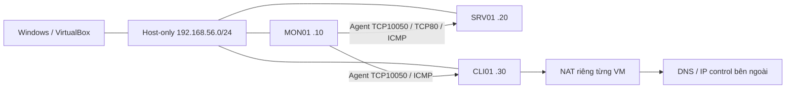
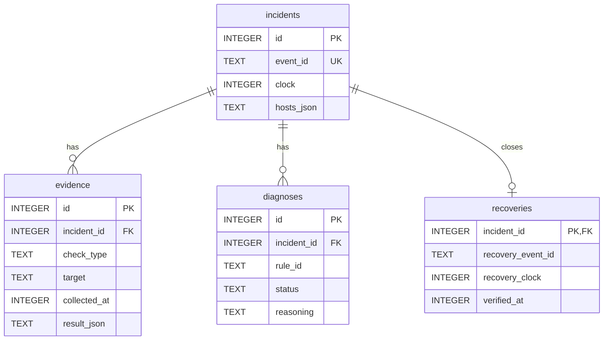

# Chương 2. Kiến trúc và triển khai hệ thống

Nội dung kỹ thuật được đối chiếu trực tiếp trên MON01, SRV01, CLI01 ngày 17/10/2026 (UTC+7), mã nguồn hiện tại và cấu hình đóng băng của thực nghiệm tuần 4. [Biên bản ngày 31](NGAY_31_TUAN_5.markdown) ghi phạm vi, thời điểm và kết quả kiểm tra. Chương này mô tả kiến trúc đã triển khai; hình thức trình bày và đánh số hình cần ghép theo mẫu của trường khi đóng gói báo cáo.

## 2.1. Mục tiêu, phạm vi và thành phần

Hệ thống dùng Zabbix để thu dữ liệu, lưu lịch sử, đánh giá trigger và phát sinh problem/recovery. Module Python nhận một problem được người vận hành chọn, thu bằng chứng hiện tại, đánh giá sáu luật và xuất hồ sơ có giải thích. Khi có `--save`, module lưu incident, evidence và diagnosis vào SQLite. Người vận hành quyết định bước kiểm tra và khắc phục tiếp theo.

| Thành phần | Trách nhiệm đã triển khai | Dữ liệu lưu |
|---|---|---|
| Zabbix server, Agent 2, frontend | Thu dữ liệu, đánh giá trigger, hiển thị problem/history | MySQL của Zabbix |
| Module Python CLI trên MON01 | Kiểm tra event, thu evidence, áp dụng luật, lưu/xuất hồ sơ | SQLite `diagnosis.db` |
| HTTP probe tại SRV01 | Kiểm tra HTTP trên chính IP dịch vụ được xác minh là địa chỉ cục bộ | JSON do người vận hành chuyển về MON01 |
| DNS probe tại CLI01 | Đo DNS và ping IP đối chứng cùng observer | JSON do người vận hành chuyển về MON01 |
| Công cụ thực nghiệm | Gây fault, rollback, poll event và gọi CLI | Log, Run ID, timestamp, report trong evidence |

CLI không phải daemon theo dõi mọi event; sản phẩm chưa có webhook/action tự gọi module, học máy hay tự khắc phục. Watcher và timer rollback thuộc công cụ thực nghiệm, không phải khả năng tự động của sản phẩm. API Zabbix và SQLite là hai nguồn dữ liệu tách biệt, không có transaction chung.

## 2.2. Topology và triển khai máy ảo

Ba VM chạy Ubuntu Server trên VirtualBox, cùng laptop Windows. Mỗi VM có NAT trên `enp0s3` và Host-only trên `enp0s8`. Mạng giám sát là `192.168.56.0/24`; lưu lượng giữa ba IP lab đi trực tiếp trong subnet, không qua gateway chung.

| Máy | IP Host-only | Host ID / tên kỹ thuật trong Zabbix | vCPU / RAM | Vai trò |
|---|---|---|---|---|
| MON01 | 192.168.56.10 | 10084 / `Zabbix server` | 2 / 4096 MB | Zabbix, MySQL, frontend Nginx:8080, Agent 2, Python và SQLite |
| SRV01 | 192.168.56.20 | 10683 / `SRV01` | 1 / 3048 MB | Nginx:80, Agent 2, đích HTTP/Agent/CPU |
| CLI01 | 192.168.56.30 | 10684 / `CLI01` | 1 / 2048 MB | Agent 2, observer DNS và host đối chứng |

Processing Cap hiện tại là 100% trên cả ba VM. Ubuntu quan sát là 26.04.1, kernel `7.0.0-34-generic`; MON01 dùng Python 3.14.4 và API Zabbix 7.0.30 thuộc nhánh 7.0 LTS. Đây là cấu hình lab đã đo, không phải yêu cầu phần cứng tối thiểu chung. [Thông số VirtualBox](../evidence/week5/day31-20261017/virtualbox-runtime.json) và [snapshot ba VM](../evidence/week5/day31-20261017/architecture-audit.json) là nguồn đối chiếu.



Gateway NAT `10.0.2.2` là đầu ra riêng của từng VM. Adapter Windows `.1` không được triển khai thành router trung gian giữa các máy lab. CLI01 dùng DNS stub `127.0.0.53`; đường DNS thực tế xem [resolver và route CLI01](../evidence/week5/day31-20261017/cli01-live.json). R5 dùng firewall HTTP thay phương án lỗi gateway, theo phạm vi đã chốt trước thực nghiệm.

| Luồng | Cổng / giao thức | Ghi chú triển khai |
|---|---|---|
| Windows → frontend MON01 | TCP8080 / HTTP | Dashboard và JSON-RPC `/api_jsonrpc.php` |
| Engine → API trên MON01 | HTTP POST / JSON-RPC 2.0 | URL từ `.env`; token Bearer, timeout 5 giây |
| Zabbix → Agent SRV01/CLI01 | TCP10050 / passive Agent | Template passive; MON01 Agent được truy cập qua 127.0.0.1 |
| MON01 → SRV01 | TCP80 / HTTP và TCP probe | Web scenario và bằng chứng kết nối là hai phép đo khác nhau |
| MON01 → đích/đối chứng | ICMP echo | Probe của CLI; không gọi đây là trigger ICMP đã triển khai |
| CLI01 → resolver | DNS qua cấu hình hệ điều hành | Probe truy vấn A; fault R4 chặn UDP/TCP đích 53 |
| Người vận hành → VM | TCP22 / SSH | Quản trị và chuyển probe, không phải tác vụ remote tự động của engine |

`ServerActive` có trong cấu hình Agent, nhưng bằng chứng về template/item hiện hành là passive; sự tồn tại tùy chọn này không chứng minh đang thu dữ liệu bằng active checks. MySQL dùng cho Zabbix, còn engine chỉ đọc API và ghi SQLite; engine không cần tài khoản MySQL.

## 2.3. Dữ liệu giám sát, item và trigger

### 2.3.1. Các item liên quan trực tiếp

Snapshot kiểm tra gồm 28 item trong phạm vi giám sát thực nghiệm trên ba host. Đây không phải tổng số item được cài trong toàn bộ Zabbix. [Bảng item đối chiếu](../evidence/week5/day31-20261017/item-inventory.csv) ghi ID, key, loại, chu kỳ, master và preprocessing; [snapshot MON01](../evidence/week5/day31-20261017/mon01-live.json) giữ cấu hình và trạng thái lúc kiểm tra.

| Item | Host / ID tiêu biểu | Thu thập / chu kỳ | Ý nghĩa và lưu ý |
|---|---|---|---|
| `agent.ping` | SRV01 / 50782 | Agent passive / 1m | Tuổi mẫu dùng cho bằng chứng Agent; không đồng nhất với availability |
| `zabbix[host,agent,available]` | SRV01 / 50821 | Internal / 1m | Trigger Agent đánh giá availability |
| `system.cpu.util[,idle]` | SRV01 / 50797 | Agent passive / 1m | Master của CPU utilization |
| `system.cpu.util` | SRV01 / 50822 | Dependent / theo master | Preprocessing `100 - value`; delay 0 không có nghĩa không cập nhật |
| `system.cpu.load[all,avg1]` | SRV01 / 50791 | Agent passive / 1m | Load một phút, dùng cùng CPU count |
| `system.cpu.num` | SRV01 / 50793 | Agent passive / 1m | Discard unchanged, heartbeat 1d; không đòi history mới mỗi phút |
| `system.uptime` | SRV01 / 50814 | Agent passive / 30s | Kiểm tra reboot và tính liên tục |
| `vm.memory.util` | SRV01 / 50823 | Dependent / master 50819 | Có thu làm ngữ cảnh; không có luật R7 về RAM |
| `web.test.fail[SRV01 HTTP]` | SRV01 / 51006 | Web scenario / 30s | Mã bước lỗi; 0 nghĩa scenario thành công |
| `web.test.rspcode[SRV01 HTTP,Homepage]` | SRV01 / 51008 | Web scenario / 30s | Mã HTTP của bước kiểm tra |
| `web.test.time[SRV01 HTTP,Homepage,resp]` | SRV01 / 51009 | Web scenario / 30s | Thời gian đáp ứng bước; không phải CLI elapsed |
| `net.dns[,example.com,A,2,1,udp]` | CLI01 / 51011 | Agent passive / 30s | Phép đo DNS từ CLI01 |

Web scenario `SRV01 HTTP` chạy tại Zabbix server, có bước `Homepage` tới `http://192.168.56.20/`, yêu cầu HTTP200, timeout 5s, một lần thử. Việc host của scenario là SRV01 không có nghĩa HTTP request được phát từ SRV01. Probe HTTP nội bộ của Python là phép đo độc lập chạy trên máy dịch vụ.

### 2.3.2. Trigger và quan hệ với sáu luật

| Kịch bản | Trigger dùng trong các lượt chính thức | Điều kiện theo cấu hình hiệu lực |
|---|---|---|
| R1, R2, R5 | 25334 — `SRV01: HTTP check failed` | `last(web.test.fail[SRV01 HTTP]) > 0` |
| R3 | 25260 — Agent không khả dụng | `max(availability, {$AGENT.TIMEOUT}) = 0`; macro = 3m |
| R4 | 25335 — DNS example.com thất bại | `max(DNS item, #3) = 0`: ba giá trị gần nhất đều 0 |
| R6 | 25250 — CPU cao | `min(CPU utilization, 5m) > {$CPU.UTIL.CRIT}`; macro = 90 |

R1 dùng problem HTTP làm đầu vào rồi kết hợp ping/TCP/đối chứng để nghi ngờ mất kết nối; không có trigger ICMP riêng được dùng trong ba lượt R1. Như vậy không tồn tại quan hệ một-một giữa sáu luật và sáu trigger. Bảng [trigger–kịch bản](../evidence/week5/day31-20261017/trigger-scenario-map.csv) lấy event thực tế làm bằng chứng.

Trigger CPU 25250 phụ thuộc trigger load-high 25249. Macro `{$LOAD_AVG_PER_CPU.MAX.WARN}` hiệu lực là 1,5. Tên hàm `last`, `max`, `min`, macro kế thừa và liên kết template được kiểm tra thêm bằng SELECT chỉ đọc vì token API không trả đủ phần này. [Kết quả đối chiếu SQL](../evidence/week5/day31-20261017/critical-sql-reviewed.json) xác nhận ngưỡng và template; không xuất thông tin đăng nhập.

Trigger Zabbix và luật Python có điều kiện khác nhau: trigger CPU dùng min >90 trong 5 phút; R6 dùng mean ≥90 cùng kiểm tra độ phủ và load ≥ số CPU. Không mô tả hai lớp này như cùng một thuật toán hoặc suy ra mọi fault CPU đều tạo event giống nhau.

## 2.4. Luồng xử lý và API Zabbix

```mermaid
sequenceDiagram
    participant O as Người vận hành
    participant P as Python CLI trên MON01
    participant Z as Zabbix API
    participant E as Probe / bằng chứng
    participant Q as SQLite
    O->>P: event-id, host-id, target, scope
    P->>Z: problem.get + event.get
    Z-->>P: Problem còn mở, đúng host
    P->>E: Ping, TCP80/10050; đọc probe JSON
    P->>Z: item.get + history.get
    P->>P: Đánh giá sáu luật
    P->>Z: Kiểm tra lại problem còn mở
    alt Có --save
        P->>Q: BEGIN IMMEDIATE / bundle / COMMIT
    else Preview
        P-->>O: Kết quả, không lưu DB
    end
    O->>P: recovery.py sau phục hồi
    P->>Z: Đọc problem và event recovery liên kết
    P->>Q: Bổ sung recovery đã xác minh
    O->>P: report.py theo incident-id
    P->>Q: Đọc snapshot nhất quán
    P-->>O: JSON / Markdown / CSV
```

Không truyền `--event-id` thì `app.py` chỉ liệt kê problem đang mở trên host được chọn. `--save` bắt buộc có event ID. Khi chẩn đoán, `require_open_event` xác nhận event nằm trong danh sách problem có quyền đọc, ID trả về đúng, `value=1`, `r_eventid=0` và thuộc đúng host. Kiểm tra được lặp sau collection và đánh giá luật; nếu thất bại, không gọi bước lưu bundle. Hai lần kiểm tra không khóa event ở Zabbix trong lúc ghi SQLite: vẫn có khoảng đua giữa kiểm tra cuối và commit.

| API sản phẩm dùng | Công dụng |
|---|---|
| `apiinfo.version` | Kiểm tra phiên bản, không dùng token cho lời gọi này |
| `problem.get` | Problem hiện đang mở trong phạm vi host và quyền truy cập |
| `event.get` | Đọc problem/recovery theo ID và host liên quan |
| `item.get` | Metric cuối, trạng thái item, tuổi mẫu và ID/value_type để lấy history |
| `history.get` | CPU history 300 giây, numeric value_type 0 hoặc 3 |

Các lời gọi API là HTTP POST nhưng chỉ thực hiện phương thức đọc. `zabbix_client.py` nạp URL/token từ `.env`, đặt timeout 5s, kiểm tra HTTP, JSON-RPC envelope, response ID và error/result. Lỗi được chuyển thành thông báo gọn, không in token hoặc nội dung trả về tùy ý. History đạt giới hạn 10.000 dòng bị từ chối như dữ liệu có thể bị cắt; không tính tiếp như đã thu đủ.

`trigger.get`, `httptest.get`, macro/template và SELECT MySQL trong hồ sơ nghiệm thu thuộc công cụ kiểm chứng cấu hình, không phải engine tự quản trị Zabbix. HTTP lab dùng mạng riêng; chưa triển khai TLS cho frontend/API trong cấu hình hiện tại. JSON probe xác minh observer/địa chỉ/thời gian ở mức ứng dụng, chưa có chữ ký bảo đảm người vận hành không sửa file.

## 2.5. Thu thập bằng chứng và tổ chức mã nguồn

| Tệp / module | Vai trò |
|---|---|
| [app.py](../diagnosis-engine/app.py) | CLI, kiểm tra event trước/sau, phối hợp thu và đánh giá, tùy chọn lưu |
| [zabbix_client.py](../diagnosis-engine/zabbix_client.py), [event_parser.py](../diagnosis-engine/event_parser.py) | JSON-RPC và chuẩn hóa event/host |
| [models.py](../diagnosis-engine/models.py) | Dataclass HostRecord, EventRecord, EvidenceRecord, DiagnosisRecord |
| [evidence.py](../diagnosis-engine/evidence.py) | Ping, TCP, DNS collector và metric ngữ cảnh |
| [roadmap_evidence.py](../diagnosis-engine/roadmap_evidence.py) | Agent heartbeat và CPU history/support items |
| [http_probe.py](../diagnosis-engine/http_probe.py), [http_evidence.py](../diagnosis-engine/http_evidence.py) | Tạo/kiểm tra local HTTP JSON |
| [dns_probe.py](../diagnosis-engine/dns_probe.py) | DNS và IP control trên CLI01, gắn observer theo hostname |
| [roadmap_rules.py](../diagnosis-engine/roadmap_rules.py) | Sáu luật roadmap và ba trạng thái |
| [repository.py](../diagnosis-engine/repository.py) | SQLite, transaction bundle, kiểm tra và lưu recovery |
| [recovery.py](../diagnosis-engine/recovery.py), [report.py](../diagnosis-engine/report.py) | Đồng bộ recovery và xuất hồ sơ đã lưu |

`rules.py` và `--ruleset legacy` được giữ để tương thích; đợt thực nghiệm dùng `--ruleset roadmap` (cũng là mặc định hiện tại). Source không tự SSH vào các host khác để thu external probe. HTTP/DNS JSON phải được tạo trên đúng observer rồi chuyển về MON01 trước khi gọi CLI.

Mỗi EvidenceRecord gồm `check_type`, `target`, `collected_at` (Unix UTC), `result`. Ping phát một gói, timeout 2s và timeout tiến trình 3s; TCP80/10050 có timeout 2s. TCP phân biệt `success`, `refused`, `timeout`, `error`; lỗi hệ điều hành như errno113 không tự được đổi thành timeout. Các luật chỉ dùng trạng thái được diễn giải hợp lệ và còn mới.

HTTP JSON giới hạn 64 KiB, đúng một record, schema_version=1, đúng observer, target, port80, path `/`, địa chỉ cục bộ đã xác minh; tuổi từ 0 đến 180s. DNS JSON phải đúng observer và chỉ gồm `dns`/`dns_control_ping`, timestamp integer; luật đối chiếu tên, control IP, record A và freshness. Sự kiểm tra hai định dạng không hoàn toàn giống nhau; không khẳng định DNS có cùng giới hạn 64 KiB của HTTP.

`collect_agent_metric` phân biệt enabled/disabled, missing, no_data, unsupported và success. Với mẫu cũ hơn 180s, collector gắn no_data trước bước đánh giá state; R3 không phải lệnh kiểm tra systemctl. `collect_cpu_history` yêu cầu numeric history hợp lệ, không trùng clock, sắp xếp theo thời gian; CPU count/load được giữ làm dữ liệu hỗ trợ.

## 2.6. Sáu luật và ý nghĩa đầu ra

Mỗi luật tạo `rule_id`, `status`, `probable_cause`, `reasoning`, `missing_info`, `next_actions`. Ba trạng thái là `matched`, `not_matched`, `insufficient_evidence`. `matched` xác nhận tổ hợp điều kiện, không chứng minh duy nhất một nguyên nhân gốc. `not_matched` chỉ bác bỏ điều kiện của luật đó; `insufficient_evidence` không phải host khỏe hoặc lỗi chẩn đoán đã xác định.

| Luật | Điều kiện khớp chính | Điểm cần phân biệt |
|---|---|---|
| R1 — host/kết nối cục bộ | Ping đích no_reply, TCP80 timeout, ping host đối chứng thành công | Đối chứng phải khác đích; người vận hành chọn host cùng subnet. Mã không tự kiểm tra subnet hoặc chứng minh mất nguồn |
| R2 — service/listener HTTP | Ping thành công, TCP80 thất bại; local HTTP không phản bác giả thuyết | TCP refused có thể khớp dù thiếu local HTTP. TCP timeout thiếu local HTTP thì insufficient; local HTTP200 thì not_matched |
| R3 — Agent không khả dụng | Ping thành công, agent.ping no_data, TCP10050 refused/timeout | Một mẫu agent.ping mới trả 1 làm luật not_matched; chưa phân biệt Agent dừng và firewall/allow-list |
| R4 — DNS/resolver/đường DNS | DNS lỗi/timeout/no-answer có thể diễn giải, IP đối chứng cùng observer còn phản hồi | NXDOMAIN có thể do tên sai; A answer không kiểm tra IP có đúng IP kỳ vọng hay không |
| R5 — filtering/đường HTTP | Ping thành công, TCP80 refused/timeout, local HTTP200 | Không tự đọc firewall/packet counter; local HTTP không đi cùng ingress path với MON01 |
| R6 — CPU cao kéo dài | Mean CPU ≥90%, history đủ độ phủ, load ≥ CPU count | Chưa có đối chứng đủ để kết luận ứng dụng chậm do CPU |

R6 cần ít nhất 3 mẫu, clock không trùng/tăng đúng, span ≥240s, max gap ≤120s, mẫu cuối ≤180s; collector thực tế lấy 300s history gần nhất. Giá trị CPU hữu hạn trong [0,100]. Mean là trung bình số học, không dùng trọng số thời gian. CPU count phải là số nguyên ≥1, tuổi ≤86.580s (heartbeat 1 ngày cộng 180s); load hữu hạn không âm, tuổi ≤180s. Nếu mean <90%, luật có thể trả not_matched mà không cần đủ corroboration load/count; nếu mean cao nhưng corroboration thiếu thì insufficient.

Hầu hết evidence dùng tuổi 0–180s. Sai observer, dữ liệu tương lai/cũ, thiếu probe hoặc lỗi lệnh không được dùng như bằng chứng xác nhận fault. Tuy nhiên luật có nhánh trả not_matched sớm khi đã có bằng chứng bác bỏ, nên không nhất thiết mọi đầu vào đều có mặt ở mọi kết quả.

HTTP scope `expected`, `absent`, `unknown` phải khai báo theo vai trò host. `expected` đánh giá R2/R5; `absent` trả not_matched với lý do not applicable; `unknown` trả insufficient cho hai luật. Các trường hợp absent không phải true negative. CLI01 dùng absent trong R4; SRV01 dùng expected trong các lượt dịch vụ.

## 2.7. SQLite và vòng đời incident

SQLite mặc định nằm cạnh `repository.py`, có thể đổi bằng `--db`. Các trường JSON giữ cấu trúc dữ liệu đầy đủ; ID event của Zabbix dùng TEXT, khác incident ID nội bộ INTEGER.



| Bảng | Ràng buộc / nội dung còn lại |
|---|---|
| `incidents` | event_id UNIQUE; clock ≥0; severity 0–5; value 0/1; name, created_at |
| `evidence` | FK incident_id; result_json và timestamp của từng phép thu |
| `diagnoses` | FK incident_id; CHECK ba status; probable_cause, missing_info_json, next_actions_json, created_at |
| `recoveries` | Một hàng mỗi incident; problem_json và recovery_json cùng thông tin xác minh |

`init_db` tạo ba bảng đầu; `recoveries` được tạo bổ sung khi lưu recovery đầu tiên. `save_incident_bundle` bật foreign_keys, mở `BEGIN IMMEDIATE`, chèn/lấy incident theo event_id duy nhất, từ chối nếu đã có evidence hoặc diagnoses rồi mới lưu toàn bộ bundle. Có lỗi thì rollback. Ràng buộc này nằm ở luồng bundle; các hàm lưu từng phần phục vụ tương thích vẫn tồn tại, nên không mô tả SQLite tự cấm mọi kiểu append từ công cụ khác.

| Trạng thái quan sát | Ý nghĩa đúng |
|---|---|
| Event còn mở qua API | Điều kiện đầu vào để chạy app; không phải trạng thái đồng bộ liên tục vào DB |
| Đã lưu bundle, chưa có recovery | `report.py` trả `lifecycle_status=unverified`, `recovery_status=not_recorded`; chưa đủ biết event hiện còn mở hay đã phục hồi |
| Có recovery đã xác minh | `lifecycle_status=closed`, `recovery_status=verified`; giữ nguyên evidence/diagnosis ban đầu |

`recovery.py` đọc problem đã lưu, lấy `r_eventid` rồi đọc recovery. `save_recovery` kiểm tra liên kết event, cùng trigger, source/object trigger events, value problem=1/recovery=0, tập host khớp, clock problem trùng bản lưu và problem ≤ recovery ≤ thời điểm xác minh. Recovery trùng ID/clock là idempotent; recovery xung đột bị từ chối ghi đè. Không sửa `incidents.value` ban đầu thành 0 để giả lập hiện trạng.

`report.py` mở SQLite mode=ro, đọc trong một transaction, xuất JSON schema_version=2, Markdown hoặc CSV. CSV incident có một dòng mỗi diagnosis; CSV thực nghiệm có một dòng mỗi Run ID. Báo cáo công bố cơ sở là evidence đã lưu tại lúc chẩn đoán, không mặc định tái dựng chính xác thời điểm event hoặc sức khỏe hiện tại. Tệp output dùng chế độ không ghi đè.

Schema thật và số hàng lúc ngày 31 được lưu trong [MON01 live snapshot](../evidence/week5/day31-20261017/mon01-live.json): 36 incidents, 268 evidence, 154 diagnoses, 26 recoveries. Các tổng này gồm cả lịch sử trước 18 lượt chính thức; không dùng tổng DB làm mẫu số thực nghiệm.

## 2.8. Cấu hình và vận hành đã triển khai

Source trên MON01 ở `/home/phat/do-an/diagnosis-engine`; bản Windows ở `C:\Users\Darrys\do-an\diagnosis-engine`. Môi trường Python dùng `requests`, `python-dotenv`; `pytest` phục vụ kiểm tra. `.env` cục bộ chứa URL/token và bị loại khỏi Git. Trên SRV01/CLI01, probe dùng Python tiêu chuẩn và các lệnh hệ điều hành (ping, dig cho DNS), không cần token API.

```bash
cd ~/do-an/diagnosis-engine
source .venv/bin/activate
python app.py --host-id 10683
```

Lệnh trên chỉ liệt kê problem. Với fault hiện đang tồn tại trên SRV01, người vận hành chọn event mới rồi chạy cấu hình tương ứng; HTTP probe phải bổ sung cho các lượt R2/R5 theo quy trình thực nghiệm.

```bash
read -r -p 'Problem event ID mới: ' EVENT_ID
python app.py --event-id "$EVENT_ID" --host-id 10683 \
  --target-ip 192.168.56.20 --ruleset roadmap \
  --control-ip 192.168.56.30 --http-service expected --save
```

Các lệnh R2/R5 thêm `--http-observer srv01 --http-evidence <JSON-mới>`. R4 chọn host10684, target `.30`, control R1 `.20`, HTTP absent, `--dns-name example.com --dns-observer cli01 --dns-control-ip 1.1.1.1 --dns-evidence <JSON-mới>`. Không tái sử dụng event tuần 4 đã closed cho một lần chạy app mới.

```bash
python recovery.py --event-id "$EVENT_ID"
read -r -p 'Incident ID đã lưu: ' INCIDENT_ID
python report.py --incident-id "$INCIDENT_ID" --format json
```

Lệnh đầy đủ, cách thu/chuyển probe và rollback xem [README](../README.md), [README module](../diagnosis-engine/README.md), [kịch bản demo](KICH_BAN_DEMO_10_PHUT.md). Ngày 31 chỉ kiểm tra đọc; không tạo fault để minh họa lệnh và không thêm chức năng.

## 2.9. Kiểm chứng, giới hạn và nguồn truy vết

Ngày 31 kiểm tra SSH cả ba VM; Agent và các dịch vụ chính active, HTTP trả 200, ba interface Agent available=1, không có problem mở lúc snapshot. NTP báo synchronized, nhưng không đo được chính xác sai lệch clock giữa VM. Cấu hình trong phạm vi baseline và 40 tệp source/test/requirements/pytest.ini trên MON01 và Windows khớp bản đóng băng. Kết quả thời điểm kiểm tra không thay thế baseline dài hạn hoặc diễn tập ba lần sau reboot.

| Nội dung kiến trúc | Nguồn kiểm chứng |
|---|---|
| IP, route, DNS, service và cấu hình Agent chọn lọc | [MON01](../evidence/week5/day31-20261017/mon01-live.json), [SRV01](../evidence/week5/day31-20261017/srv01-live.json), [CLI01](../evidence/week5/day31-20261017/cli01-live.json) |
| Item, trigger, web scenario và trạng thái host | [Inventory](../evidence/week5/day31-20261017/item-inventory.csv), [trigger map](../evidence/week5/day31-20261017/trigger-scenario-map.csv), snapshot MON01 |
| Hàm trigger, ngưỡng và template kế thừa | [SQL đã đối chiếu](../evidence/week5/day31-20261017/critical-sql-reviewed.json) |
| Schema, foreign key và integrity DB runtime | Snapshot MON01; SQLite mở chỉ đọc |
| Khớp source/config và giới hạn kiểm tra | [Architecture audit](../evidence/week5/day31-20261017/architecture-audit.json) |
| Ví dụ lưu incident/recovery thật | [R2-01, incident22](../evidence/week4/official-runs/R2-01/incident.json), [R6-01, incident34](../evidence/week4/official-runs/R6-01/incident.json) |

SQLite được sao lưu bằng backup API để tạo bản nhất quán. Export YAML host/template không thay backup MySQL, cấu hình daemon hoặc secret. Bản Windows và VM cùng phụ thuộc laptop, chưa phải dự phòng độc lập trước mất/hỏng thiết bị. Baseline chính thức dài 1.806 giây theo lựa chọn phiên ngắn, không gọi là baseline bốn giờ.

R1 ngắt Host-only thay vì tắt nguồn; R4 chặn DNS thay vì chứng minh resolver upstream hỏng; R5 chặn TCP80 thay lỗi gateway. Không suy rộng lab một topology và ba lượt mỗi fault thành chất lượng vận hành doanh nghiệp. Phân tích định lượng thuộc [Chương 3](CHUONG_3_THUC_NGHIEM_VA_DANH_GIA.md); hoàn thiện báo cáo thực nghiệm, diễn tập và release là các đầu việc tiếp theo của tuần 5.
