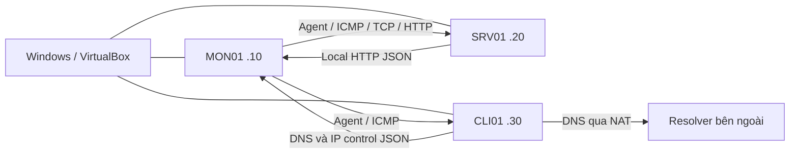
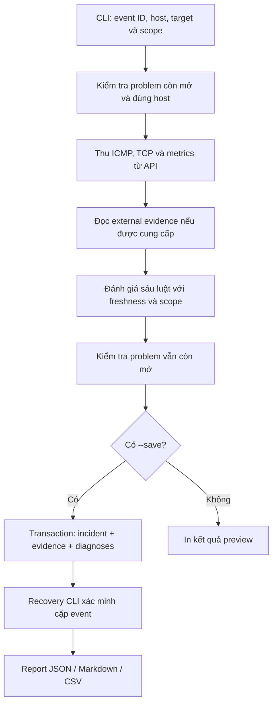

# Chương 2. Kiến trúc và triển khai hệ thống

Bản thảo kỹ thuật theo hệ thống đã chạy ngày 16–17/10/2026. Các tham số và kết quả thực nghiệm dẫn tới bộ evidence tuần 4 trong repository; bản này cần được ghép với Chương 1 và quy chuẩn trình bày của trường trước khi nộp.

## 2.1. Phạm vi triển khai

Hệ thống thu thập dữ liệu bằng Zabbix và bổ sung module Python chạy bằng dòng lệnh để đánh giá bằng chứng cho một problem đang mở. Đầu vào gồm event, host, địa chỉ đích, scope dịch vụ và các probe cần thiết. Đầu ra gồm trạng thái của sáu luật, nguyên nhân nghi ngờ, giải thích, dữ liệu còn thiếu và bước kiểm tra tiếp theo. Khi có `--save`, module lưu một incident cùng evidence và diagnosis trong SQLite.

Module không phải daemon tự động xử lý mọi event. Bộ ghi thử chạy nền trong thực nghiệm chỉ gọi CLI hiện có; timer gây lỗi và script rollback thuộc công cụ vận hành lab. Zabbix và module Python có cơ sở dữ liệu độc lập.

## 2.2. Topology và vai trò máy ảo

Lab chạy trên VirtualBox, gồm ba VM Ubuntu. Mỗi VM có một card NAT và một card Host-only. Giao tiếp giám sát trong lab đi qua mạng Host-only `192.168.56.0/24`; ba host cùng subnet, không có router lab nằm giữa chúng.

| Host | IP Host-only | Vai trò |
|---|---|---|
| MON01 | 192.168.56.10 | Zabbix server, MySQL, frontend Nginx cổng 8080, Agent 2, Python CLI và SQLite |
| SRV01 | 192.168.56.20 | Nginx cổng 80, Agent 2, đích thử HTTP/agent/CPU |
| CLI01 | 192.168.56.30 | Agent 2, observer DNS và host đối chứng cho các lượt SRV01 |

Trong phiên đo, Ubuntu là 26.04.1, kernel `7.0.0-34-generic`; MON01 sử dụng Zabbix 7.0 LTS và Python 3.14.4. SRV01 có một vCPU, Processing Cap 100%, RAM 3048 MB. Đây là thông số quan sát tại phiên đo, không phải yêu cầu tối thiểu áp dụng chung.

CLI01 dùng resolver stub `127.0.0.53`; cấu hình resolver ngoài và output `resolvectl` được lưu trong evidence. Không gán vai trò DNS resolver cho card Host-only chỉ vì card này có IP lab. R5 sử dụng phương án firewall chặn TCP 80 đã được chọn trước thực nghiệm, thay cho gateway chưa triển khai.

## 2.3. Thu thập dữ liệu và phát hiện problem

Agent 2 cung cấp dữ liệu hệ điều hành; Zabbix server thu lịch sử và đánh giá trigger. Web scenario trên MON01 kiểm tra trang chủ SRV01, yêu cầu HTTP 200, chu kỳ 30 giây, timeout 5 giây. Item DNS trên CLI01 là `net.dns[,example.com,A,2,1,udp]`, chu kỳ 30 giây.

| Loại dữ liệu | Item/điều kiện tiêu biểu | Lưu ý khi diễn giải |
|---|---|---|
| HTTP | `web.test.fail[SRV01 HTTP]`, response code/time | HTTP fail không tự chứng minh Nginx đã dừng |
| Agent | `agent.ping`, `zabbix[host,agent,available]` | Heartbeat và availability là hai loại dữ liệu khác nhau |
| CPU | CPU utilization, idle, load 1 phút, CPU count | Cần kiểm tra tuổi mẫu và độ phủ lịch sử |
| DNS | `net.dns[,example.com,A,2,1,udp]` | Observer là CLI01; cần IP đối chứng cùng observer |
| Liên tục | uptime, timestamp, state/error của item | Không suy ra toàn phiên khỏe chỉ từ Problems trống cuối phiên |

Trigger agent dùng availability không sẵn sàng kéo dài ba phút. Trigger CPU dùng CPU cao hơn 90% trong năm phút và có dependency với trigger load cao. CPU count có preprocessing bỏ giá trị không đổi với heartbeat một ngày. Các chi tiết này giải thích vì sao không thể yêu cầu mọi item luôn tạo một history row mới mỗi phút.

Phiên thực nghiệm lưu cấu hình hiệu lực, preprocessing, trigger expression/functions/dependencies và web scenario, thay vì chỉ dựa vào tên file export cũ. API token đọc không nhìn được một số macro kế thừa; phần kiểm chứng thực nghiệm bổ sung SELECT cục bộ chỉ đọc để xác nhận threshold và liên kết template. Engine không dùng quyền MySQL này.

## 2.4. Luồng xử lý của module Python

`app.py` kiểm tra event nằm trong các problem người dùng API có quyền đọc trên host đã chọn. Module đối chiếu event ID, host, value và recovery reference trước khi thu evidence, rồi kiểm tra lại sau collection để giảm nguy cơ lưu chẩn đoán cho problem đã recovery trong lúc đo. Đây không phải cơ chế khóa event xuyên hai hệ thống; vẫn cần công bố thời điểm collection và cơ sở đánh giá là evidence hiện tại.

`zabbix_client.py` cung cấp truy cập JSON-RPC; `event_parser.py` chuẩn hóa event. `evidence.py` thực hiện ICMP, TCP và metrics; `roadmap_evidence.py` thu dữ liệu agent và lịch sử CPU. `http_probe.py` chạy tại SRV01, xác minh địa chỉ đích thuộc máy cục bộ rồi thu HTTP. `dns_probe.py` chạy tại CLI01 và cung cấp cả DNS lẫn IP control cùng observer. Probe ngoài được chuyển sang MON01 khi còn mới; việc chuyển file do người vận hành hoặc công cụ thực nghiệm thực hiện.

`roadmap_rules.py` chứa sáu luật hiện hành. `rules.py` và tùy chọn `legacy` được giữ để tương thích dữ liệu trước; bộ thực nghiệm chính thức dùng `--ruleset roadmap`.

## 2.5. Ý nghĩa sáu luật

| Luật | Tổ hợp bằng chứng chính | Giới hạn kết luận |
|---|---|---|
| R1 | Target không trả lời ping, TCP timeout, host đối chứng còn trả lời | Host hoặc kết nối cục bộ có vấn đề; không khẳng định máy mất nguồn |
| R2 | Target ping được, HTTP từ xa thất bại, local HTTP hỗ trợ lỗi dịch vụ | Nghi ngờ HTTP/service; cần đối chiếu log/process để kết luận nguyên nhân cụ thể |
| R3 | Ping được, agent metric không còn dữ liệu đủ lâu và TCP 10050 thất bại | Agent dừng hoặc đường truy cập agent bị chặn |
| R4 | DNS thất bại nhưng IP control cùng observer còn phản hồi | Nghi ngờ resolver/đường DNS; không chứng minh toàn Internet hoạt động |
| R5 | HTTP từ xa thất bại, local HTTP 200, host vẫn reachable | Nghi ngờ lọc hoặc đường truy cập HTTP; không xác định riêng firewall bằng hai probe này |
| R6 | Mean CPU ít nhất 90%, lịch sử đủ độ phủ, load ít nhất bằng CPU count | CPU/load gợi ý quá tải; chưa tự chứng minh ứng dụng chậm do CPU |

Mỗi luật trả một trong ba trạng thái: `matched`, `not_matched`, `insufficient_evidence`. Lỗi probe, dữ liệu cũ hoặc sai observer không được chuyển thành bằng chứng xác nhận fault. Hầu hết evidence yêu cầu tuổi không quá 180 giây. R6 yêu cầu ít nhất ba mẫu, span tối thiểu 240 giây, khoảng cách không quá 120 giây và mẫu cuối không quá 180 giây. CPU count cho phép tuổi tới 86.580 giây do heartbeat một ngày cộng 180 giây dự phòng; load vẫn phải mới.

Mean CPU trong R6 là trung bình số học các mẫu hợp lệ, không phải tích phân có trọng số thời gian. Trigger CPU có dependency với load-high; bộ thử một worker chưa bao phủ trường hợp load-high trở thành problem và ảnh hưởng việc phát sinh event CPU. Vì vậy không suy rộng kết quả R6 thành phát hiện mọi dạng quá tải.

HTTP scope phải khai báo theo vai trò host trước khi biết kết quả. Khi scope `absent` trên CLI01, R2/R5 không áp dụng; không được đếm các kết quả này như true negatives. Nếu thiếu evidence, luật giữ trạng thái thiếu dữ liệu ngay cả khi người vận hành biết fault đã tạo là gì.

## 2.6. SQLite và incident lifecycle

`repository.py` tạo các bảng `incidents`, `evidence`, `diagnoses`; recovery được lưu bổ sung vào `recoveries`. `incidents.event_id` là duy nhất. Evidence và diagnosis tham chiếu incident qua foreign key; payload chi tiết được lưu dạng JSON kèm timestamp.

`save_incident_bundle` dùng transaction `BEGIN IMMEDIATE`. Nếu incident đã có evidence hoặc diagnoses, module từ chối thêm bundle trùng hoặc trộn hai lần thu. Việc nhận ra cùng event không đồng nghĩa được phép ghi đè bằng chứng cũ.

`recovery.py` chỉ lưu recovery sau khi kiểm tra event liên kết đúng problem, cùng trigger, đúng value và thứ tự thời gian. Recovery được bổ sung vào hồ sơ; evidence và chẩn đoán ban đầu vẫn giữ nguyên. Trạng thái lifecycle `closed` là kết quả đã đồng bộ recovery, không phải sửa diagnosis thành tình trạng khỏe sau khi service chạy lại.

`report.py` xuất JSON, Markdown hoặc CSV từ SQLite. Một incident CSV có nhiều dòng diagnosis; bảng thực nghiệm `all-trials.csv` có một dòng cho mỗi fault trial. Hai loại CSV có đơn vị quan sát khác nhau nên không được cộng số dòng để suy ra số lượt thử.

## 2.7. Tái lập và giới hạn vận hành

Hướng dẫn lệnh nằm trong README của repository; bộ dữ liệu chính nằm ở `evidence/week4/official-runs`. Source tham chiếu `ca04071`, config export `978b4f9`, protocol `4cabeb0`; hash toàn bộ source và snapshot hiệu lực xác định phiên bản thật của đợt đo.

Các fault được tạo từng loại, có timer hoặc thời hạn và rollback độc lập. Mỗi lượt giữ timestamp trước/sau thao tác, event/recovery ID, CLI elapsed, external probe và report. Baseline mới dài 1.806 giây theo lựa chọn phiên ngắn; không gọi đây là baseline bốn giờ. Test tự động kiểm tra module nhưng không thay thế fault thật, kiểm tra cấu hình hay độ liên tục của dữ liệu.

Token API nằm trong `.env` cục bộ, không đưa vào repository hoặc report. SQLite được backup bằng backup API để tạo bản nhất quán. Export YAML của Zabbix mô tả host/template, không thay thế toàn bộ MySQL hoặc cấu hình daemon. Bản Windows và bản MON01 tạo hai bản sao vận hành; cả hai VM và repository vẫn phụ thuộc cùng laptop, nên chưa phải dự phòng độc lập trước hỏng/mất thiết bị.
