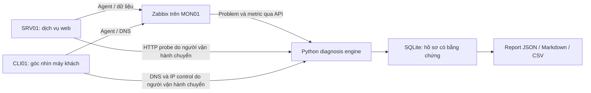

# Giới thiệu và giải thích đồ án giám sát mạng

Bản giới thiệu cập nhật theo cleanup ngày 17/10/2026. Kết quả thực nghiệm tuần 4–5 được giữ là kết quả lịch sử; phần cleanup có kiểm thử hồi quy riêng.

## 1. Đồ án làm gì?

Tên đề tài: **Xây dựng hệ thống giám sát tập trung, cảnh báo và hỗ trợ chẩn đoán sự cố cho hạ tầng mạng doanh nghiệp nhỏ**.

Đồ án hiện thực một lab ba máy ảo để giải quyết câu hỏi: khi một dịch vụ không truy cập được, hệ thống có thể thu thập bằng chứng nào để người quản trị khoanh vùng nguyên nhân?

Zabbix phát hiện bất thường và hiển thị cảnh báo. Module Python do đồ án xây dựng đọc một problem, thu dữ liệu bổ sung, áp dụng các luật và lưu hồ sơ có giải thích. Kết quả giúp người vận hành biết vì sao một giả thuyết được đặt ra, dữ liệu nào còn thiếu và nên kiểm tra gì tiếp.

Tên đề tài hướng tới doanh nghiệp nhỏ, nhưng kết quả thực nghiệm hiện chỉ được kiểm chứng trong lab. Chưa triển khai hoặc đánh giá trên một mạng doanh nghiệp thực tế.

## 2. Vì sao chỉ có cảnh báo vẫn chưa đủ?

Giả sử Zabbix báo “HTTP check failed”. Cảnh báo đó chưa trả lời được liệu:

- Máy chủ mất liên lạc.
- Dịch vụ web không còn lắng nghe.
- Chính sách truy cập chặn kết nối từ máy giám sát.

Cùng một biểu hiện bên ngoài có thể tương ứng nhiều tình huống. Đồ án bổ sung các phép kiểm tra như ping, TCP, HTTP từ chính máy dịch vụ, DNS từ máy khách và lịch sử CPU. Các bằng chứng được đối chiếu với nhau trước khi đưa ra nhận định sơ bộ.

Ví dụ, máy chủ còn ping được, TCP 80 từ xa thất bại, nhưng HTTP nội bộ trả 200 thì giả thuyết “Nginx đã dừng” không được hỗ trợ. Hệ thống chuyển sang nghi vấn đường truy cập hoặc filtering; người vận hành vẫn cần kiểm tra firewall/route để xác định nguyên nhân cụ thể.

## 3. Mô hình ba máy ảo

| Máy | Địa chỉ lab | Chức năng |
|---|---|---|
| MON01 |192.168.56.10|Zabbix, MySQL, giao diện web, Python diagnosis engine và SQLite|
| SRV01 |192.168.56.20|Máy chủ web Nginx, Agent2; đích thử HTTP/Agent/CPU|
| CLI01 |192.168.56.30|Máy khách, observer DNS, host đối chứng|

Lab chạy Ubuntu Server trên VirtualBox. Mỗi máy có NAT để ra ngoài và Host-only để trao đổi nội bộ. Ba IP trên cùng subnet; chưa có gateway lab chung giữa chúng. Giao diện Zabbix là `http://192.168.56.10:8080/`.

Các mũi tên probe mô tả luồng dữ liệu, không phải engine tự SSH hoặc gọi một dịch vụ probe đang chạy nền.

## 4. Hai phần chính của hệ thống

### Zabbix: giám sát và phát hiện

Zabbix thu chỉ số từ Agent và các phép kiểm tra dịch vụ. Item mô tả giá trị cần thu; trigger mô tả điều kiện bất thường. Khi điều kiện thỏa, Zabbix tạo problem; khi điều kiện phục hồi, có recovery event liên kết. Dashboard giúp xem trạng thái và lịch sử.

Trong lab có web scenario kiểm tra HTTP 200 của SRV01, item DNS trên CLI01, availability của Agent và CPU/load. Zabbix sử dụng MySQL cho dữ liệu của nó.

### Diagnosis engine: đánh giá và giải thích

Module Python là chương trình dòng lệnh do người vận hành gọi. Nó xác minh event, thu bằng chứng hiện tại, chạy sáu luật, giải thích kết quả và có thể lưu SQLite. Module không tự giám sát tất cả event, không tự sửa dịch vụ và không dùng mô hình AI để suy luận.

Từ “chẩn đoán” ở đây là khoanh vùng có bằng chứng, chưa phải khẳng định một nguyên nhân gốc duy nhất.

## 5. Một sự cố được xử lý ra sao?

Ví dụ diễn tập dừng Nginx trên SRV01:

1. Kiểm tra trạng thái nền và đặt timer khôi phục dự phòng trước khi gây lỗi.
2. Người vận hành dừng Nginx; web scenario thất bại và Zabbix tạo problem HTTP mới.
3. Chọn event ID; engine kiểm tra đó là problem còn mở thuộc đúng host.
4. Thu ping/TCP/metric; người vận hành tạo HTTP probe mới tại SRV01 và chuyển JSON về MON01.
5. Khai báo HTTP scope `expected`. Engine thấy ping còn phản hồi, TCP 80 từ xa bị từ chối và local HTTP thất bại; luật R2 khớp, có giải thích và bước kiểm tra tiếp.
6. Engine kiểm tra lại event còn mở; có --save thì lưu incident, evidence và kết quả sáu luật trong một transaction.
7. Người vận hành bật lại Nginx. Khi Zabbix có recovery, recovery.py xác minh cặp event và bổ sung thông tin phục hồi.
8. Mở report đã lưu để xem event, bằng chứng lúc chẩn đoán, kết quả luật và recovery; không sửa bằng chứng lỗi thành trạng thái khỏe.

Timer và script gây lỗi/rollback là công cụ thực nghiệm, không phải tính năng tự khắc phục của sản phẩm.

## 6. Sáu nhóm tình huống đang được hỗ trợ

| Luật | Kiểm tra điều gì? | Kết luận có giới hạn |
|---|---|---|
|R1|Ping/TCP đích và host đối chứng|Nghi host hoặc kết nối cục bộ; chưa chứng minh mất nguồn|
|R2|Kết nối HTTP từ xa và HTTP trên máy dịch vụ|Nghi service/listener hoặc active rejection; chưa khẳng định Nginx đã dừng|
|R3|Ping, tuổi mẫu agent.ping và TCP 10050|Nghi Agent không khả dụng hoặc đường truy cập bị chặn|
|R4|DNS và IP control từ cùng máy khách|Nghi phân giải/đường DNS; NXDOMAIN có thể do tên sai|
|R5|Remote TCP 80 thất bại nhưng local HTTP 200|Nghi filtering/đường HTTP; chưa chứng minh riêng firewall|
|R6|Lịch sử CPU, độ phủ mẫu, load và CPU count|Nghi CPU cao kéo dài; chưa chứng minh ứng dụng chậm do CPU|

Sáu luật không tương ứng sáu trigger riêng: R1/R2/R5 đều đã dùng cùng problem HTTP trong thực nghiệm. Module phân biệt bằng evidence bổ sung. Dữ liệu RAM/disk có được thu làm ngữ cảnh hoặc phục vụ legacy, nhưng chưa phải luật mới trong bộ roadmap sáu luật này.

## 7. Tại sao có ba trạng thái kết quả?

| Trạng thái | Cách hiểu |
|---|---|
|matched|Bằng chứng hiện có thỏa tổ hợp điều kiện của luật|
|not_matched|Điều kiện của luật không thỏa; không có nghĩa toàn host khỏe|
|insufficient_evidence|Thiếu dữ liệu, dữ liệu cũ/lỗi hoặc chưa cô lập được giả thuyết|

Ví dụ, CPU history chỉ phủ 239 giây trong khi luật cần 240 giây thì giữ insufficient_evidence. Không hạ ngưỡng chỉ để hồ sơ có kết quả “đẹp”. Khi host không cung cấp HTTP theo thiết kế, R2/R5 được đánh dấu không áp dụng bằng lý do trong not_matched; không tính thành một mẫu âm đúng.

CLI và lời gọi Python cùng mặc định HTTP là `unknown`: khi chưa biết máy có cung cấp web hay không, R2/R5 giữ trạng thái thiếu bằng chứng. Phải khai báo `expected` cho web server, hoặc `absent` cho host không cung cấp HTTP. Cách này tránh gán lỗi dịch vụ chỉ vì một cổng vốn không cần mở.

## 8. Hồ sơ lưu gì và vì sao cần lưu?

SQLite lưu bốn nhóm dữ liệu: incident gắn event ID; evidence có thời điểm/đối tượng đo; diagnoses có luật, nhận định và thông tin thiếu; recovery đã xác minh.

Một event đã có bundle không được ghép tùy ý evidence từ lần thu khác. Khi phục hồi, giữ nguyên bằng chứng ban đầu để người khác kiểm tra lại vì sao engine đưa ra nhận định lúc đó.

Chưa lưu recovery thì report là `unverified`, không mặc định sự cố vẫn mở. Có recovery đã xác minh thì `closed`, không đồng nghĩa xác nhận host hiện tại vẫn khỏe. Report hỗ trợ JSON để trao đổi dữ liệu, Markdown để đọc và CSV để xử lý bảng.

## 9. Đồ án đã kiểm chứng được gì?

Tại mốc kỹ thuật tuần 5 ngày17/10/2026:

- Có 18 fault hợp lệ, sáu nhóm và ba lượt mỗi nhóm; mục tiêu của từng lượt đều matched, tức 18/18 trong đúng bộ thử này.
- Baseline mới dài 30 phút 06 giây theo lựa chọn phiên ngắn; không có problem mới trong cửa sổ đã kiểm tra.
- Có 280 tests đạt trên MON01 và 280 tests đạt trên Windows; hai kết quả không phải 560 lượt fault thực tế.
- Ba lượt diễn tập HTTP sau reboot đã tạo problem, lưu incident và xác minh recovery; thời lượng luồng kỹ thuật khoảng67,88s,59,03s,60,75s. Chưa bao gồm bài nói10 phút.
- Có raw log, ID liên kết, CSV, hình, snapshot cấu hình và checksum; đã thử phục hồi Git bundle và SQLite backup.

18/18 không phải accuracy tổng quát100%: chưa có tập âm độc lập để tính true negatives hoặc false-positive rate. Mẫu nhỏ, cùng host/topology, chưa đánh giá nhiều lỗi đồng thời hoặc vận hành dài hạn. Ảnh dự phòng event lịch sử không được gọi là ảnh lỗi đang xảy ra.

## 10. Đóng góp của đồ án

Phần kế thừa là nền tảng Zabbix, Agent, MySQL, Nginx và công cụ mạng. Phần xây dựng là luồng đọc/xác minh problem, cấu trúc evidence, các luật có trạng thái thiếu dữ liệu, hồ sơ SQLite chống trộn lần thu, xác minh recovery và report có thể truy vết.

Phần thực nghiệm gồm mô hình lab, các fault có rollback, đo thời gian và đối chiếu nhận định với lỗi chủ động tạo. Chưa có đối chứng đủ để kết luận đã giảm thời gian vận hành thủ công hoặc tốt hơn mọi giải pháp giám sát khác.

## 11. Hướng phát triển tiếp

Các hướng phù hợp là quản lý cấu hình host/observer linh hoạt, version hóa rule và assessment, bổ sung luật có bằng chứng rõ, thêm giao diện đọc hồ sơ hoặc worker xử lý event có kiểm soát. Mỗi hướng cần test, dữ liệu đánh giá và tương thích hồ sơ cũ.

Muốn đánh giá chất lượng rộng hơn cần thêm mẫu âm gắn nhãn, nhiều host/topology/tải và baseline dài; muốn nói về tác động ứng dụng cần thêm response-time đối chứng. Chưa có căn cứ để coi việc thêm AI hoặc tự khắc phục là bước bắt buộc tiếp theo.

## 12. Đọc tiếp ở đâu?

- Dành cho AI/người viết tính năng: [Logic engine và bàn giao phát triển](DIAGNOSIS_ENGINE_LOGIC_VA_PHAT_TRIEN.md).
- Tự cài/chạy lab: [Hướng dẫn cài đặt và khôi phục](HUONG_DAN_CAI_DAT_VA_KHOI_PHUC.md).
- Kiến trúc đầy đủ: [Chương 2](CHUONG_2_KIEN_TRUC_VA_TRIEN_KHAI.md).
- Phương pháp và kết quả: [Chương 3](CHUONG_3_THUC_NGHIEM_VA_DANH_GIA.md).
- Trạng thái bàn giao: [Tổng hợp tuần 5](TONG_HOP_TUAN_5.markdown).

Thông tin kết quả ở tài liệu này gắn với mốc tuần 5, không phải kiểm tra live mới tại thời điểm người khác mở file. Hai bản backup C:/D: nằm trên hai ổ NVMe cùng laptop; bản ngoài thiết bị, định dạng theo mẫu trường và năng lực trình bày của người thực hiện cần xác nhận riêng trước nộp.

## 13. Code được tổ chức thế nào để dễ giải thích và phát triển?

`app.py` điều phối theo thứ tự: kiểm tra tham số → xác minh event → thu evidence → đánh giá luật → kiểm tra lại event → hiển thị → lưu khi có yêu cầu. `models.py` mô tả dữ liệu trao đổi; `policy.py` giữ phạm vi HTTP và ngưỡng roadmap; `roadmap_rules.py` chứa điều kiện sáu luật; `repository.py` chịu trách nhiệm SQLite. Recovery và report có chương trình riêng.

HTTP/DNS dùng chung lớp kiểm tra file ngoài, sau đó kiểm tra nội dung riêng của từng phép đo. File sai cấu trúc, sai observer, quá lớn hoặc hết hạn bị từ chối rõ ràng. Một phép đo hợp lệ nhưng gặp lỗi công cụ vẫn được giữ là evidence lỗi để luật trả thiếu bằng chứng. Việc này phân biệt “không đo được” với “đã chứng minh dịch vụ hỏng”.

Bản cleanup đạt **355 kiểm thử trên Windows và MON01**, giữ nguyên **108 kết quả luật của 18 hồ sơ cũ** khi replay và khớp bản trước trên **576 tổ hợp đầu vào tường minh**. Ba file DNS và sáu file HTTP gốc vẫn đọc được ở thời gian lịch sử. Đây là kiểm chứng hồi quy; không thay thế thử fault mới hoặc chứng minh độ chính xác trên mọi mạng.

Khi bảo vệ, nên mở `app.main()` để giải thích luồng, chọn R2/R5 để chứng minh vai trò của các góc nhìn, rồi mở một report cũ để chỉ ra evidence, reasoning và recovery. Tài liệu kỹ thuật kèm theo có bảng đọc source theo từng bước và đoạn trình bày ngắn ở mục 16.

Source đã đồng bộ trên MON01; HTTP probe trên SRV01 và DNS probe trên CLI01 đã kiểm tra bằng phép đo thật ở trạng thái bình thường. SQLite và cấu hình bí mật giữ nguyên. MON01 có một lần mất phản hồi trong phiên làm việc, được người thực hiện reset rồi kiểm tra lại trước khi cập nhật; nguyên nhân gián đoạn VM chưa được kết luận.
