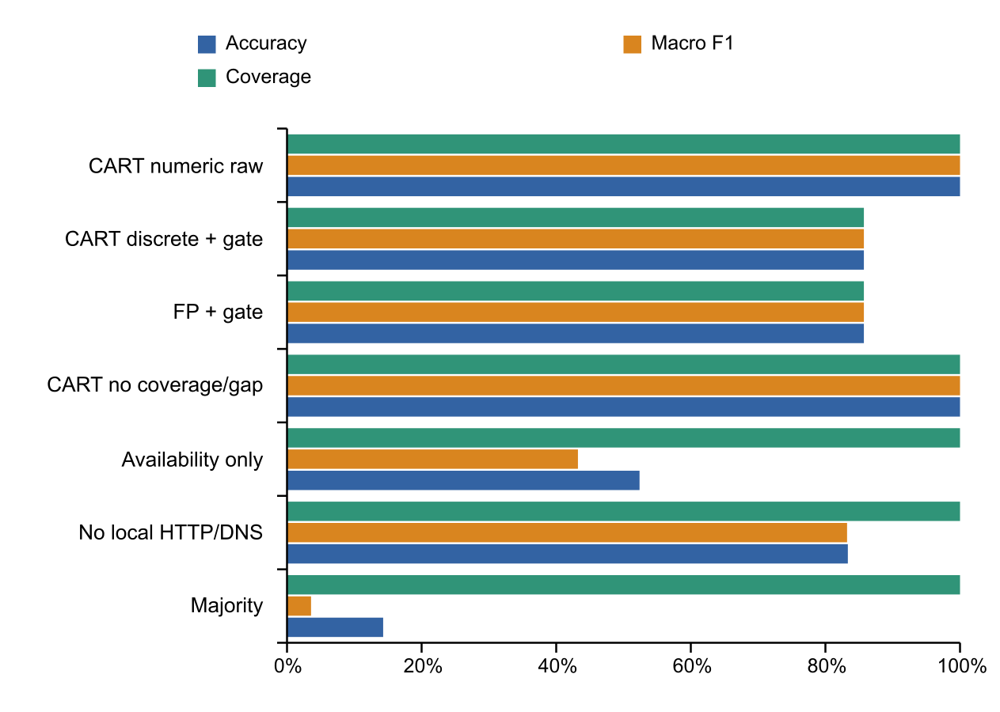
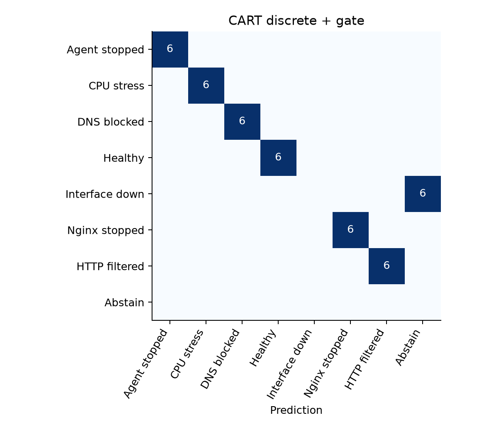
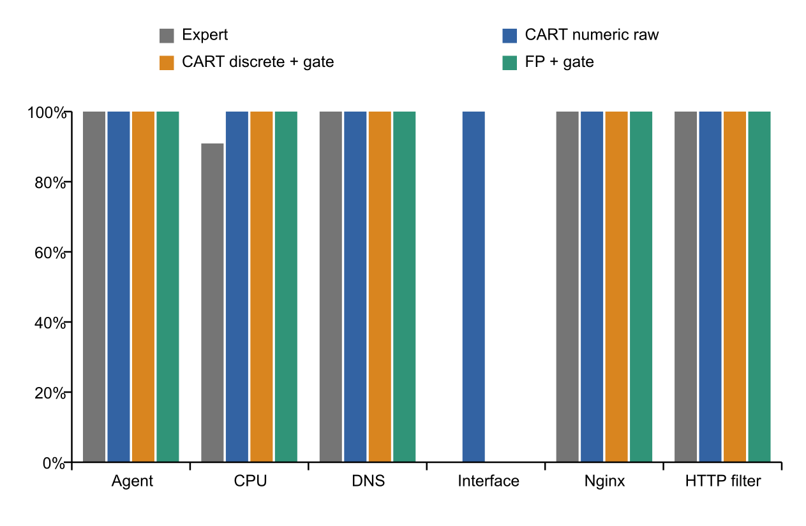

# Báo cáo tổng hợp đồ án giám sát mạng và học luật

Chuyên đề Công nghệ thông tin

Mốc tổng hợp ngày 31 tháng 10 năm 2026

## Tóm tắt kết quả

Đồ án đã xây dựng lab giám sát ba máy ảo, mô đun Python hỗ trợ chẩn đoán theo luật chuyên gia và một nhánh nghiên cứu học luật từ dữ liệu can thiệp lỗi có kiểm soát. Zabbix đảm nhiệm thu chỉ số và tạo problem theo trigger; mô đun chuyên gia đối chiếu bằng chứng; CART và bộ phân loại luật kết hợp dùng FP Growth đưa ra đề xuất trong chế độ nghiên cứu shadow.

Giai đoạn học máy đã có 42 lượt pilot hợp lệ để phát triển và 42 lượt test mới thu sau khi khóa cấu hình. CART numeric nghiên cứu đúng 42/42; hai pipeline phục vụ qua SQLite là CART discrete có gate và FP có gate đúng 36/42, từ chối cả sáu lượt ngắt interface. Các kết quả này chỉ áp dụng cho bảy trạng thái lab đã định nghĩa trên cùng SRV01, không phải độ chính xác triển khai doanh nghiệp.

Bản chốt ML là commit `8ba97a7bab5debb24f6eeb852fd59f49c66462d7`. Đã chạy demo Nginx thật, kiểm tra tương đương Python và SQLite, đối chiếu 42 kết quả shadow lúc can thiệp và backup có kiểm tra khôi phục. Ba VM được tắt theo yêu cầu sau nghiệm thu; trạng thái và backup lạnh được trình bày ở phần sao lưu. [E1] [E2]

## 1 Bối cảnh và câu hỏi nghiên cứu

### 1.1 Bài toán của đồ án

Tên đề tài là Xây dựng hệ thống giám sát tập trung cảnh báo và hỗ trợ chẩn đoán sự cố cho hạ tầng mạng doanh nghiệp nhỏ. Cùng một cảnh báo HTTP không truy cập được có thể xuất phát từ máy mất liên lạc, service không lắng nghe hoặc đường truy cập bị lọc. Một event riêng lẻ chưa đủ để khẳng định nguyên nhân.

Đồ án bổ sung các góc nhìn ping, TCP, HTTP tại chính máy dịch vụ, DNS tại observer, chỉ số tài nguyên và host đối chứng. Mục tiêu là khoanh vùng có giải thích, lưu lại bằng chứng và cho biết khi nào chưa đủ dữ liệu. Việc thực hiện hiện tại là phòng lab VirtualBox; chưa có bằng chứng triển khai doanh nghiệp hay thử trên Ubuntu PC thật. [E3]

### 1.2 Câu hỏi nghiên cứu của phần học máy

Phần nâng cấp xem xét ba câu hỏi. Thứ nhất, cùng một bộ quan sát có thể phân biệt các can thiệp lỗi đơn đã biết tới mức nào. Thứ hai, luật học được có thể xuất thành dữ liệu SQLite và tái hiện kết quả của mô hình hay không. Thứ ba, sự thiếu dữ liệu, góc nhìn đo và chính sách từ chối ảnh hưởng thế nào đến kết luận.

Luật chuyên gia là đối chứng về suy luận theo từng giả thuyết. CART numeric là đối chứng nghiên cứu trên dữ liệu số. CART discrete và FP dùng chung cách chia bins và cùng gate phục vụ để so hai cách học luật. Không đặt yêu cầu máy học bắt buộc phải thắng chuyên gia.

### 1.3 Đối chiếu yêu cầu mở rộng với kết quả

| Hạng mục | Kết quả ở mốc tổng hợp | Phần còn lại |
|---|---|---|
| Máy thật và tạo lỗi | Đã can thiệp có kiểm soát trên SRV01 VM | Chưa có PC Ubuntu thật hoặc video trên PC thật |
| Chuẩn hóa vector | Whitelist 7 biến trạng thái và 5 biến số thuộc các nhóm đo | Không phải đúng 5 đến 7 scalar; chưa có Parent Node Status thật |
| Bảng quyết định SQLite | Có 7 lá CART và 19 luật FP, kiểm chứng serialization | Chưa thay toàn bộ luật chuyên gia trong engine vận hành |
| Học luật từ dữ liệu | Đã thực hiện CART và FP Growth với train và test mới | Cần thêm host và tình huống ngoài các lớp lab |
| Multi fault và alert storm | Chưa được nghiệm thu bởi bộ dữ liệu lỗi đơn | Cần nhãn đa lỗi, topology và thí nghiệm correlation riêng |
| So sánh đối chứng | Có bảng chất lượng, coverage, latency và ablation | Chưa có benchmark scalability hoặc độ trễ dispatch production |

Không cộng các hạng mục này thành một tỷ lệ hoàn thành toàn đồ án khi chưa có trọng số đã thống nhất. Trạng thái đã chốt là nghiệm thu ban đầu phần ML trên ba VM. [E1] [E4]

## 2 Kiến trúc và môi trường

### 2.1 Mô hình lab

| Nút | Địa chỉ Host only | Vai trò |
|---|---|---|
| MON01 | 192.168.56.10 | Zabbix, MySQL, giao diện web và diagnosis engine |
| SRV01 | 192.168.56.20 | Nginx, Zabbix Agent2 và đích can thiệp lỗi ML |
| CLI01 | 192.168.56.30 | Client và host đối chứng của đường mạng lab |
| Windows host | Máy chạy VirtualBox | Điều phối SSH, học máy, SQLite nghiên cứu và lưu evidence |

Ba VM dùng Host only cùng subnet và NAT để truy cập ngoài. CLI01 là peer đối chứng, không phải router hay parent của SRV01. IP 1.1.1.1 được dùng làm IP control cho quan sát DNS; nó cũng không phải gateway lab. Giao diện Zabbix theo cấu hình lab là `http://192.168.56.10:8080/`.

Metadata đã lưu khi thực nghiệm ghi Ubuntu 26.04 trên VM và Zabbix 7.0.30. Đây là phiên bản quan sát trong lab, không phải yêu cầu cập nhật hệ điều hành hay khẳng định phiên bản mới nhất của sản phẩm. [E3] [E5]

### 2.2 Các luồng xử lý

Luồng baseline bắt đầu từ problem do người vận hành chọn. Engine xác minh event, thu bằng chứng hiện tại, chạy sáu luật, in giải thích và chỉ ghi SQLite khi có `--save`. Sau khi dịch vụ phục hồi, một lệnh riêng xác minh recovery và bổ sung hồ sơ. Baseline không tự SSH tới mọi host, không tự sửa lỗi và chưa có daemon tự gọi chẩn đoán cho mọi event.

Luồng nghiên cứu chạy từ Windows. Collector dùng SSH để thực hiện chương trình probe ở đúng observer, lấy metric qua MON01, lưu raw observation và chuyển thành vector. Shadow đánh giá chuyên gia và hai bộ luật ML trên cùng observation. Nó không ghi chẩn đoán ML vào database incident, không thay trigger và không kích hoạt luật vào engine vận hành.

Việc nghiên cứu có SSH và script rollback không có nghĩa baseline đã có tính năng tự sửa sự cố. Rollback chỉ phục hồi can thiệp do thí nghiệm sở hữu. [E6]

### 2.3 Phân biệt các nơi lưu dữ liệu

| Kho dữ liệu | Chứa gì | Không được nhầm với |
|---|---|---|
| MySQL của Zabbix trên MON01 | Item, history, trigger và event giám sát | SQLite luật ML |
| diagnosis.db trên MON01 | Incident, evidence, diagnosis và recovery của baseline | Dataset dùng train |
| candidate_rules.sqlite trong evaluation | Điều kiện và thống kê train của CART và FP | Luật production đã phê duyệt |
| research_registry.sqlite trong evaluation | Dataset, model, rule, evaluation và lifecycle nghiên cứu | Lịch sử incident đang vận hành |
| Raw observation và log trên Windows | Cửa sổ đo, nhãn xác minh, log can thiệp, hash và metadata | Một log alert production tự gán nhãn |

## 3 Mô đun chẩn đoán theo luật chuyên gia

### 3.1 Sáu câu hỏi chẩn đoán

| Luật | Bằng chứng chính | Giới hạn kết luận |
|---|---|---|
| R1 | Ping, TCP đích và host đối chứng | Nghi host hoặc đường kết nối; không chứng minh mất nguồn |
| R2 | TCP80 từ xa và HTTP trên máy dịch vụ | Nghi service hoặc listener; không khẳng định duy nhất Nginx |
| R3 | Ping, agent.ping, tuổi mẫu và TCP10050 | Nghi Agent hoặc đường truy cập Agent |
| R4 | DNS và IP control ở cùng observer | Nghi phân giải hoặc đường DNS; NXDOMAIN có thể do tên sai |
| R5 | TCP80 từ xa thất bại nhưng HTTP local 200 | Nghi lọc hoặc đường truy cập HTTP; chưa cô lập riêng firewall |
| R6 | History CPU, độ phủ, khoảng cách mẫu, load và số CPU | Nghi CPU cao kéo dài; chưa chứng minh nguyên nhân ứng dụng chậm |

Các luật được đánh giá theo từng giả thuyết. Nhiều luật có thể cùng khớp hoặc cùng thiếu bằng chứng; hệ thống không chọn một nguyên nhân gốc duy nhất bằng cách lấy luật đầu tiên.

### 3.2 Ý nghĩa trạng thái

`matched` nghĩa là bằng chứng thỏa điều kiện của luật. `not_matched` nghĩa là điều kiện đó không thỏa, không có nghĩa toàn bộ host khỏe. `insufficient_evidence` nghĩa là thiếu, cũ, sai nguồn hoặc chưa đủ khả năng phân biệt giả thuyết.

HTTP scope phải được khai báo. Web server dùng `expected`; host không cung cấp HTTP theo thiết kế dùng `absent`; chưa biết thì giữ `unknown`. Không dùng việc cổng đóng vốn hợp lệ làm bằng chứng một dịch vụ đã hỏng.

Hồ sơ baseline lưu bằng chứng ở thời điểm chẩn đoán và không thay nó bằng dữ liệu khỏe sau phục hồi. Report `unverified` là chưa lưu recovery đã xác minh; `closed` nghĩa có recovery liên kết đã kiểm tra, không chứng minh host còn khỏe ở thời điểm mở report sau này. [E6]

### 3.3 Kết quả lịch sử và kết quả mới

Mốc tuần 5 ngày 17/10 có 18 lượt fault, sáu nhóm và ba lượt mỗi nhóm, với giả thuyết mục tiêu khớp 18/18 trong bộ thử đó. Đây không phải accuracy bảy lớp và không có tập âm độc lập để suy ra FPR production.

Các log lịch sử của baseline ghi 280 tests ở mốc tuần 5, 355 tests sau cleanup và 369 tests sau tối ưu. Chúng thuộc các commit và lần chạy khác nhau; không cộng thành số fault thật, cũng không coi kết quả lịch sử là một lần chạy lại trong phiên viết báo cáo. Đợt ML chốt ngày 31/10 có 57 tests đạt; đó là bộ kiểm tra ML riêng. [E3] [E7]

## 4 Thu thập dữ liệu và gán nhãn

### 4.1 Đơn vị thực nghiệm

Một run là một lần can thiệp có đăng ký, log xác minh, hai cửa sổ quan sát và bước khôi phục. Quy tắc chọn mẫu được chốt trước: chỉ dùng cửa sổ cuối của mỗi run hợp lệ để tạo một dòng dataset. Hai cửa sổ cùng run không được tính thành hai fault độc lập.

Collector thực hiện cùng tập phép đo trong healthy và mọi fault. Nhãn không được đưa vào profile hay observation; planned label được giữ riêng trong registry. Nhãn dùng train và test chỉ được chấp nhận khi review có bằng chứng can thiệp và khôi phục tham chiếu bằng SHA256.

Các log systemd độc lập với output classifier là bằng chứng can thiệp; đây không phải một hội đồng chuyên gia độc lập gán nhãn. Việc có file log và hash chỉ bảo đảm khả năng truy vết, không tự chứng minh nội dung nhãn đúng nếu protocol bị làm sai. [E8]

### 4.2 Bảy trạng thái đã thu

| Nhãn | Thao tác kiểm soát | Thời lượng giữ danh nghĩa |
|---|---|---:|
| healthy | Không gây lỗi, kiểm tra dịch vụ đang chạy | 30 giây |
| nginx_stopped | Dừng Nginx rồi bật lại | 40 giây |
| agent_stopped | Dừng zabbix-agent2 rồi bật lại | 210 giây |
| interface_down | Đưa enp0s8 xuống rồi bật lại | 55 giây |
| remote_http_filtered | Chặn TCP80 từ MON01 bằng table nft riêng | 40 giây |
| dns_egress_blocked | Chặn UDP và TCP53 đầu ra SRV01 bằng table riêng | 40 giây |
| cpu_stress | Tạo tải stress-ng theo số CPU rồi dừng unit sở hữu | 330 giây |

Thời lượng trên là khoảng giữ sau cửa sổ đầu theo bộ chạy, không phải toàn thời gian end to end của run. Source probe, truyền SSH, rollback và đợi history sạch làm tổng thời gian dài hơn.

Với fault, timer rollback độc lập được đặt trước khi can thiệp. Firewall table và unit stress mang token riêng; rollback không xóa toàn bộ firewall hay dừng process tùy ý. Trước lượt kế tiếp cần dịch vụ, HTTP, DNS, IP control, lịch sử CPU và problem nghiêm trọng trở lại nền. [E8]

### 4.3 Số lượng và chia tập

| Tập | Run hợp lệ | Run uncertain giữ riêng | Cách dùng |
|---|---:|---:|---|
| Pilot | 42 | 9 | Phát triển, kiểm tra protocol và validation nội bộ |
| Test mới | 42 | 1 | Chấm một lần sau khi thu đủ theo cấu hình đã khóa |

Mỗi tập gồm hai block, ba lượt mỗi trạng thái trong từng block, tức sáu run mỗi lớp. Seed lịch pilot là 37; seed lịch test là 101. Các block đều dùng SRV01. Chúng là nhóm thực nghiệm theo lịch, không tự trở thành các mẫu IID độc lập thống kê.

Pilot đã được xem trong quá trình thiết kế, nên điểm validation trên pilot không được gọi là kết quả test cuối. Test dùng dữ liệu mới, có khoảng cách thời gian tối thiểu 600 giây sau observation train cuối để tránh chồng history CPU. Một lần tạm dừng theo yêu cầu làm run CPU đang dở thành uncertain và được thử lại bằng ID mới; không dựng lại timeline còn thiếu.

Ngân sách 210 lượt trong đề xuất đầu là mục tiêu tham khảo. Phiên nghiệm thu ban đầu đã công bố protocol 42 lượt test trước khi thu. Báo cáo không coi 42 lượt là đã hoàn thành ngân sách 210. [E4]

### 4.4 Giữ môi trường và chống rò rỉ dữ liệu

Manifest khóa source, feature, profile, config, package Python, nguồn train và lịch test. Test giữ riêng tới khi cả 42 lượt hợp lệ được thu xong; model output không dùng để quyết định validity hay retry. Dữ liệu uncertain vẫn được giữ và không đưa vào bảng điểm chính.

Gate platform kiểm tra boot, kernel stall, job cập nhật package, dpkg lock và audit. Fingerprint package ba VM phải khớp bản trước test; trong từng trial không được có thay đổi platform ngoài can thiệp dự kiến. Không tắt auto update để làm đẹp kết quả.

ID, timestamp, event name, đường dẫn log, planned label, kết quả expert và recovery không phải predictor. Encoder và imputer chỉ fit train trong từng fold; model cuối dùng toàn bộ 42 pilot, không dùng test để fit. Những kiểm soát này giảm rò rỉ nhưng không loại bỏ thiên kiến cùng host hoặc sự đơn giản của các can thiệp lab. [E4] [E8]

## 5 Vector đặc trưng và dữ liệu thiếu

### 5.1 Whitelist đang dùng

| Feature | Kiểu | Ý nghĩa |
|---|---|---|
| ping_status | Trạng thái | success, no_reply hoặc unknown |
| tcp80_status | Trạng thái | success, refused, timeout hoặc unknown |
| tcp10050_status | Trạng thái | Kết nối tới cổng Agent |
| local_http_status | Trạng thái | http_200, failed, unknown hoặc not_applicable |
| dns_status | Trạng thái | success, timeout, nxdomain, no_answer, dns_error hoặc unknown |
| agent_status | Trạng thái | success, no_data hoặc unknown |
| control_ping_status | Trạng thái | Ping peer đối chứng từ MON01 |
| cpu_percent | Số phần trăm | Mẫu CPU mới và đúng đơn vị |
| ram_percent | Số phần trăm | Mẫu RAM mới và đúng đơn vị |
| cpu_mean | Số phần trăm | Trung bình lịch sử khi đạt điều kiện chất lượng |
| cpu_coverage_seconds | Số giây | Khoảng từ mẫu CPU đầu tới mẫu cuối |
| cpu_max_gap_seconds | Số giây | Khoảng cách lớn nhất giữa hai mẫu CPU kế tiếp |

Có 12 scalar, gồm 7 biến trạng thái và 5 biến số. Các phép đo thuộc các nhóm ICMP, TCP, HTTP, DNS, tài nguyên, Agent và control. Phiên bản hiện tại không đưa DNS response time thành một cột số ML; HTTP status code được rút thành trạng thái local HTTP, không giữ nguyên mọi mã HTTP làm feature số. Parent Node Status chưa được hiện thực bằng topology thật. [E8]

### 5.2 Điều kiện hợp lệ và ngưỡng

Feature builder kiểm tra observer, target, port, thời điểm, đơn vị và phạm vi giá trị. Observation là cửa sổ thu tuần tự, không phải một snapshot đồng thời tuyệt đối. Evidence hoặc sample metric cũ hơn giới hạn 180 giây không được tự coi là mẫu mới.

CPU history cần ít nhất ba mẫu, timestamp tăng chặt, giá trị hữu hạn trong khoảng 0 đến 100 và không quá cũ. Chỉ tạo cpu_mean khi độ phủ ít nhất 240 giây, max gap không quá 120 giây và mẫu cuối còn mới. Không đủ chất lượng thì giữ thiếu; không điền CPU bằng 0 để biểu thị không thu được dữ liệu.

CART numeric có median imputation và indicator được fit từ train. CART discrete và FP biến giá trị CPU, RAM, CPU mean thành bins dưới 90 hoặc từ 90 trở lên; coverage và gap có bin chất lượng riêng. Ngưỡng 90 là lựa chọn domain chốt trước test, không phải một phát hiện do FP tự tìm. [E8]

## 6 Phương pháp học luật

### 6.1 CART

Code dùng DecisionTreeClassifier của scikit learn với tiêu chí Gini mặc định đã kiểm tra ở môi trường chạy, cây nhị phân, max_depth bằng 6, min_samples_leaf bằng 2 và random_state bằng 37. Giới hạn độ sâu và số mẫu tối thiểu ở lá giúp hạn chế cây khớp từng mẫu nhỏ, nhưng không chứng minh đã tối ưu tham số hoặc đã tránh mọi overfit.

CART numeric giữ biến số liên tục và one hot cho trạng thái. CART discrete biến toàn bộ feature sang category đã chia bins trước khi one hot. Đường từ gốc tới lá của cây discrete được xuất thành tổ hợp điều kiện bằng hoặc khác category, có thể đánh giá lại từ SQLite. Pipeline này là CART, không phải C4.5. [T1] [E8]

### 6.2 FP Growth và bộ phân loại luật kết hợp

Mỗi dòng train được chuyển thành basket như `local_http_status=failed`, kèm mục nhãn ở bước khai phá. Unknown và not_applicable không được đưa vào basket như bằng chứng đo thành công. FP Growth tìm itemset phổ biến; code sau đó chỉ giữ luật có điều kiện feature và một nhãn ở vế kết luận. Nhãn là đầu ra học có giám sát của bước phân loại, không phải feature được truyền khi suy luận.

Support của luật là số run có cả điều kiện và nhãn chia tổng số run train. Confidence là số run có cả điều kiện và nhãn chia số run thỏa điều kiện. Lift là confidence chia tỷ lệ nền của nhãn. Lift lớn hơn một thể hiện liên hệ trong dataset; nó không phải kiểm định ý nghĩa thống kê và không chứng minh quan hệ nhân quả. [T2] [T3]

Ngưỡng chốt là ít nhất hai run hỗ trợ, confidence từ 0,8, lift từ 1,1 và tối đa bốn điều kiện feature. Với 42 run train, support nhỏ nhất tương ứng 2/42. Luật dài bị loại nếu có luật ngắn hơn cùng nhãn với confidence và support không thấp hơn. Khi suy luận, các luật khớp được xếp theo confidence, support rồi độ ngắn. Không có luật khớp hoặc các luật đầu bảng xung đột nhãn thì từ chối. Đây là bộ phân loại luật kết hợp do project xây quanh FP Growth, không phải FP Growth tự là classifier. [E8]

### 6.3 Ví dụ luật đã học

Một luật FP của bộ candidate là điều kiện `local_http_status=failed` dẫn tới nhãn `nginx_stopped`. Nó có sáu run train hỗ trợ, support 6/42 xấp xỉ 0,1429, confidence 1 và lift 7. Đây là mẫu đơn giản của lab: local HTTP thất bại xuất hiện trong sáu lượt dừng Nginx đã được gán nhãn.

Luật CART tương ứng xét thêm DNS thành công, Agent còn thành công, TCP80 không thành công và local HTTP thất bại. Kết luận ở lá là nhãn lab nginx_stopped. Các con số confidence 100 phần trăm và leaf fraction 100 phần trăm mô tả train, không phải xác suất nguyên nhân ngoài thực tế đúng 100 phần trăm. [E9]

### 6.4 Gate và ablation

Serving policy đã khóa yêu cầu đúng profile và không có unknown ở ping_status, tcp80_status, tcp10050_status hoặc control_ping_status. Nếu vi phạm, CART discrete và FP trả ABSTAIN trước khi đánh giá đề xuất phục vụ. CART numeric và các ablation là đối chứng nghiên cứu không dùng serving gate này.

Majority kiểm tra mức nền khi chỉ đoán lớp phổ biến trong train. Availability only chỉ nhìn có hoặc thiếu dữ liệu để khảo sát shortcut. Biến thể bỏ local HTTP và DNS kiểm tra ích lợi của góc nhìn bổ sung. Biến thể bỏ coverage và max gap chỉ bỏ hai cột đó khỏi input; cách tạo cpu_mean vẫn có gate chất lượng, nên không gọi là tắt toàn bộ quality control.

Do biểu diễn và policy khác nhau, không thể kết luận riêng thuật toán CART tốt hơn FP từ việc numeric đạt 42/42 còn hai pipeline có gate đạt 36/42. Đối chứng cùng bins và cùng serving gate mới trả lời sát hơn câu hỏi về hai cách học luật trong thiết kế hiện tại. [E4] [E8]

## 7 SQLite và vòng đời luật

Candidate database chứa metadata, schema version và 26 record luật: 7 lá CART và 19 luật FP. Điều kiện được lưu dưới dạng JSON dữ liệu với toán tử cho phép, không chạy eval hoặc exec từ nội dung bảng. Bộ evaluator vẫn là chương trình Python tổng quát; việc lưu điều kiện trong SQL không có nghĩa đã loại mọi cấu trúc điều khiển khỏi toàn bộ phần mềm.

Registry nghiên cứu có các bảng datasets, experiments, models, rules, rule_evaluations và rule_lifecycle. Foreign key được kiểm tra. Trigger bảo vệ lịch sử lifecycle và rule khỏi UPDATE hoặc DELETE tùy ý. Trạng thái validated ở đây nghĩa đã ghi nhận kiểm chứng serialization và đánh giá giữ riêng, không phải phê duyệt hiệu quả production.

Có hai model được validated cho nghiên cứu và không có record active. Chưa có cơ chế biến candidate ML thành luật đang vận hành trong diagnosis engine; các luật chuyên gia baseline vẫn là code Python. Sự tách biệt này giữ được bộ đối chứng và tránh thay đổi engine từ một bộ dữ liệu nhỏ. [E9]

## 8 Kết quả thực nghiệm

### 8.1 Validation nội bộ trên pilot

| Đối chứng pilot | Đúng trên tổng | Macro F1 | Coverage |
|---|---|---|---|
| CART numeric nghiên cứu nội bộ | 42/42 | 1.000 | 100.0% |
| CART discrete nội bộ | 42/42 | 1.000 | 100.0% |
| FP nội bộ | 41/42 | 0.987 | 97.6% |
| CART bỏ coverage và gap nội bộ | 42/42 | 1.000 | 100.0% |
| Availability only nội bộ | 19/42 | 0.389 | 100.0% |
| CART bỏ local HTTP và DNS nội bộ | 35/42 | 0.815 | 100.0% |
| Majority nội bộ | 6/42 | 0.036 | 100.0% |

Đây là leave one group out trên hai block pilot, dùng làm chẩn đoán nội bộ của quá trình phát triển. Thiết kế đã nhìn thấy pilot nên bảng này không thay thế test mới. Forward block validation được lưu riêng trong benchmark; không chọn điểm tốt nhất giữa các cách chia để gọi là kết quả cuối. [E10]

### 8.2 Test mới đã khóa

| Phương pháp | Đúng trên tổng | Accuracy | Macro F1 | Coverage |
|---|---|---|---|---|
| CART numeric nghiên cứu | 42/42 | 100.0% | 1.000 | 100.0% |
| CART discrete có gate | 36/42 | 85.7% | 0.857 | 85.7% |
| FP có gate | 36/42 | 85.7% | 0.857 | 85.7% |
| CART bỏ coverage và gap | 42/42 | 100.0% | 1.000 | 100.0% |
| Availability only | 22/42 | 52.4% | 0.432 | 100.0% |
| CART bỏ local HTTP và DNS | 35/42 | 83.3% | 0.832 | 100.0% |
| Majority | 6/42 | 14.3% | 0.036 | 100.0% |

Hình 1 So sánh accuracy macro F1 và coverage trên 42 run test

Accuracy trên toàn bộ run tính cả ABSTAIN trong mẫu số. Coverage là tỷ lệ run có kết luận xác định. Macro F1 lấy trung bình F1 của bảy lớp thật, không thêm ABSTAIN thành một lớp sự cố thứ tám. Accuracy của riêng các ca được trả lời phải luôn đọc kèm coverage, không dùng nó thay chỉ số trên toàn tập.

Mỗi lớp có sáu test. CART numeric nghiên cứu nhận diện đúng sáu trường hợp của từng lớp. Hai pipeline có gate nhận diện đúng sáu trường hợp của sáu lớp còn lại và từ chối cả sáu ca interface_down. Trong sáu ca đó, ping không có reply, control vẫn thành công, TCP10050 timeout nhưng TCP80 là unknown. Gate đã chốt từ trước nên không được gỡ sau khi thấy điểm. [E11]

Hình 2 Confusion matrix của CART discrete có gate

### 8.3 Đối chứng chuyên gia theo từng câu hỏi

| Nhóm câu hỏi expert | TP | FP | FN gồm từ chối | F1 | Coverage |
|---|---|---|---|---|---|
| agent_stopped | 6 | 0 | 0 | 1.000 | 100.0% |
| cpu_stress | 5 | 0 | 1 | 0.909 | 26.2% |
| dns_egress_blocked | 6 | 0 | 0 | 1.000 | 85.7% |
| interface_down | 0 | 0 | 6 | 0.000 | 85.7% |
| nginx_stopped | 6 | 0 | 0 | 1.000 | 85.7% |
| remote_http_filtered | 6 | 0 | 0 | 1.000 | 100.0% |

Hình 3 So sánh F1 của sáu câu hỏi chẩn đoán

Mỗi câu hỏi được đánh giá trên cùng 42 observation. Trường hợp thiếu bằng chứng giữ là từ chối. F1 chủ yếu thể hiện nhận diện ca dương, nên có thể cao dù nhiều ca âm bị từ chối; vì vậy bảng phải công bố cả coverage. CPU của expert có F1 khoảng 0,909 nhưng coverage chỉ 26,2 phần trăm. R1 không nhận diện được ca dương interface trong tập này, phù hợp việc thiếu bằng chứng TCP80 đủ chắc để luật kết luận.

Không ép sáu trạng thái expert thành một nhãn healthy chỉ vì không có matched. Cũng không báo một accuracy bảy lớp cho expert nếu chưa có phép ánh xạ đã chốt trước. [E11]

### 8.4 Độ trễ cùng đầu vào

| Phương pháp | Median ms | P95 ms | Lần gọi |
|---|---|---|---|
| Expert | 0.088 | 0.147 | 840 |
| CART numeric nghiên cứu | 4.899 | 7.569 | 840 |
| CART discrete có gate | 5.229 | 8.242 | 840 |
| FP có gate | 2.216 | 3.872 | 840 |

Mỗi phương pháp có 840 lần gọi, tức 20 lần trên mỗi một trong 42 raw observation đã nạp sẵn. Phép đo gồm dựng feature và inference, loại thời gian SSH, API, đọc đĩa và nạp model. Trong phép đo này expert có median thấp hơn các pipeline ML. Đây là latency warm offline, không phải độ trễ từ khi sự cố xảy ra đến lúc người vận hành nhận cảnh báo, và chưa phải bằng chứng khả năng mở rộng theo số host. [E11]

### 8.5 Zabbix phát hiện và phân loại là hai phép đo riêng

| Kịch bản | Lượt | Trigger liên quan | Có event trong can thiệp | Có trước lúc quan sát |
|---|---|---|---|---|
| agent_stopped | 6 | 1 | 1 | 1 |
| cpu_stress | 6 | 2 | 1 | 1 |
| dns_egress_blocked | 6 | 0 | 0 | 0 |
| healthy | 6 | 0 | 0 | 0 |
| interface_down | 6 | 3 | 6 | 6 |
| nginx_stopped | 6 | 1 | 6 | 6 |
| remote_http_filtered | 6 | 1 | 6 | 6 |

Event được đọc bằng event.get theo host và khung thời gian can thiệp. Bảng dùng biên giây nghiêm ngặt; audit giữ riêng trường dung sai một giây. Event liên quan có thể là triệu chứng, không xác định duy nhất nguyên nhân gốc. [T4] [E12]

Agent và CPU chỉ có event liên quan trong 1/6 cửa sổ can thiệp của mỗi loại. DNS trên SRV01 chưa có trigger riêng nên không có coverage cảnh báo theo nhãn đó trong bộ mapping. Các con số không có nghĩa Agent hay CPU không bao giờ tạo cảnh báo; chúng mô tả đúng cửa sổ can thiệp đã đánh giá.

Collector được gọi theo lịch fault kể cả khi không có problem. Vì vậy không dùng điểm classifier cao để tuyên bố toàn bộ luồng phát hiện và tự động dispatch chẩn đoán đã hoàn tất. Việc điều chỉnh thời lượng fault hoặc trigger sau này phải thuộc thí nghiệm mới, không sửa bộ test đã chấm để nâng coverage.

### 8.6 Demo công khai sau nghiệm thu

Demo `demo-20261031T141114556079Z` chạy healthy trước lỗi, hai observation trong lúc dừng Nginx và healthy sau khôi phục. Hai ML candidate đều trả healthy trước, nginx_stopped ở cả hai cửa sổ fault và healthy sau. Log can thiệp và rollback xác minh lượt demo hợp lệ.

Các cửa sổ demo không được cộng vào 42 train hoặc 42 test. Demo xác nhận luồng sử dụng trên một lỗi cụ thể, không mở rộng thống kê hiệu năng ra mọi loại lỗi. Postflight sau demo ghi source baseline giữ nguyên, SQLite vẫn 39 incidents, 301 evidence, 172 diagnoses và 29 recoveries; không còn timer, firewall table hoặc stress của lượt. [E2]

## 9 Kiểm chứng và sao lưu

### 9.1 Những kiểm tra đã đạt

Đợt nghiệm thu có 57 tests ML đạt. Bộ kiểm tra bao phủ contract dữ liệu, nhãn không đi vào observation, freshness, chọn nhóm train và test, imputer fit train, dữ liệu thiếu, rule conflict, điều kiện SQL không hỗ trợ, serialization và detection audit. Có các kiểm tra riêng cho wake guard và fingerprint môi trường đã ghi trong evidence; không cộng chúng với số fault vật lý.

QA độc lập tính lại bảy bộ chỉ số phân loại từ CSV, đối chiếu 24 hàng so sánh theo run ID, kiểm tra không trùng source giữa train và test, SHA raw và source, package freeze, integrity và foreign key của SQLite. Dự đoán Python và SQLite khớp trên 42 test; shadow lưu lúc fault cũng khớp các kết quả đã đánh giá sau khi mở điểm. [E1] [E11]

### 9.2 Gián đoạn hạ tầng được ghi nhận

Đã có Modern Standby của Windows, kernel stall của VM và một đợt cập nhật package gây vướng thứ tự khởi động MySQL với Zabbix. Các episode và run uncertain được giữ lại. Bước phục hồi database có backup riêng trước khi xử lý; không thay token để giải thích một lỗi nội bộ database.

Yêu cầu giữ display và system thức chỉ là biện pháp tạm thời cho phiên thí nghiệm và được clear sau hoàn tất. Không đổi power plan, chính sách khóa, affinity hay CPU và RAM VM. Sự trùng thời gian ngủ máy và gián đoạn được ghi bằng event; không quy mọi kernel stall trong lịch sử cho cùng một nguyên nhân. [E5]

### 9.3 Hai lớp backup

Bản source và evidence chốt ML được lưu ở C và D, gồm Git bundle, working bytes nguyên bản, ML evidence, helper và manifest. Đã clone bundle để kiểm tra fsck và HEAD; ZIP có CRC, SHA từng file và đối chiếu bản sao. Khôi phục raw ZIP quan trọng vì một số manifest khóa byte và đường dẫn tuyệt đối; chỉ git checkout có thể chịu quy tắc đổi newline trên Windows.

Backup lạnh được tạo sau khi cả ba VM đã poweroff, hoàn tất lúc 2026-10-31T21:33:45.685316+07:00. Có 56 tệp, 28 hard disk trong chuỗi cấu hình, tổng 45,704,094,798 byte, xấp xỉ 45.70 GB. Mọi file nguồn và bản sao có SHA256 khớp, source giữ nguyên trong lúc copy; chưa boot thử từ bản phục hồi.

Đường dẫn backup lạnh là `D:\Study\network-monitoring-project\backups\cold-vms-after-ml-20261031T142959433223Z`. Các tệp VERIFICATION.json, FILES_SHA256.json, DISK_CHAINS.json và RESTORE.md ghi trạng thái, hash và cách phục hồi. Receipt tra cứu ở `C:\Users\Darrys\Documents\ChatGPT\Đồ án network\cold-vm-backup-latest.json`. Cả MON01, SRV01 và CLI01 được giữ tắt sau thao tác.

Backup đầy đủ VM và backup source giải quyết hai nhu cầu khác nhau. Hai bản trên các phân vùng của cùng laptop không phải giải pháp chống mất toàn thiết bị. Việc copy và kiểm tra byte không thay cho một cuộc diễn tập boot bản phục hồi trên môi trường tách biệt. [E2] [E13]

## 10 Hạn chế và diễn giải khoa học

### 10.1 Giới hạn dữ liệu

Các phép thử tập trung vào một SRV01, cùng nền VirtualBox, bảy trạng thái cân bằng và các thao tác đã biết. Dữ liệu không phản ánh tỷ lệ sự cố trong doanh nghiệp. Hai block không đủ để suy ra khoảng tin cậy theo phiên đáng tin cậy hoặc chứng minh 42 run là IID. CPU cao do công việc hợp lệ và lỗi cấu hình giống triệu chứng chưa có tập kiểm chứng riêng.

Pilot có các lượt phát triển được thu trước khi gate kernel và package hoàn chỉnh hơn; cần giữ sự khác biệt đó trong mô tả train. Lọc run theo protocol bảo vệ chất lượng nhưng làm điểm số có điều kiện trên run hợp lệ; tỷ lệ attempt valid phải được báo riêng. Không dùng dữ liệu tổng hợp để lấp đủ số test vật lý.

### 10.2 Giới hạn quan sát và suy luận

Observation không đồng thời nguyên tử, có thể thiếu nguồn đo khi chính interface bị ngắt. Availability only đúng 22/42 cho thấy việc có hoặc thiếu dữ liệu đã mang tín hiệu về lớp; không nên coi mọi kết quả tốt là mô hình hiểu cơ chế mạng. Ablation bỏ local HTTP và DNS đạt 35/42, thể hiện giá trị của góc nhìn bổ sung trong chính tập này.

Một phân tích riêng lấy vector healthy pilot rồi che HTTP và DNS thành unknown, giữ core probes tốt, khiến candidate CART gợi ý interface_down còn FP từ chối. Đây là vector giả định, không phải fault thật hoặc test thứ 43. Nó chứng minh một trường hợp giới hạn của mô hình, không ước lượng tần suất sai ngoài thực tế. Không sửa model đã khóa sau khi thấy ca này. [E14]

### 10.3 Giới hạn của confidence và tính tự động

Confidence của luật và tỷ lệ lớp tại lá không được hiệu chỉnh bằng tập calibration. Lift cao trong bộ cân bằng không phải bằng chứng nhân quả. Nhãn nginx_stopped hoặc cpu_stress mô tả can thiệp lab, không tự loại trừ tất cả nguyên nhân khác có cùng triệu chứng.

Phần ML chưa hoạt động như một hệ thống tự học liên tục từ alert production, chưa tự phê duyệt luật và chưa tự sửa mạng. Nhánh chuyên gia còn nguyên để vận hành và làm đối chứng; candidate chỉ hỗ trợ đề xuất trong scope đã đánh giá. Những giới hạn này là ranh giới của kết luận nghiên cứu, không được xóa khi trình bày điểm số.

## 11 Hướng phát triển sau bản chốt

Ưu tiên trước hết là bổ sung tình huống nguồn đo lỗi, ICMP bị chặn nhưng TCP tốt, HTTP trả mã lỗi và tải CPU hợp lệ. Cần phân biệt failed measurement với network symptom bằng thiết kế probe và tập dữ liệu mới, sau đó đánh giá lại gate theo protocol mới. Khi đã đọc điểm test hiện tại, nếu sửa feature hay policy thì phải thu test mới để tiếp tục gọi là held out.

Tiếp theo là đánh giá chuyển host hoặc PC thật bằng các phiên độc lập, rồi mở sang multi fault theo bài toán đa nhãn. Gateway và suppression cần topology thật và thử tách các sự cố độc lập cùng lúc; host đối chứng không đủ thay parent node. Cửa sổ correlation 30 giây phải được đánh giá độ trễ, cảnh báo gốc, cảnh báo bị ức chế đúng và mất cảnh báo sai, không chỉ đếm số alert giảm.

Phần phát hiện cần một protocol riêng đối chiếu chu kỳ item, biểu thức trigger và thời lượng can thiệp cho Agent, CPU và DNS. Cuối cùng mới cân nhắc rule lifecycle active, giám sát drift, version hóa, rollback và thử tải nhiều host. Đây là các bước tiếp theo đề xuất, chưa phải kết quả đã đạt.

## 12 Gợi ý trình bày khi bảo vệ

Có thể mở đầu bằng lời giải thích: Đồ án dùng Zabbix để giám sát, mô đun Python để đối chiếu bằng chứng và một nhánh học luật để so sánh với chuyên gia. Em dùng 42 lượt pilot để phát triển, khóa cấu hình rồi thu riêng 42 lượt test mới. CART và FP xuất luật vào SQLite, được kiểm tra tương đương và chạy shadow. Kết quả hiện mới chứng minh các lỗi đơn đã biết trên cùng lab.

Khi được hỏi tại sao không gọi độ chính xác 100 phần trăm, cần nêu rõ 42/42 thuộc CART numeric nghiên cứu trên cùng host, còn hai pipeline phục vụ có sáu lần từ chối. Khi được hỏi FP Growth học gì, giải thích nó tìm itemset, sau đó code xây luật feature dẫn tới nhãn và cơ chế chọn luật. Khi được hỏi confidence 100 phần trăm, trả lời đó là tỷ lệ trên train, không phải xác suất nguyên nhân ngoài đời đúng.

Nếu hội đồng hỏi vì sao chưa thay chuyên gia, có thể chỉ ra sự thiếu dữ liệu ở interface, ca che feature pilot và coverage cảnh báo Agent hoặc CPU thấp trong cửa sổ thử. Đó là lý do cần đánh giá tiếp trước khi cho luật tự tác động engine. Bằng chứng được mở theo CSV, log, SHA và demo đã lưu, thay vì dùng một ảnh dashboard để thay toàn bộ quy trình kiểm chứng.

## 13 Nguồn bằng chứng và tài liệu tham khảo

[E1] Release và QA độc lập. `C:/Users/Darrys/do-an/evidence/ml-v2/ML_RELEASE.json`.

[E2] Biên bản chốt source cùng demo và runtime. `C:/Users/Darrys/Documents/ChatGPT/Đồ án network/deliverables/initial-vm-ml-complete-20261031T141344679255Z/FINAL_VERIFICATION.json`.

[E3] Bàn giao baseline và hệ thống. `C:/Users/Darrys/do-an/docs/AI_HANDOFF/02_GIOI_THIEU_DO_AN.md`.

[E4] Protocol nghiệm thu VM đã chốt. `C:/Users/Darrys/do-an/ml-research/docs/NGHIEM_THU_VM_V1.md`.

[E5] Evidence platform và gián đoạn hạ tầng. `C:/Users/Darrys/do-an/evidence/ml-v2/verification`.

[E6] Source engine và ý nghĩa trạng thái. `C:/Users/Darrys/do-an/diagnosis-engine/README.md`.

[E7] Lịch sử kiểm chứng baseline. `C:/Users/Darrys/do-an/docs/AI_HANDOFF/01_HIEN_TRANG_VA_CACH_TIEP_TUC.md`.

[E8] Source feature và pipeline. `C:/Users/Darrys/do-an/ml-research`.

[E9] Bảng luật đã học. `C:/Users/Darrys/do-an/evidence/ml-v2/locked-test-v1/evaluation/20261031T140643065544Z/presentation-20261031T141036524152Z/LUAT_HOC_DUOC.md`.

[E10] Validation pilot. `C:/Users/Darrys/do-an/evidence/ml-v2/benchmark/20261031T082356416394Z/REPORT.md`.

[E11] Evaluation test mới. `C:/Users/Darrys/do-an/evidence/ml-v2/locked-test-v1/evaluation/20261031T140643065544Z`.

[E12] Audit detection. `C:/Users/Darrys/do-an/evidence/ml-v2/locked-test-v1/evaluation/20261031T140643065544Z/detection-audit/DETECTION.md`.

[E13] Biên bản backup lạnh VM. `D:/Study/network-monitoring-project/backups/cold-vms-after-ml-20261031T142959433223Z/VERIFICATION.json`.

[E14] Phân tích che feature pilot. `C:/Users/Darrys/do-an/evidence/ml-v2/analysis-not-training/synthetic-feature-mask-20261031T083753046423Z/PHAN_TICH.md`.

[T1] scikit learn Decision Trees https://scikit-learn.org/stable/modules/tree.html

[T2] mlxtend FP Growth https://rasbt.github.io/mlxtend/user_guide/frequent_patterns/fpgrowth/

[T3] mlxtend Association Rules https://rasbt.github.io/mlxtend/user_guide/frequent_patterns/association_rules/

[T4] Zabbix 7 event.get https://www.zabbix.com/documentation/7.0/en/manual/api/reference/event/get

Các nguồn T mô tả thuật toán hoặc API. Các điểm số, số lượng và kết luận về lab trong tài liệu này lấy từ bằng chứng E của đồ án; tài liệu nhà cung cấp không xác nhận thay kết quả thực nghiệm.
