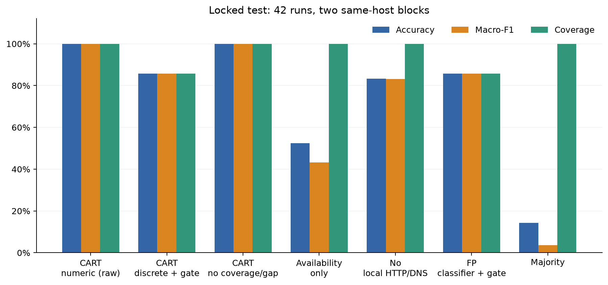
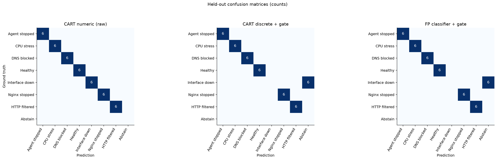
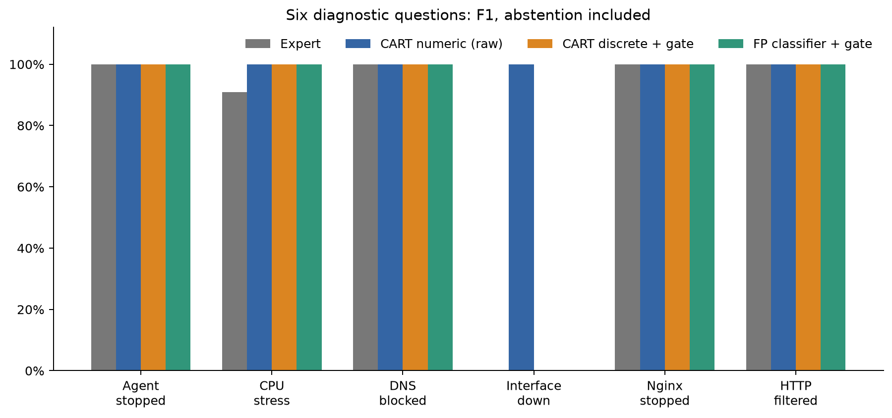

# Báo cáo nghiệm thu phần học máy trên lab VM

Đã đánh giá trên **42 lượt test mới**, sau khi khóa train gồm **42 lượt pilot**. Hai block test cùng SRV01; đây là đánh giá giữ riêng theo thời gian trong lab, chưa phải chuyển host.

| Phương pháp | Đúng / tổng | Macro-F1 | Coverage |
|---|---:|---:|---:|
| CART numeric (raw) | 42/42 | 1.000 | 100.0% |
| CART discrete + gate | 36/42 | 0.857 | 85.7% |
| CART no coverage/gap | 42/42 | 1.000 | 100.0% |
| Availability only | 22/42 | 0.432 | 100.0% |
| No local HTTP/DNS | 35/42 | 0.832 | 100.0% |
| FP classifier + gate | 36/42 | 0.857 | 85.7% |
| Majority | 6/42 | 0.036 | 100.0% |

**Chính sách kết luận:** CART discrete + gate và FP classifier + gate dùng cùng cách chia bins và từ chối khi core probe unknown. CART numeric và các ablation là đối chứng nghiên cứu không dùng serving gate này. Chênh lệch điểm giữa chúng có thể đến từ cả biểu diễn feature lẫn chính sách từ chối; không quy toàn bộ cho thuật toán.

Bảng dưới giữ nguyên mọi lần từ chối trong mẫu số accuracy; không loại chúng để báo điểm cao hơn.
- CART discrete + gate: ABSTAIN theo nhãn can thiệp = {"interface_down": 6}.
- FP classifier + gate: ABSTAIN theo nhãn can thiệp = {"interface_down": 6}.

Đọc dữ liệu feature gốc [locked_test_used.csv](../locked_test_used.csv) để kiểm tra probe unknown. Serving gate không được chỉnh sau khi xem điểm.

## Đối chứng với luật chuyên gia

Expert trả sáu nhận định độc lập. Insufficient được giữ riêng; không ép thành healthy. Hình dưới so cùng câu hỏi từng nhóm, không trộn với accuracy phân loại bảy lớp.

## Độ trễ cùng đầu vào

Warm offline, raw observation nạp sẵn; gồm dựng feature và inference. Không gồm API/SSH hoặc chờ Zabbix phát hiện.

| Phương pháp | Median ms | P95 ms | Số lần đo |
|---|---:|---:|---:|
| Expert | 0.088 | 0.147 | 840 |
| CART numeric (raw) | 4.899 | 7.569 | 840 |
| CART discrete + gate | 5.229 | 8.242 | 840 |
| FP classifier + gate | 2.216 | 3.872 | 840 |

## Chuyên gia: số đếm và độ bao phủ từng câu hỏi

Mỗi nhóm là một câu hỏi nhị phân trên toàn bộ test. Thiếu bằng chứng được giữ là từ chối; coverage là tỷ lệ có câu trả lời xác định. F1 không phản ánh mọi lần từ chối ở ca âm, vì vậy cần đọc cùng coverage.

| Nhóm | TP | FP | FN gồm từ chối | Coverage | Báo fault trên healthy |
|---|---:|---:|---:|---:|---:|
| agent_stopped | 6 | 0 | 0 | 100.0% | 0/6 |
| cpu_stress | 5 | 0 | 1 | 26.2% | 0/6 |
| dns_egress_blocked | 6 | 0 | 0 | 85.7% | 0/6 |
| interface_down | 0 | 0 | 6 | 85.7% | 0/6 |
| nginx_stopped | 6 | 0 | 0 | 85.7% | 0/6 |
| remote_http_filtered | 6 | 0 | 0 | 100.0% | 0/6 |

## Bình thường, thiếu dữ liệu và giới hạn

Có 6 lượt healthy test. Báo số đếm báo nhầm/từ chối theo từng phương pháp, không suy FPR production từ số ít lượt này.

Thu thập có 43 attempt đã chốt: 42 valid, 1 uncertain. Điểm phân loại ở trên có điều kiện trên các lượt đạt protocol; đây không phải tỷ lệ thành công của mọi attempt.

Lý do uncertain được giữ nguyên: {"CoordinatorInterrupted": 1}.

Gate platform trước/sau trial ghi nhận kernel stall/reboot bất ngờ và chốt uncertain theo bằng chứng độc lập, không theo điểm classifier. Gate này có tính bảo thủ; báo riêng tỷ lệ attempt đạt yêu cầu thay vì loại ca lỗi mà không nêu.
- CART numeric (raw): 0/6 dự đoán fault trên healthy; 0/6 từ chối.
- CART discrete + gate: 0/6 dự đoán fault trên healthy; 0/6 từ chối.
- FP classifier + gate: 0/6 dự đoán fault trên healthy; 0/6 từ chối.

Availability-only đúng 22/42; majority đúng 6/42. Đối chứng này cho thấy mức tín hiệu chỉ do việc có/thiếu dữ liệu; không được bỏ nó khỏi báo cáo.

Dữ liệu được cân bằng theo lớp và can thiệp đã biết. Confidence/lift và tỷ lệ lớp tại lá là thống kê train, không phải xác suất nguyên nhân đúng đã hiệu chỉnh. CPU cao ngoài lab có thể là công việc hợp lệ.

Mô hình chỉ nhận whitelist feature; run ID, timestamp, tên lỗi, output expert và recovery không phải predictor. Collector gọi theo lịch độc lập nhãn. Mỗi valid run chỉ dùng cửa sổ cuối.

Chưa có bằng chứng chuyển VM sang PC thật, nhiều lỗi đồng thời, root-cause topology hoặc suppression. Hai block không đủ để tính CI theo phiên đáng tin cậy. Không có yêu cầu ML phải thắng expert.

Pilot phát triển có các đợt lỗi ảo hóa/RCU được lưu log. Những lượt đầu dùng kiểm tra can thiệp và timing trước khi có bộ đếm kernel; test mới thêm kiểm tra platform ổn định. Vì vậy pilot là dữ liệu phát triển có hạn chế, không được mô tả như một bộ test sạch đã giấu kín.

## Câu trả lời ngắn khi bảo vệ

“Em dùng 42 lượt pilot làm tập phát triển, khóa cấu hình và thu riêng 42 lượt test mới. Cây CART phân loại trực tiếp; FP-Growth tìm tập mục rồi module của em lọc và xếp luật feature → nhãn. Em so với chuyên gia trên cùng bằng chứng, giữ trường hợp thiếu thông tin. Luật SQLite được kiểm tra tương đương với model và shadow lúc fault; em chưa tự kích hoạt luật vào engine vận hành.”

Khi nói về kết quả, đọc đúng số đếm trong bảng; không dùng confidence train để thay cho độ chính xác test hoặc chứng minh quan hệ nhân quả.

## Hạn chế cụ thể từ phân tích pilot

Ở một vector giả định xây dựng từ healthy pilot, chỉ che HTTP/DNS thành unknown trong khi Ping/TCP/control vẫn thành công, candidate CART pilot đề xuất `interface_down`, còn FP là `ABSTAIN`.

**Đây là phân tích che feature giả định, không phải lượt thí nghiệm thực và không được cộng vào train/test.** Nó minh họa rủi ro nhầm lỗi kênh quan sát với lỗi mạng ngoài các lớp lab đã biết; không ước lượng tần suất sai ngoài thực tế.

Mô hình/cấu hình giữ nguyên sau phân tích. Cần thêm dữ liệu lỗi nguồn đo và đánh giá tính nhất quán triệu chứng trong phiên bản nghiên cứu tiếp theo trước khi kích hoạt luật. Đọc [vector, rule và SHA gốc](PILOT_COUNTERFACTUAL.json).

## Zabbix phát hiện sự cố và ML phân loại là hai phép đo riêng

Collector được gọi theo lịch can thiệp, kể cả khi chưa có cảnh báo. Accuracy phân loại ở trên không chứng minh luồng tự động cảnh báo → gọi module đã hoạt động.

| Kịch bản | Lượt | Trigger liên quan đã cấu hình | Có event trong can thiệp | Có event trước/lúc quan sát được chọn |
|---|---:|---:|---:|---:|
| agent_stopped | 6 | 1 | 1 | 1 |
| cpu_stress | 6 | 2 | 1 | 1 |
| dns_egress_blocked | 6 | 0 | 0 | 0 |
| healthy | 6 | 0 | 0 | 0 |
| interface_down | 6 | 3 | 6 | 6 |
| nginx_stopped | 6 | 1 | 6 | 6 |
| remote_http_filtered | 6 | 1 | 6 | 6 |

SRV01 chưa có trigger DNS/ICMP riêng trong inventory đã chụp. Healthy không có trigger fault kỳ vọng; event xuất hiện trong cửa sổ healthy cần xem xét riêng trước khi gọi là false positive.

Bảng dùng biên can thiệp theo giây nghiêm ngặt; audit gốc giữ riêng dung sai biên 1 giây. Event liên quan có thể là triệu chứng dây chuyền, không chứng minh duy nhất nguyên nhân.

Đọc [audit gốc](../detection-audit/DETECTION.md) và [số đếm/hash](ZABBIX_DETECTION.json).
